# Nano Cortex Controller (inoffiziell)

Ein Touchscreen- und Fußschalter-Controller für den **Neural DSP Nano Cortex**, gebaut auf einem Waveshare-ESP32-
Displayboard. Er arbeitet wie ein kleiner Bodencontroller im Stil des Quad Cortex: acht Kacheln für acht
Fußschalter, eigene Preset-Bänke, Szenen, ein FX-Editor, die Capture- und IR-Library, die Belegung des
Expression-Pedals und ein Stimmgerät. Das größere **7"-Board** hängt per USB-Kabel am Nano und spielt zusätzlich
eigenen Ton hinein: einen Looper mit zwei Parts, einen Drumcomputer und Backing-Tracks.

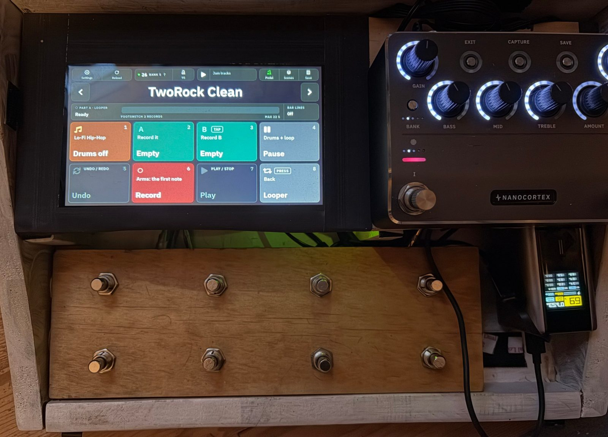

**English:** [README](README.md) · **Noch kein Board?** Die Firmware des 4,3"-Boards läuft im Browser:
[Nano Cortex Controller Web](https://github.com/DrD85/nano-cortex-controller-web)

> **Inoffizielles Community-Projekt.** Nicht verbunden mit, unterstützt oder betreut von Neural DSP.
> „Nano Cortex“, „Quad Cortex“ und „Neural DSP“ sind Marken von Neural DSP Technologies.
> Der Controller schreibt auf dein Gerät. Nutzung auf eigene Gefahr – sichere deine Presets vorher
> (zum Beispiel mit der offiziellen Cortex-Cloud-App).

**Inhalt:** [Zwei Boards](#zwei-boards) · [Das 7"-Board](#das-7-board) · [Loslegen](#loslegen-7-board) ·
[Das 4,3"-Board](#das-43-board) · [Editor und Jam Player](#dazu-editor-und-jam-player) ·
[Selbst bauen](#selbst-bauen) · [Noch nicht getestet](#noch-nicht-getestet) · [Lizenz](#lizenz)

## Zwei Boards

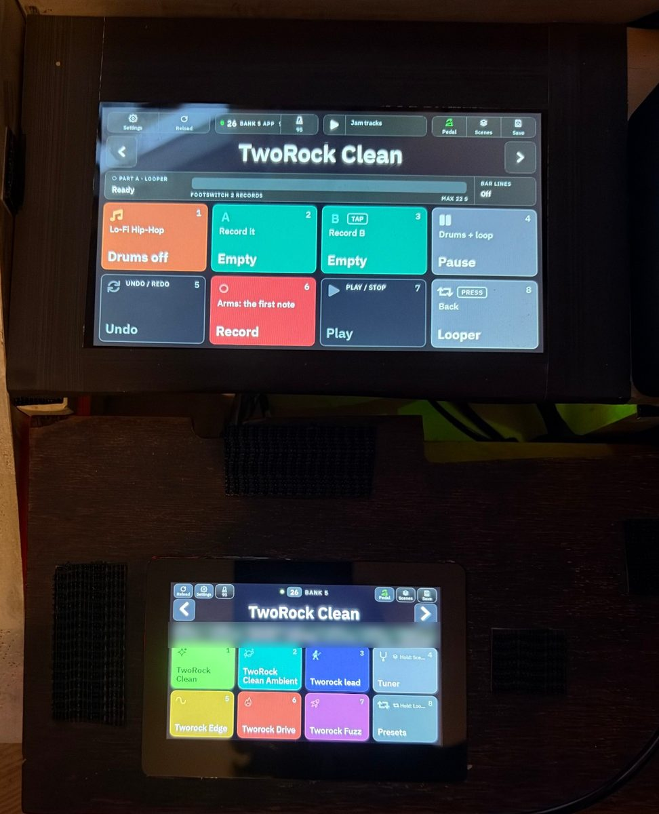

| | **7"-Board** | **4,3"-Board** |
|---|---|---|
| Displayboard | Waveshare ESP32-P4-WIFI6-Touch-LCD-7B, 1024 × 600 | Waveshare ESP32-S3-Touch-LCD-4.3, 800 × 480 |
| Verbindung zum Nano | USB-Kabel (ohne Kabel Bluetooth) | Bluetooth |
| Presets, Bänke, Szenen, FX-Editor, Capture und Cab, Stimmgerät, Setlist, Expression-Pedal | ja | ja |
| Looper, Drums und Backing-Tracks, in den Nano gespielt | ja | – (seine Schalter können eine Looper-App auf dem Telefon steuern) |
| Level, Gain Reduction, Auto-Wah nach dem Spiel, EQ-Spektrum | ja | – |
| Fußschalter | 8, direkt am Board angeschlossen (oder eine SX1509-Platine) | eine SX1509-Platine mit bis zu 8 |
| WLAN | Tracks vom Mac, Firmware-Updates | – |
| Release-Dateien | `nano-controller-p4-<version>-…` | `nano-controller-<version>-…` |

Beide Boards teilen den größten Teil ihres Codes, ihre Bildschirme sind also gleich aufgebaut und werden gleich
bedient. Die Tabelle zeigt, was nur das 7"-Board hat; es ist das neuere und bekommt neue Funktionen zuerst.

## Das 7"-Board

### Der Hauptbildschirm

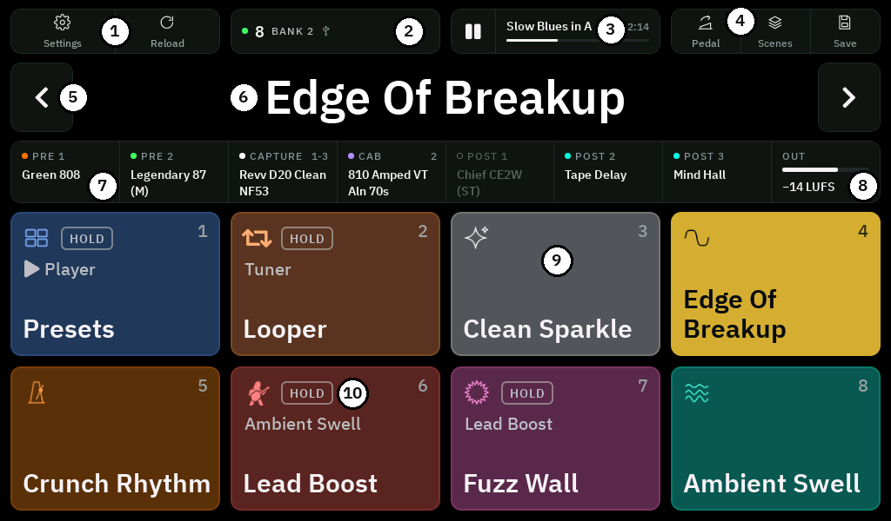

1. **Settings** (Nano, Audio, Telefon, WLAN, MIDI, Fußschalter, Kachel-Anordnung, Display, System, Capture) ·
   **Reload** liest alles neu vom Nano
2. Grüner Punkt = mit dem Nano verbunden; Nummer des Presets und Bank. **Tippen**: die Setlist
3. Der Player: der Jam-Track, der gerade läuft (oder das Telefon). **Tippen**: seine Seite mit Liste, Alben und
   Lautstärke
4. **Pedal**: was das Expression-Pedal in diesem Preset bewegt · **Scenes**: die Kacheln 3–8 werden zu den Szenen
   des Presets, nochmal tippen: die Presets der Bank · **Save** wird grün bei ungespeicherten Änderungen
5. Vorherige / nächste **Bank**
6. Der Name des Presets: **tippen** für die Liste aller 64 Presets (mit **New preset**), **halten** zum Umbenennen.
   Überall **nach links / rechts wischen**: nächstes / vorheriges Preset, **nach oben wischen**: Gig-Ansicht
7. Die Signalkette: Pre FX 1–2, Capture, Cab, Post FX 1–3, gefüllter Punkt = an. **Tippen** auf einen Effekt
   öffnet seinen FX-Editor; Capture und Cab: **tippen** zum Auswählen, **halten** für Klang bzw. Cab-Einstellungen
8. **OUT**: die Lautheit des Nano. **Tippen**: [Level](#level-gain-reduction-auto-wah-nach-dem-spiel)
9. Acht Kacheln für acht Fußschalter, die Nummer in der Ecke. **Tippen** auf eine Kachel = ihren Schalter treten.
   Eine Kachel ist gefüllt, wenn sie aktiv ist (das geladene Preset, ein eingeschalteter Effekt)
10. Eine kleine Taste sagt, wie die zweite Funktion eines Schalters erreicht wird: **HOLD** = halten, **TAP** =
    antippen, **PRESS** = sie wirkt, sobald der Schalter unten ist. Die Zeile darunter sagt, was sie tut – hier:
    6 halten für „Ambient Swell“, ein zweites Preset auf diesem Schalter

### Fußschalter und Modi

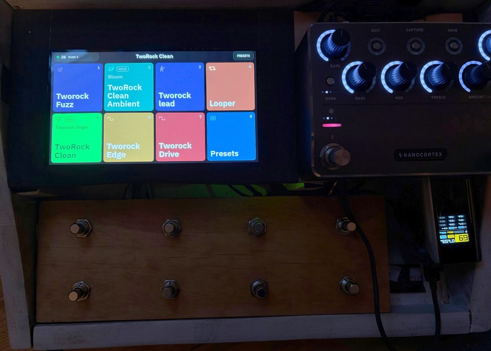

Die Fußschalter **1** und **2** führen in die Modi; aus jedem anderen Modus führt Fußschalter **8** zurück zu den
Presets. In der Standard-Anordnung mit acht Feldern:

| Modus | 1 | 2 | 3 | 4 | 5 | 6 | 7 | 8 |
|---|---|---|---|---|---|---|---|---|
| **Presets** (oder Szenen) | FX-Modus · *halten:* Player | Looper · *halten:* Stimmgerät | Preset | Preset | Preset | Preset | Preset | Preset |
| **FX** | Pre FX 1 | Pre FX 2 | Post FX 3 | Looper · *halten:* Stimmgerät | Post FX 1 | Post FX 2 | Reverb-Schalter | Presets · *halten:* Player |
| **Looper** | Drums an / aus · *halten:* Drum-Menü | Part A | Part B | Pause | Undo / Redo · *halten:* löschen | Aufnahme / Overdub | Play / Stop | zurück |
| **Player** | Jam-Tracks / Telefon | Songliste | nächstes Album | Looper | vorherigen wählen | gewählten spielen | nächsten wählen | zurück |

- Ein Preset-Schalter kann ein **zweites Preset** tragen, geladen, wenn der Schalter nach langem Drücken losgelassen
  wird (dazu seine Kachel halten). Mit Szenen rufen die Schalter 3–8 [Szenen](#szenen-fx-modus-gig-ansicht-und-pedalansicht) ab.
- Im FX-Modus wechselt ein Effekt mit **zweitem Effekt** (A / B) beim Antippen oder Halten – wie in seinem Editor gewählt.
- Settings › **Tile layout** ändert die Reihenfolge der Schalter für Presets und FX-Modus (6 oder 8 Felder); Settings ›
  **Footswitches** lernt, welcher Schalter welcher ist, auch den Schalter eines MIDI-Controllers.

### Looper

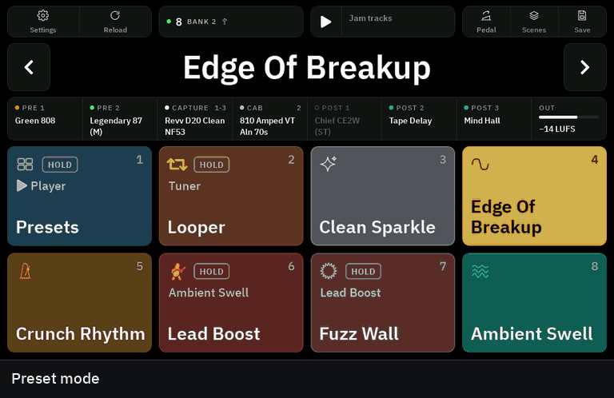

**2 drücken** für den Looper-Modus. **6** nimmt den ersten Take von Part A auf; nochmal gedrückt, wird der Loop
geschlossen – auf ganze Takte im Tempo des Nano gerundet, ein etwas zu früh beendeter Take läuft also bis zum
Taktstrich weiter. Danach wechselt **6** zwischen Overdub und Play, **7** stoppt und startet, **5** nimmt den letzten
Overdub zurück (halten: löschen). **3** wählt Part B: er übernimmt am Ende des laufenden Loops, und ein leerer Part
nimmt dort auf. **4** hält Loop und Drums gemeinsam an. Bis zu 22 Sekunden pro Part. Das Board nimmt den Klang des
Nano über das USB-Kabel auf und spielt den Loop dorthin zurück, die Laufzeit hin und zurück herausgerechnet. *(Das GIF
ist gekürzt: die Zeit läuft schneller als auf dem Board.)*

### Drums und Loops speichern

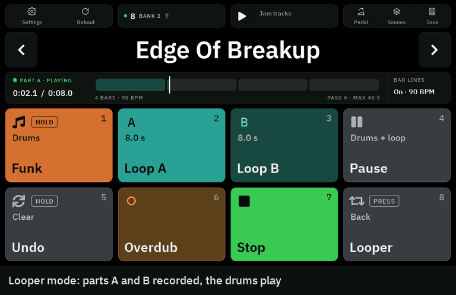

Ein Drumcomputer im Tempo des Nano: 108 Grooves in zehn Stilen, zwei auf dem Board berechnete Kits (**Electronic**
und **Lo-Fi**), ein eigener Groove pro Looper-Part. **1 drücken** im Looper-Modus schaltet die Drums an / aus,
**1 halten** öffnet das Drum-Menü: Stile, Grooves, Kit, Pegel und wie der erste Take eines Parts beginnt (mit den
Drums, nach einem eingezählten Takt, auf den Taktstrichen der Drums oder mit der ersten Note). **Save loops** schreibt
die Parts A und B als WAV-Dateien auf die microSD-Karte (`loops/`, mit Tempo und Takten im Namen), während der Looper
weiterspielt. Das **Acoustic**-Kit im Menü braucht eine Sample-Datei, die nicht zum Release gehört; ohne sie bleibt
es gedimmt.

### Jam-Tracks und Player-Modus

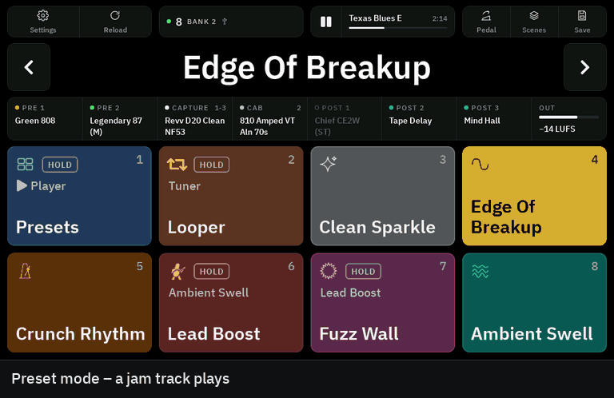

Backing-Tracks (WAV) von einer microSD-Karte, ein Ordner pro Album, mit Covern. Jeder Track wird gemessen und mit
derselben Lautheit gespielt (−21 LUFS), dazu eine Korrektur nach Gehör pro Track. **1 halten** für den Player-Modus:
Cover, Titel und Zeit des laufenden Tracks und die Liste des Albums. Songs werden erst gewählt und dann gespielt:
**5 / 7** wählen den Song davor / danach, während der aktuelle weiterläuft, **6** spielt den gewählten (oder
pausiert), **3** geht zum nächsten Album, **8** zurück. Die Tracks kommen per WLAN auf die Karte, vom
[Jam Player](https://github.com/DrD85/jam-player) auf dem Mac oder über die Seite des Boards `http://nano-board.local`.

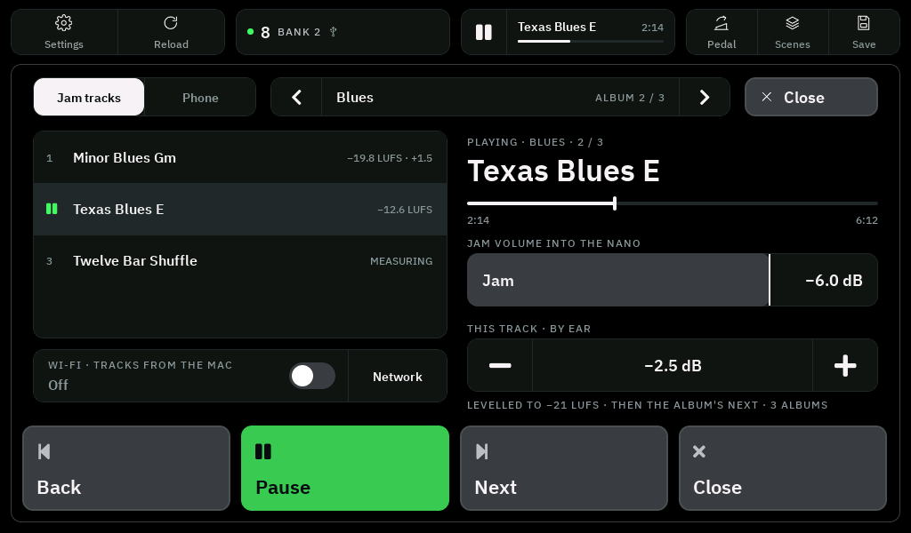

### FX-Editor, Fläche und Info-Seite

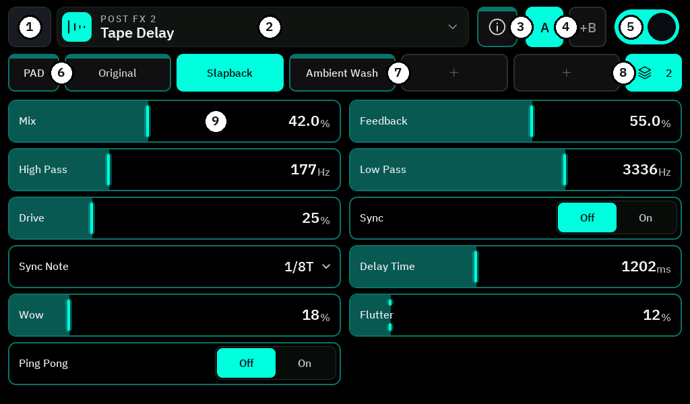

Auf einen Effekt in der Signalkette tippen (oder im FX-Modus seine Kachel halten).

1. Zurück
2. Das Modell: **tippen** für ein anderes
3. **i**: die Info-Seite – worauf der Effekt beruht, Startpunkte und Spieler-Sounds, jeweils mit der Quelle ihrer
   Einstellungen; **Apply** setzt sie
4. **A / +B**: ein zweiter Effekt auf diesem Slot, mit seinem Fußschalter getauscht
5. An / aus
6. **PAD**: die Fläche (unten)
7. **FX-Presets**: tippen = laden, **halten** = aktuelle Einstellungen unter einem Namen speichern
8. **Szenen**: diese Einstellungen für eine Szene des Presets (die Zahl: wie viele Szenen eigene haben)
9. Auf einem Balken **seitlich wischen** ändert seinen Wert; *Off | On* wird angetippt

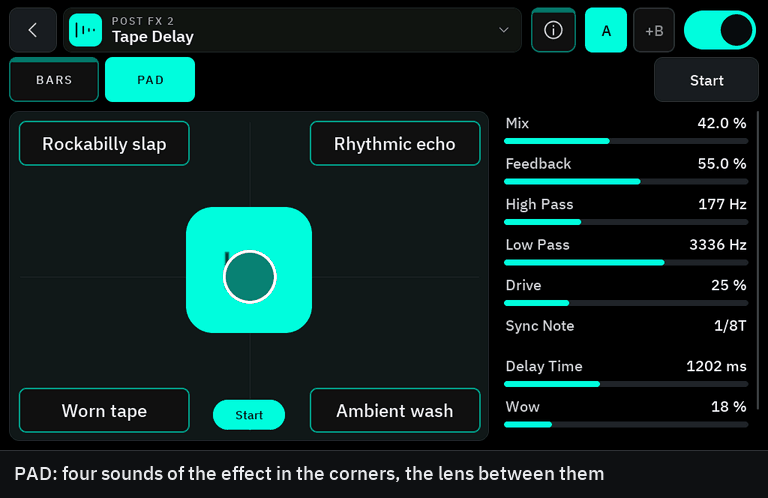

**Die Fläche (PAD)** legt vier Klänge des Effekts in ihre Ecken. Die Lupe dazwischen ziehen, und jeder Regler bewegt
sich mit; loslassen, und der Klang bleibt, wo die Lupe ist. Ein langer Druck auf ein Pedal der Pedalansicht öffnet
sie direkt.

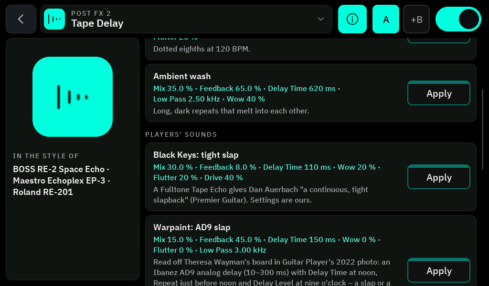

### EQ mit Live-Spektrum

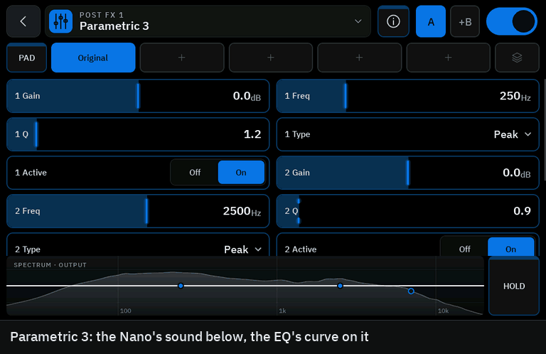

Die Editoren von **Parametric 3**, **Graphic 9** und **Low-High Cut** zeigen den Klang des Nano als Spektrum unter
den Reglern, mit der Kurve des EQ darüber. **HOLD** hält den Klang des Moments als gestrichelte Linie fest: den EQ
ändern und vorher mit nachher vergleichen. Der Klang kommt über das USB-Kabel, der Nano muss also eingesteckt sein.
*(Der Klang im GIF ist für das Bild erfunden.)*

### Level, Gain Reduction, Auto-Wah nach dem Spiel

<table>
<tr>
<td width="33%">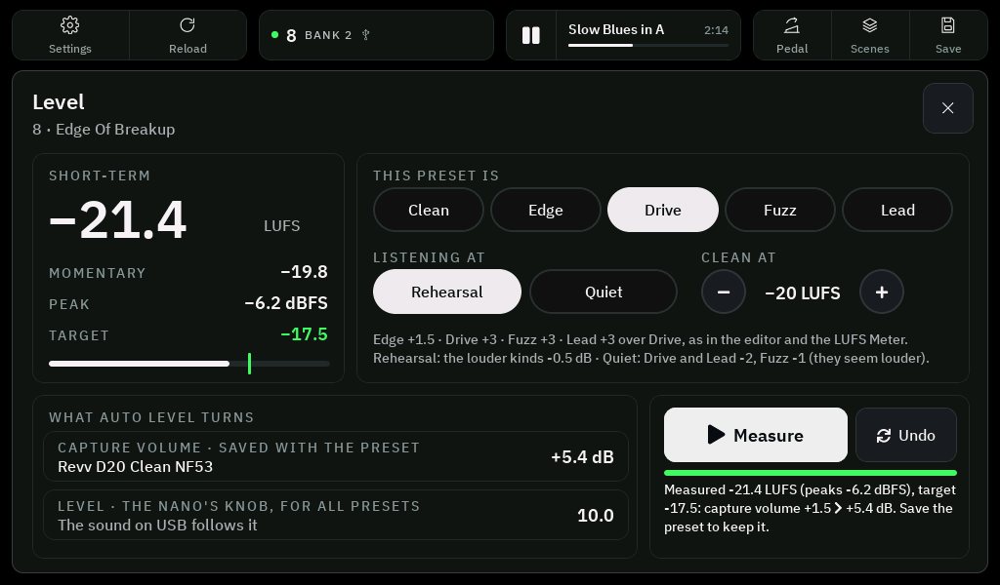</td>
<td width="33%">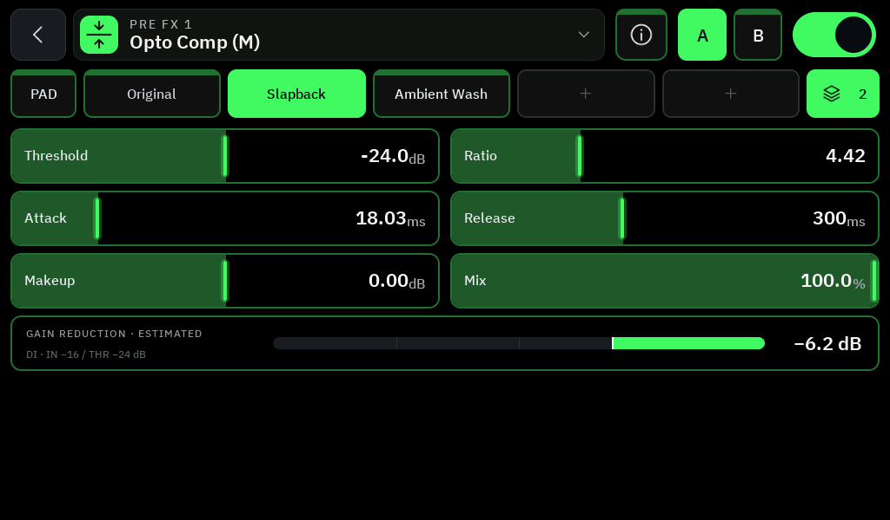</td>
<td width="33%">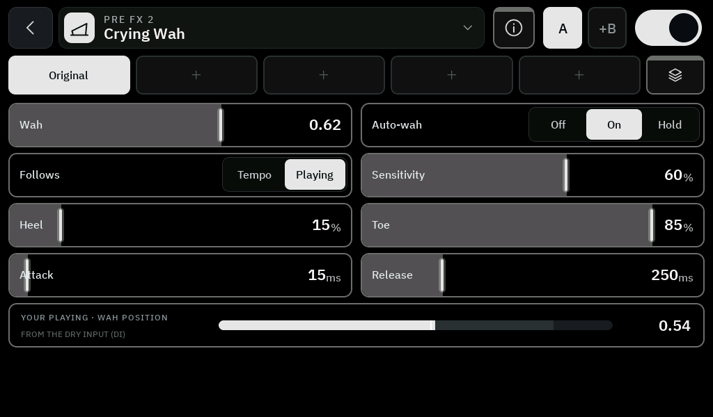</td>
</tr>
<tr>
<td valign="top">

**Level** – auf OUT tippen, wählen, was das Preset ist (Clean, Edge, Drive, Fuzz, Lead), ein paar Sekunden spielen:
das Board misst die Lautheit und schlägt den Pegel des Presets vor, damit die Presets zusammenpassen.

</td>
<td valign="top">

**Gain Reduction** – unter den Reglern eines Kompressors, berechnet aus seinen Reglern und dem trockenen Eingang des
Nano (der Nano meldet sie nicht).

</td>
<td valign="top">

**Auto-Wah** – ein Wah, das das Board im Tempo des Nano bewegt, oder eines, das sich mit dem Anschlag öffnet
(Empfindlichkeit, Attack, Release), mit Live-Anzeige.

</td>
</tr>
</table>

### Szenen, FX-Modus, Gig-Ansicht und Pedalansicht

<table>
<tr>
<td width="50%">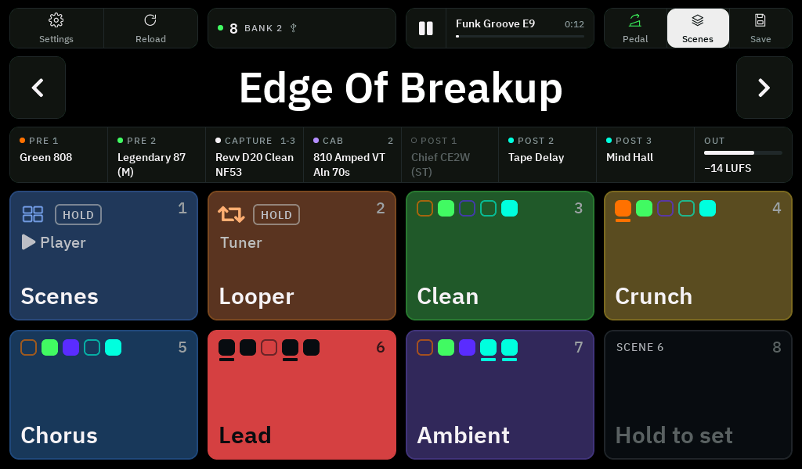</td>
<td width="50%">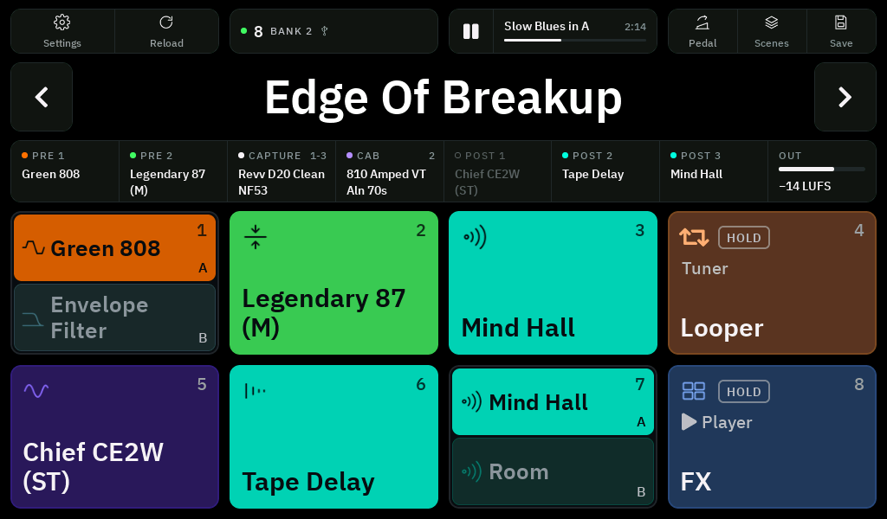</td>
</tr>
<tr>
<td valign="top">

**Szenen** – sechs pro Preset. Eine Szene legt fest, welche der fünf Effekte an sind und auf Wunsch, wie sie
eingestellt sind; ihr Schalter ändert das alles auf einmal, ohne die Lücke eines Preset-Wechsels. **Scenes** in der
oberen Leiste; eine Kachel **halten**, um eine Szene einzurichten.

</td>
<td valign="top">

**FX-Modus** – die fünf Effekte auf den Schaltern in eigener Reihenfolge: Pre FX oben, Post FX unten, der
Reverb-Schalter (zwei Mix-Positionen, zwei Reverbs oder zwei benannte Einstellungen eines Reverbs) auf 7.

</td>
</tr>
<tr>
<td width="50%">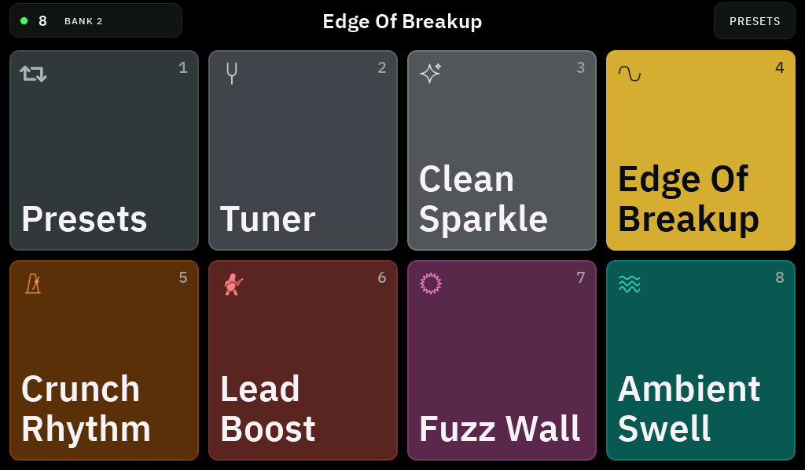</td>
<td width="50%">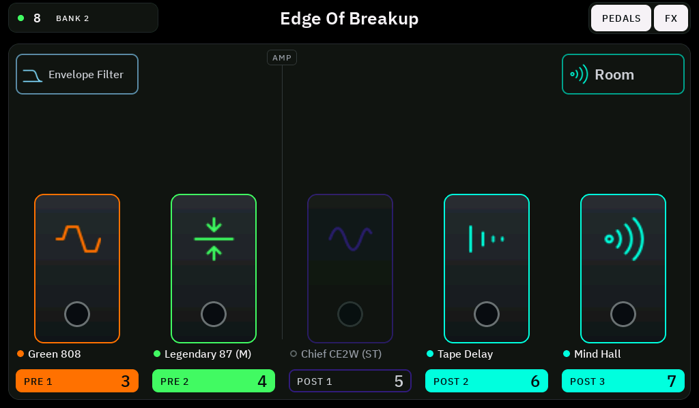</td>
</tr>
<tr>
<td valign="top">

**Gig-Ansicht** – nach oben wischen: große Kacheln und eine schmale Leiste mit Verbindung, Preset, Bank,
ungespeicherten Änderungen und dem Modus. Nach unten wischen: zurück.

</td>
<td valign="top">

**Pedalansicht** – **PEDALS** in der Leiste der Gig-Ansicht, im FX-Modus: die fünf Effekte als Pedale, der Amp
zwischen Pre und Post FX, jedes mit seinem Fußschalter.

</td>
</tr>
</table>

### Mehr auf dem Bildschirm

<table>
<tr>
<td width="33%">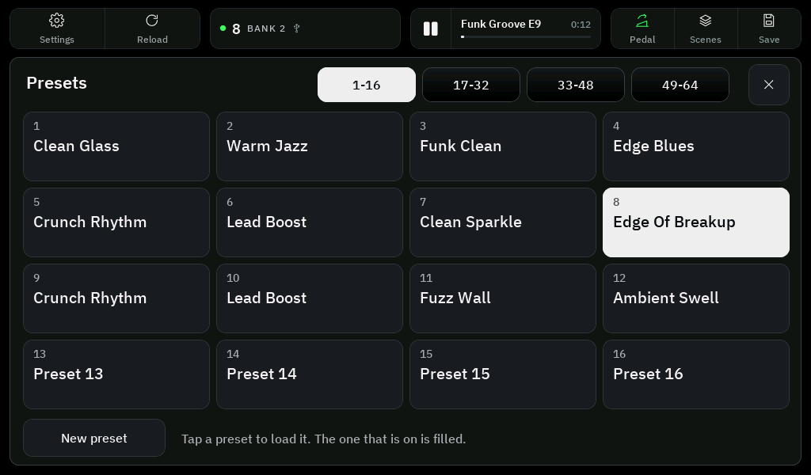</td>
<td width="33%">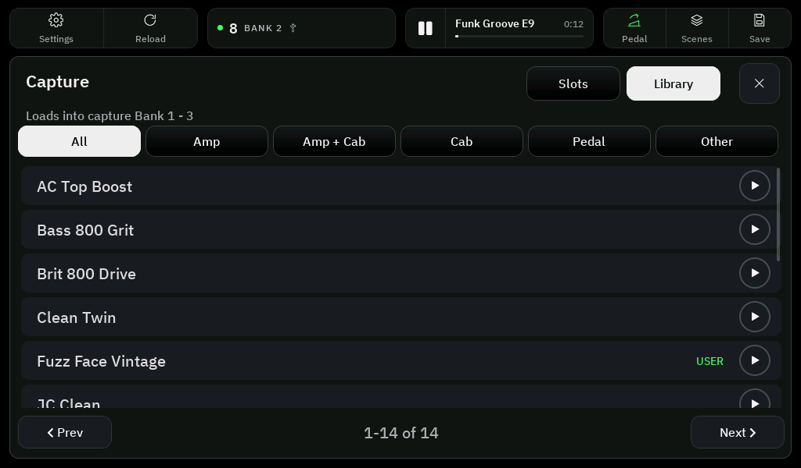</td>
<td width="33%">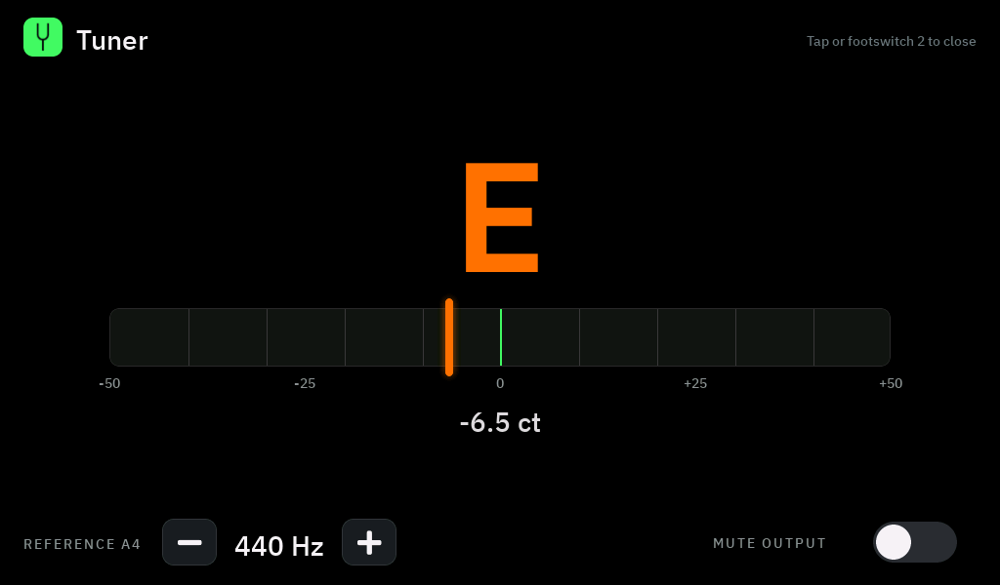</td>
</tr>
<tr>
<td valign="top">

**Preset-Liste** – auf den Namen des Presets tippen: alle 64 Presets, **New preset** in jedem Platz.

</td>
<td valign="top">

**Capture und Cab** – die Slots des Nano oder seine ganze Library, mit Filtern.

</td>
<td valign="top">

**Stimmgerät** – 2 halten. Kammerton und Stummschaltung.

</td>
</tr>
</table>

Außerdem: eigene Bänke mit Farben und Symbolen, eine Setlist, die Belegung des Expression-Pedals pro Preset,
Bluetooth-MIDI-Controller (zum Beispiel ein M-VAVE Chocolate) mit MIDI-Learn, der Neural-Capture-Assistent, Tempo und
Metronom, eine Sicherung der Einstellungen über den Editor. Alle Funktionen im Detail: das [Handbuch](docs/manual.de.md)
– geschrieben für das 4,3"-Board; die Bildschirme sind dieselben, die Fußschalter wie in der Tabelle oben.

## Loslegen (7"-Board)

**1. Was du brauchst**

| Teil | Hinweise |
|---|---|
| [Waveshare ESP32-P4-WIFI6-Touch-LCD-7B](https://www.waveshare.com/wiki/ESP32-P4-WIFI6-Touch-LCD-7B) | 7", 1024 × 600, ein ESP32-P4 mit einem ESP32-C6 für Bluetooth und WLAN |
| Neural DSP Nano Cortex | mit einem USB-C-Kabel zur **USB-A**-Buchse des Boards |
| Optional: microSD-Karte | **FAT32**, für Jam-Tracks (Ordner `jam`, ein Unterordner pro Album) und gespeicherte Loops (`loops`) |
| Optional: bis zu 8 Fußtaster | jeder zwischen einem Pin der Stiftleiste **P3** des Boards und GND, ohne Widerstände – [Verdrahtung](p4/README.md#what-you-need) (englisch) |

**2. Firmware installieren** – die Dateien stehen auf der Seite [Releases](../../releases) (`nano-controller-p4-<version>-…`).

- **Im Browser:** [esptool.spacehuhn.com](https://esptool.spacehuhn.com) in **Chrome** oder **Edge** öffnen, den
  USB-C-Anschluss **USB TO UART** des Boards anschließen und **Connect** klicken. Erstinstallation: **Erase**, dann
  `…-full.bin` an **`0x0`**. Update: `…-update.bin` an **`0x10000`**, ohne Erase – Bänke und Einstellungen bleiben.
  **RESET** drücken. (Kein Anschluss zu sehen? **BOOT** halten, **RESET** drücken und loslassen, **BOOT** loslassen.
  Bricht es mittendrin ab? 115200 Baud wählen.)
- **Über WLAN** (sobald eine Firmware auf dem Board ist): WLAN einschalten (Settings › Wi-Fi oder auf der Seite des
  Jam-Players), `http://nano-board.local` öffnen und unter **Firmware** `…-wifi.bin` wählen. Startet die neue
  Firmware nicht richtig, geht das Board zur alten zurück.
- **Auf der Kommandozeile** (esptool 5): siehe [p4/README.md](p4/README.md#install-the-firmware).

**3. Erster Start** – Nano einschalten, in die USB-A-Buchse des Boards stecken und das Board mit Strom versorgen. Es
liest die Presets über das Kabel und zeigt das aktuelle; der grüne Punkt heißt verbunden.

Mehr zum 7"-Board – die ganze Funktionsliste, die Pins der Fußschalter, das Bauen (englisch):
**[p4/README.md](p4/README.md)**.

## Das 4,3"-Board

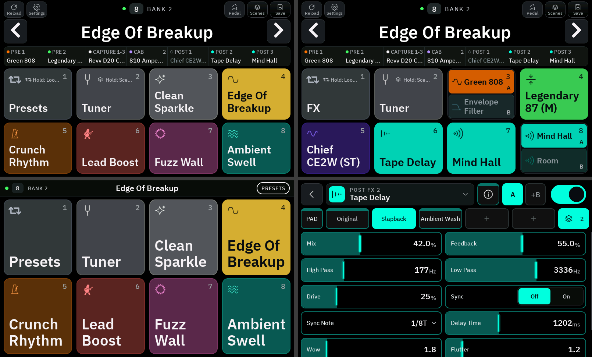

Der ursprüngliche Controller, auf einem **Waveshare ESP32-S3-Touch-LCD-4.3** (800 × 480, die Version mit EINEM
USB-C-Anschluss mit der Aufschrift **USB**). Er spricht per **Bluetooth** mit dem Nano, braucht also kein Kabel zum
Nano, und spielt keinen eigenen Ton. Bildschirme und Funktionen sind die des 7"-Boards oben, ohne Looper, Drums,
Jam-Tracks, Level, Gain Reduction, Spektrum und WLAN. Seine Fußschalter sind anders belegt:

| Fußschalter | Drücken | Halten |
|---|---|---|
| 1 | Presets oder Szenen ↔ FX-Modus | Looper-Modus: die Schalter steuern eine Looper-App auf dem Telefon (zum Beispiel Loopy Pro) per Bluetooth-MIDI |
| 2 | Stimmgerät | Szenen ↔ Presets |
| 3–8 | Presets, Szenen oder Effekte | 3–7 im FX-Modus: der zweite Effekt eines Slots (A / B) |

**Was du brauchst:** das Board, den Nano und optional ein SX1509-Breakout mit bis zu 8 Fußtastern
([Verkabelung](docs/manual.de.md#fußschalter) – der Touchscreen funktioniert auch allein).

**Firmware installieren** – im Browser wie oben: [esptool.spacehuhn.com](https://esptool.spacehuhn.com), der
Anschluss **USB** des Boards (meist „USB JTAG/serial debug unit“), dann:

| Datei | Adresse | Wofür |
|---|---|---|
| `nano-controller-<version>-full.bin` | `0x0` | die **Erstinstallation** (löscht gespeicherte Bänke und Einstellungen) |
| `nano-controller-<version>-update.bin` | `0x10000` | **Updates** – Bänke und Einstellungen bleiben |
| `nano-controller-<version>-partitions.bin` | `0x8000` | **mit dem Update**, wenn du von 1.18 oder älter kommst (seit 1.19 ist der Einstellungsspeicher größer); Einstellungen bleiben |

**Erster Start** – Nano einschalten, die Cortex-Cloud-App und den Nano Cortex Editor schließen (der Nano nimmt nur
eine Bluetooth-Verbindung an) und das Board mit Strom versorgen. Der Nano ist nach dem Einschalten ein paar Sekunden
lang auffindbar; später auf ihm **EXIT + CAPTURE** drücken (der Controller sagt es). Findet das Board den Nano nicht
innerhalb einer Minute, den Nano aus- und wieder einschalten.

Alles im Detail: das **[Handbuch](docs/manual.de.md)** – Bänke, Szenen, Expression-Pedal, Capture und Cab,
FX-Presets, Reverb-Schalter, zweiter Effekt, [Bluetooth-MIDI](docs/manual.de.md#bluetooth-midi) mit allen Befehlen,
der Modus für die Looper-App, was wo gespeichert ist.

## Dazu: Editor und Jam Player

- **[Nano Cortex Editor](https://github.com/DrD85/nano-cortex-editor)** – der Desktop-Editor für den Nano. Er kann
  sich **über** jedes der beiden Boards verbinden (Bluetooth-Gerät „Nano Cortex Controller“), Editor und Board
  arbeiten also nebeneinander. Er legt auch automatisch Sicherungen der Einstellungen des Boards an.
- **[Jam Player](https://github.com/DrD85/jam-player)** – ein Backing-Track-Player für den Mac, der jeden Track mit
  derselben Lautheit spielt. Er schickt Tracks per WLAN an das 7"-Board (jeder Ordner wird ein Album; nur neue oder
  geänderte Tracks gehen raus), ab Version 1.5.0 auch ihre Cover, und er holt die auf dem Board gespeicherten Loops ab.

## Selbst bauen

- **4,3"-Board:** ESP-IDF 6.0, `idf.py build` im Projektordner – [docs/development.de.md](docs/development.de.md)
  (Aufbau des Projekts, serielle Konsole, wie der Controller mit dem Nano spricht). Die Browser-Fassung:
  [web/README.md](web/README.md).
- **7"-Board:** ESP-IDF 6.0, in `p4/firmware`:
  `idf.py -B build-public -D SDKCONFIG=build-public/sdkconfig -DNANO_PUBLIC=1 build` – Details, Host-Tests und die
  Echtzeit-Regeln für den Audioweg in [p4/README.md](p4/README.md#build-from-source) (englisch).

Die Bilder der Bildschirme sind keine Fotos: der UI-Code der Firmware zeichnet sie auf einem Computer mit
Beispiel-Presets (`tools/screenshots/make_screenshots.sh`, `p4/firmware/tools/screenshots/make_p4.sh`); die GIFs sind
Folgen solcher Bilder. Die Fotos zeigen die Boards des Autors, mit seinen eigenen Presets.

## Noch nicht getestet

Beim 7"-Board:

- Neu in 1.2.0 und noch wenig gespielt: das Lo-Fi-Kit und seine Grooves, das Live-Spektrum, das Speichern von Loops
  (das Abholen mit dem Jam Player wurde nur gegen ein simuliertes Board probiert), die Song-Auswahl im Player-Modus
- Der Nano Cortex Editor über das Board wurde mit einem ESP32-C6 auf esp_hosted 2.13.1 probiert
  (`p4/firmware/main/p4_c6_update.c` sagt, wie); mit der Werks-Firmware des C6 noch nicht
- Der Nano per Bluetooth **ohne** Kabel, und der Wechsel zwischen Kabel und Bluetooth beim Spielen
- Telefon-Audio über die optionale ESP32-Brücke (`p4/a2dp-bridge`) in den Nano: die Brücke allein wurde mit einem
  Telefon probiert, noch nicht am Board
- Der veröffentlichte Build selbst auf einem Board: Bildschirme und Host-Tests kommen aus demselben Code, und der
  eigene Build des Autors unterscheidet sich nur in privaten Bildern und Daten (Bilder, eine zusätzliche Gruppe von
  Presets auf der Info-Seite, die Samples des akustischen Kits) und dem Log-Anschluss. Die langen Looper-Läufe wurden
  mit dem Build des Autors gemessen

## Danksagung

Aufgebaut auf dem [Nano Cortex Editor](https://github.com/DrD85/nano-cortex-editor) (Protokoll, FX-Tabellen),
[rixrix/deskop-nano-cortex](https://github.com/rixrix/deskop-nano-cortex) (Protokoll-Notizen),
[Builty/TonexOneController](https://github.com/Builty/TonexOneController) (die Idee, Display- und
Fußschalter-Aufbau), [ESP-IDF](https://github.com/espressif/esp-idf) mit NimBLE,
[LVGL](https://github.com/lvgl/lvgl) und [IBM Plex Sans](https://github.com/IBM/plex).
Die vollständige Liste mit Lizenzen: [docs/credits.de.md](docs/credits.de.md).

## Lizenz

[MIT](LICENSE) für den Code dieses Projekts. Die oben genannten Komponenten behalten ihre eigenen Lizenzen.
