# Nano Cortex Controller (unofficial)

A touch screen and footswitch controller for the **Neural DSP Nano Cortex**, built on a Waveshare ESP32 display
board. It works like a small Quad Cortex floor unit: eight tiles for eight footswitches, your own preset banks,
scenes, an FX editor, the capture and IR library, the expression pedal's assignments and a tuner. The larger
**7" board** is connected to the Nano with a USB cable and also plays its own sound into it: a looper with two
parts, a drum machine and backing tracks.

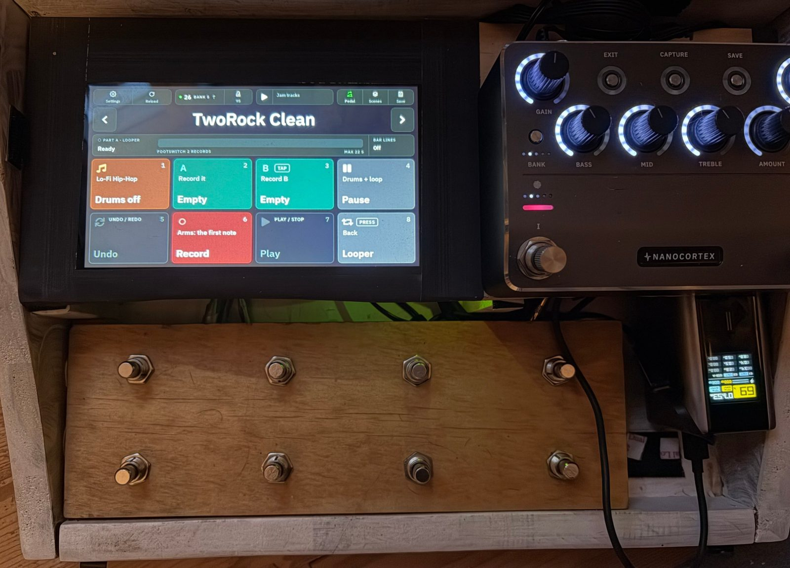

**Deutsch:** [Anleitung auf Deutsch](README.de.md) · **No board yet?** The 4.3" board's firmware runs in the browser:
[Nano Cortex Controller Web](https://github.com/DrD85/nano-cortex-controller-web)

> **Unofficial community project.** Not affiliated with, endorsed by or supported by Neural DSP.
> "Nano Cortex", "Quad Cortex" and "Neural DSP" are trademarks of Neural DSP Technologies.
> The controller writes to your device. Use it at your own risk and keep backups of your presets
> (for example with the official Cortex Cloud app).

**Contents:** [Two boards](#two-boards) · [The 7" board](#the-7-board) · [Getting started](#getting-started-7-board) ·
[The 4.3" board](#the-43-board) · [Editor and Jam Player](#companions-editor-and-jam-player) ·
[Build from source](#build-from-source) · [Not tested yet](#not-tested-yet) · [License](#license)

## Two boards

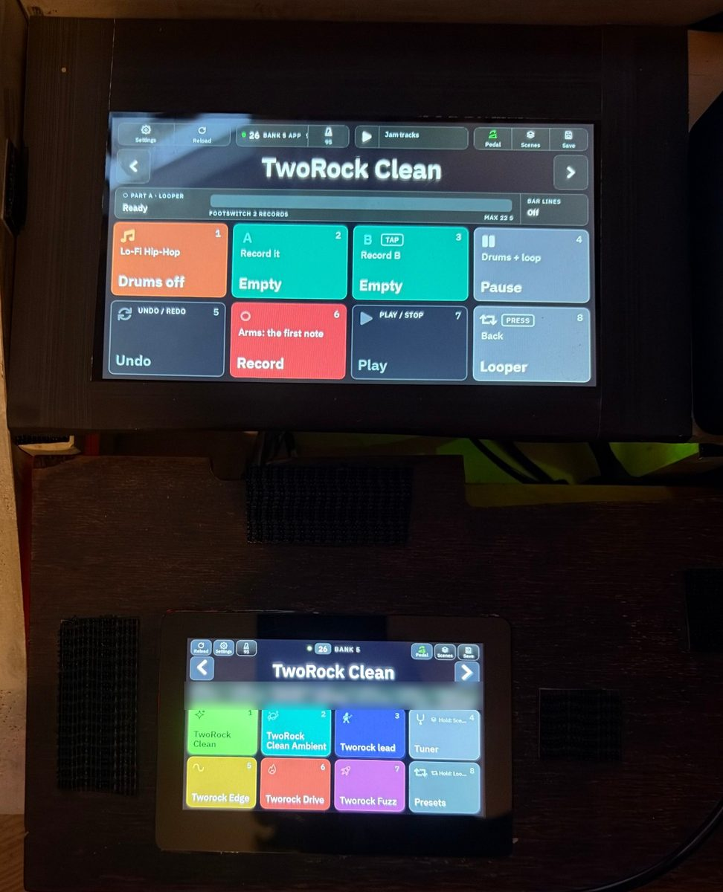

| | **7" board** | **4.3" board** |
|---|---|---|
| Display board | Waveshare ESP32-P4-WIFI6-Touch-LCD-7B, 1024 × 600 | Waveshare ESP32-S3-Touch-LCD-4.3, 800 × 480 |
| Link to the Nano | USB cable (Bluetooth without the cable) | Bluetooth |
| Presets, banks, scenes, FX editor, capture and cab, tuner, set list, expression pedal | yes | yes |
| Looper, drums and backing tracks played into the Nano | yes | – (its switches can control a looper app on a phone) |
| Level, gain reduction, auto-wah from the playing, EQ spectrum | yes | – |
| Footswitches | 8, wired straight to the board (or an SX1509 board) | an SX1509 board with up to 8 |
| Wi-Fi | tracks from the Mac, firmware updates | – |
| Release files | `nano-controller-p4-<version>-…` | `nano-controller-<version>-…` |

Both boards share most of their code, so their screens are laid out alike and work the same way. The table shows
what only the 7" board has; it is the newer one and gets new features first.

## The 7" board

### The main screen

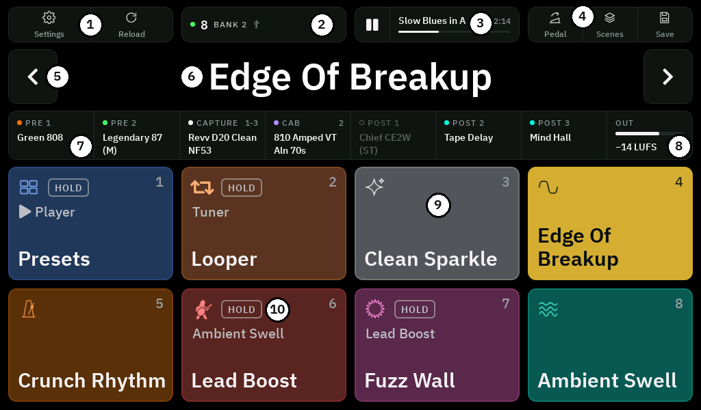

1. **Settings** (the Nano, audio, phone, Wi-Fi, MIDI, footswitches, tile layout, display, system, capture) · **Reload**
   reads everything from the Nano again
2. Green dot = connected to the Nano; the preset's number and the bank. **Tap** for the set list
3. The player: the jam track that plays (or the phone). **Tap** for its page with the list, the albums and the volume
4. **Pedal**: what the expression pedal moves in this preset · **Scenes**: tiles 3–8 become the preset's scenes,
   tap again for the bank's presets · **Save** turns green when there are unsaved changes
5. Previous / next **bank**
6. The preset's name: **tap** for the list of all 64 presets (with **New preset**), **hold** to rename.
   **Swipe** left / right anywhere for the next / previous preset, **swipe up** for the gig view
7. The signal chain: Pre FX 1–2, capture, cab, Post FX 1–3, a filled dot = on. **Tap** an effect for its FX editor;
   capture and cab: **tap** to choose one, **hold** for its tone or cab settings
8. **OUT**: the Nano's loudness. **Tap** for [Level](#level-gain-reduction-auto-wah-from-the-playing)
9. Eight tiles for eight footswitches, the number in the corner. **Tap** a tile = press its switch. A tile is
   filled when it is active (the preset that is loaded, an effect that is on)
10. A small key says how a switch's second function is reached: **HOLD** the switch, **TAP** it, or **PRESS**
    (it acts the moment the switch goes down). The line below the key says what it does – here: hold 6 for
    "Ambient Swell", a second preset on that switch

### Footswitches and modes

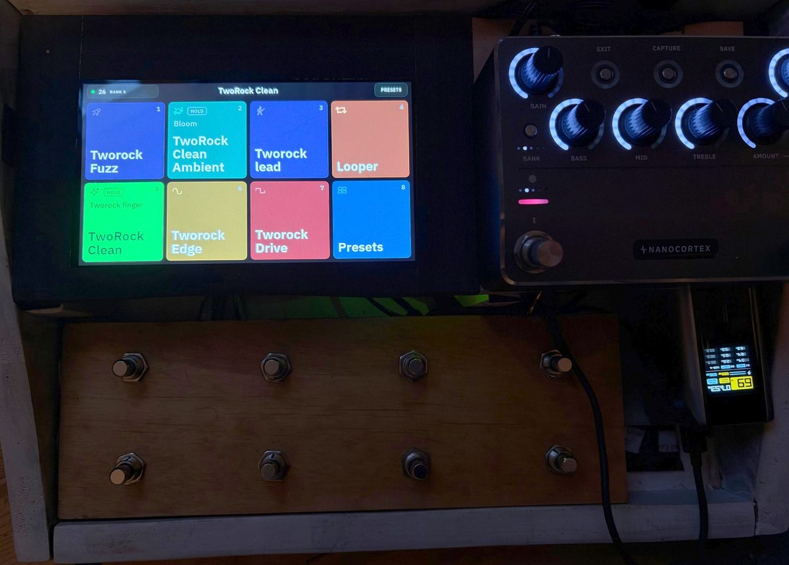

Footswitches **1** and **2** lead to the modes; from every other mode, footswitch **8** leads back to the presets.
In the default layout of eight fields:

| Mode | 1 | 2 | 3 | 4 | 5 | 6 | 7 | 8 |
|---|---|---|---|---|---|---|---|---|
| **Presets** (or scenes) | FX mode · *hold:* player | looper · *hold:* tuner | preset | preset | preset | preset | preset | preset |
| **FX** | Pre FX 1 | Pre FX 2 | Post FX 3 | looper · *hold:* tuner | Post FX 1 | Post FX 2 | reverb switch | presets · *hold:* player |
| **Looper** | drums on / off · *hold:* drum menu | part A | part B | pause | undo / redo · *hold:* clear | record / overdub | play / stop | back |
| **Player** | jam tracks / phone | song list | next album | looper | select previous | play selected | select next | back |

- A preset switch can hold a **second preset**, loaded when the switch is released after a long press (hold its
  tile to set it). With scenes on, switches 3–8 recall [scenes](#scenes-fx-mode-gig-view-and-pedal-view).
- In FX mode an effect with a **second effect** (A / B) swaps or switches on a tap or a hold, as chosen in its editor.
- Settings › **Tile layout** changes the order of the presets' and FX mode's switches (6 or 8 fields); Settings ›
  **Footswitches** learns which switch is which, a MIDI controller's switch too.

### Looper

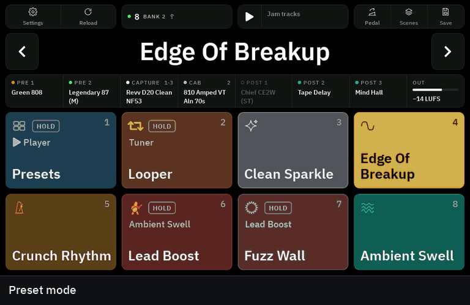

**Press 2** for looper mode. **6** records the first take of part A; pressed again, the loop is closed – rounded to
whole bars of the Nano's tempo, so a take that ends a little early goes on to the bar line. **6** then switches
between overdub and play, **7** stops and starts, **5** undoes the last overdub (hold: clear). **3** chooses part B: it
takes over at the end of the loop that plays, and an empty part starts recording there. **4** pauses loop and drums
together. Up to 22 seconds per part. The board records the Nano's sound from the USB cable and plays the loop back
into it, with the round trip taken out. *(The GIF is shortened: the time runs faster than on the board.)*

### Drums and saving loops

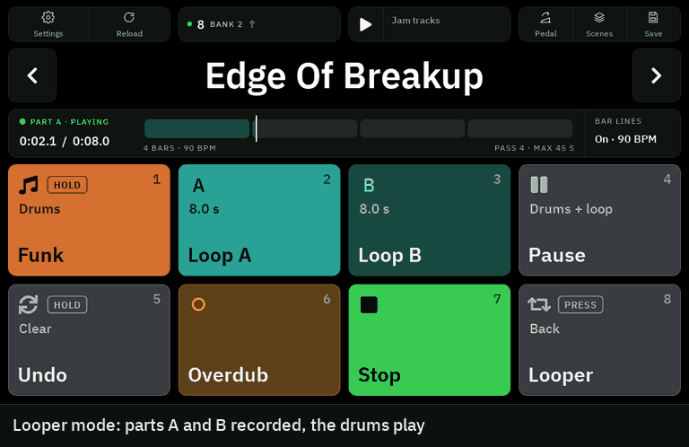

A drum machine in the Nano's tempo: 108 grooves in ten styles, two kits computed on the board (**Electronic** and
**Lo-Fi**), a groove of its own per looper part. **Press 1** in looper mode for drums on / off, **hold 1** for the
drum menu: styles, grooves, kit, level, and how a part's first take starts (with the drums, after a bar counted in, on
the drums' bar lines, or with the first note). **Save loops** writes parts A and B as WAV files to the microSD card
(`loops/`, with tempo and bars in the name) while the looper plays on. The menu's **Acoustic** kit needs a sample file
that is not part of the release; it stays dimmed without it.

### Jam tracks and player mode

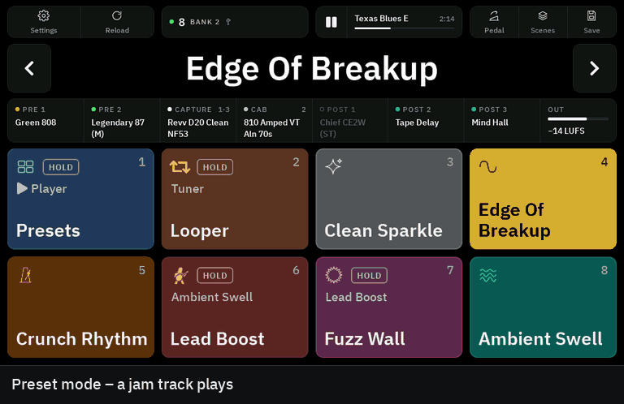

Backing tracks (WAV) from a microSD card, one folder per album, with covers. Every track is measured and played at
the same loudness (−21 LUFS), with a correction by ear per track. **Hold 1** for player mode: the playing track's
cover, title and time, and the album's list. Songs are chosen first and then played: **5 / 7** select the song before /
after while the current one plays on, **6** plays the selected song (or pauses), **3** goes to the next album, **8**
back. Tracks come onto the card over Wi-Fi from the [Jam Player](https://github.com/DrD85/jam-player) on a Mac or from
the board's page `http://nano-board.local`.

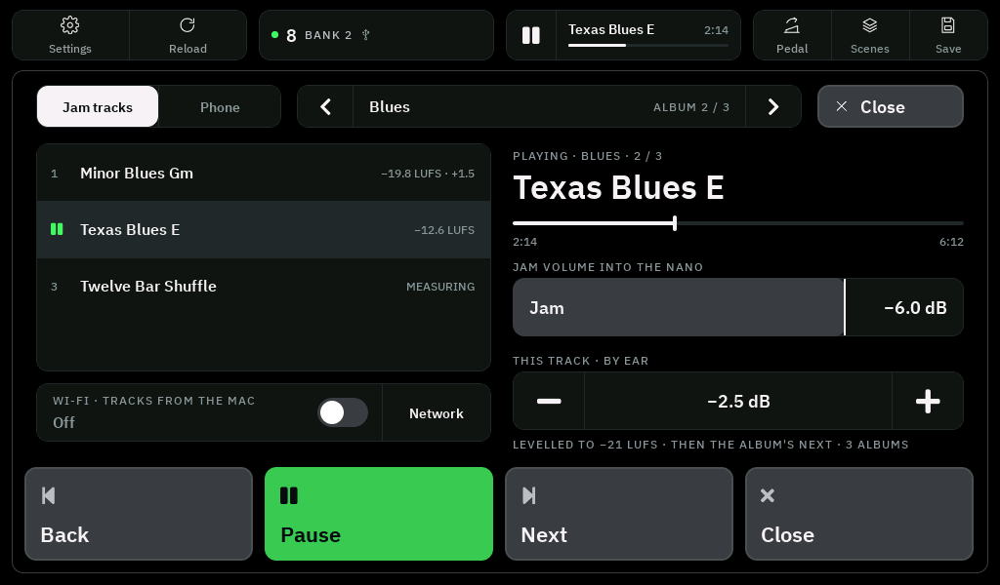

### FX editor, pad and info page

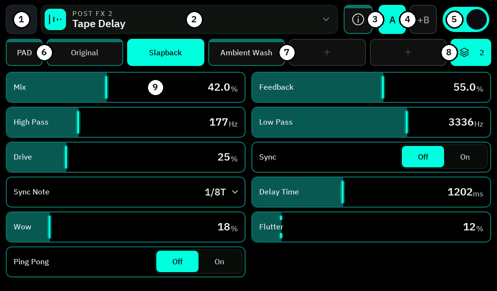

Tap an effect in the signal chain (or hold its tile in FX mode).

1. Back
2. The model: **tap** for another one
3. **i**: the info page – what the effect is based on, starting points and players' sounds, each with where its
   settings come from; **Apply** sets them
4. **A / +B**: a second effect on this slot, swapped with its footswitch
5. On / off
6. **PAD**: the pad page (below)
7. **FX presets**: tap = load, **hold** = save the current settings under a name
8. **Scenes**: keep these settings for a scene of the preset (the number: how many scenes have their own)
9. **Slide sideways** on a bar to change its value; *Off | On* settings switch with a tap

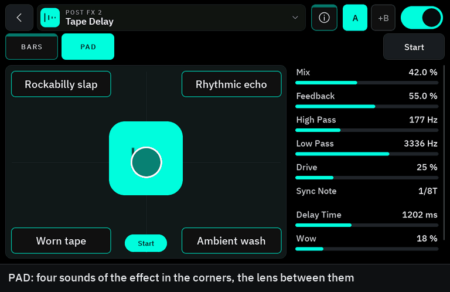

**The pad** puts four sounds of the effect in its corners. Drag the lens between them and every control moves with
it; let go and the sound stays where the lens is. A long press on a pedal in the pedal view opens it directly.

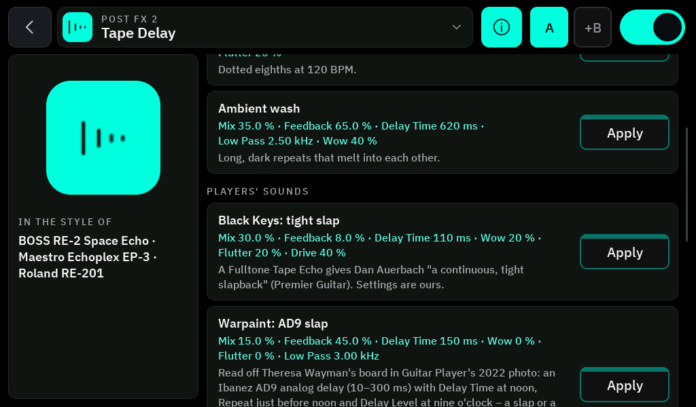

### EQ with a live spectrum

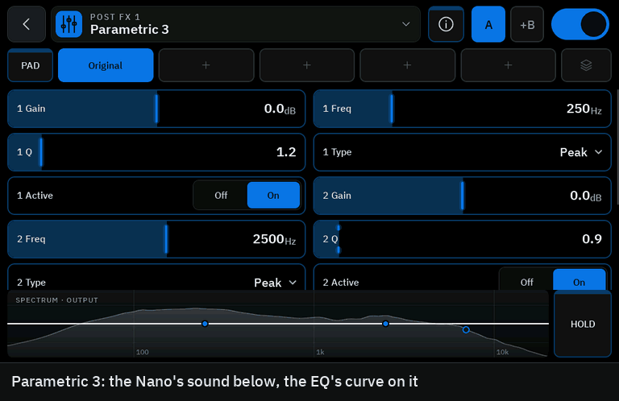

The editors of **Parametric 3**, **Graphic 9** and **Low-High Cut** show the Nano's sound as a spectrum below the
controls, with the EQ's curve over it. **HOLD** keeps the sound of the moment as a dashed line: change the EQ and
compare before and after. It reads the sound from the USB cable, so it needs the Nano plugged in. *(The sound in the
GIF is made up for the picture.)*

### Level, gain reduction, auto-wah from the playing

<table>
<tr>
<td width="33%">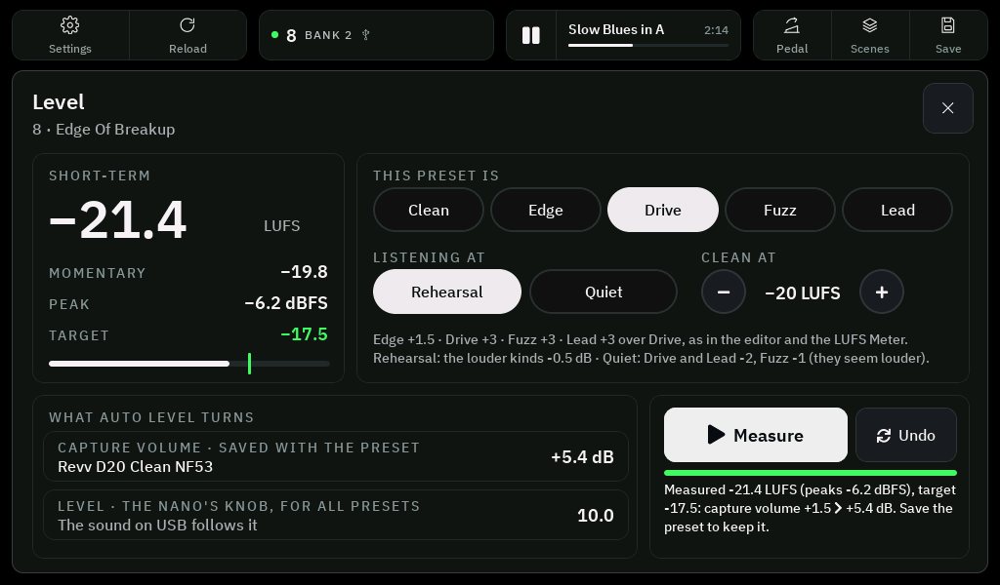</td>
<td width="33%">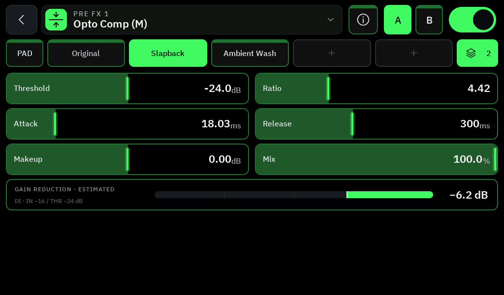</td>
<td width="33%">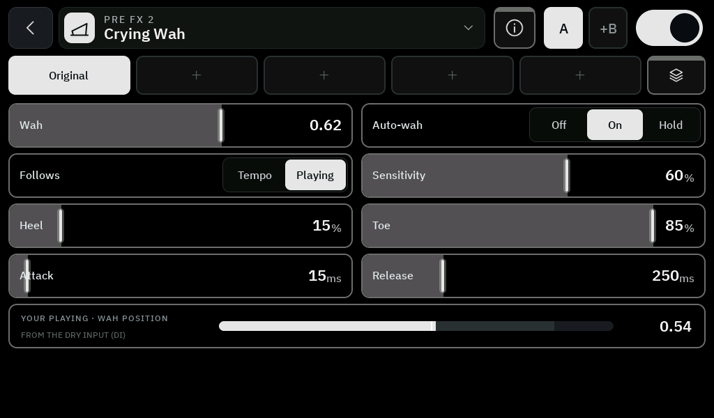</td>
</tr>
<tr>
<td valign="top">

**Level** – tap OUT, choose what the preset is (clean, edge, drive, fuzz, lead), play for a few seconds: the board
measures the loudness and suggests the preset's level, so presets match.

</td>
<td valign="top">

**Gain reduction** – below a compressor's knobs, worked out from its knobs and the Nano's dry input (the Nano does
not report it).

</td>
<td valign="top">

**Auto-wah** – a wah the board moves in the Nano's tempo, or one that opens with your picking (sensitivity, attack,
release), with a live view.

</td>
</tr>
</table>

### Scenes, FX mode, gig view and pedal view

<table>
<tr>
<td width="50%">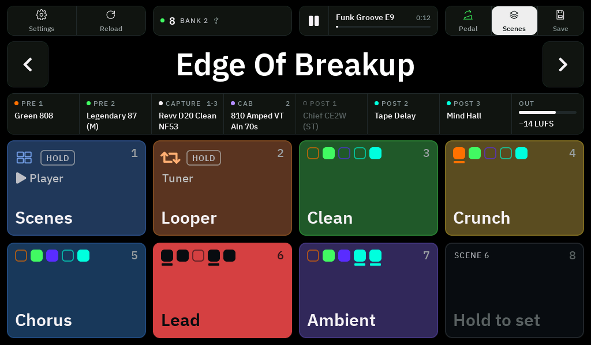</td>
<td width="50%">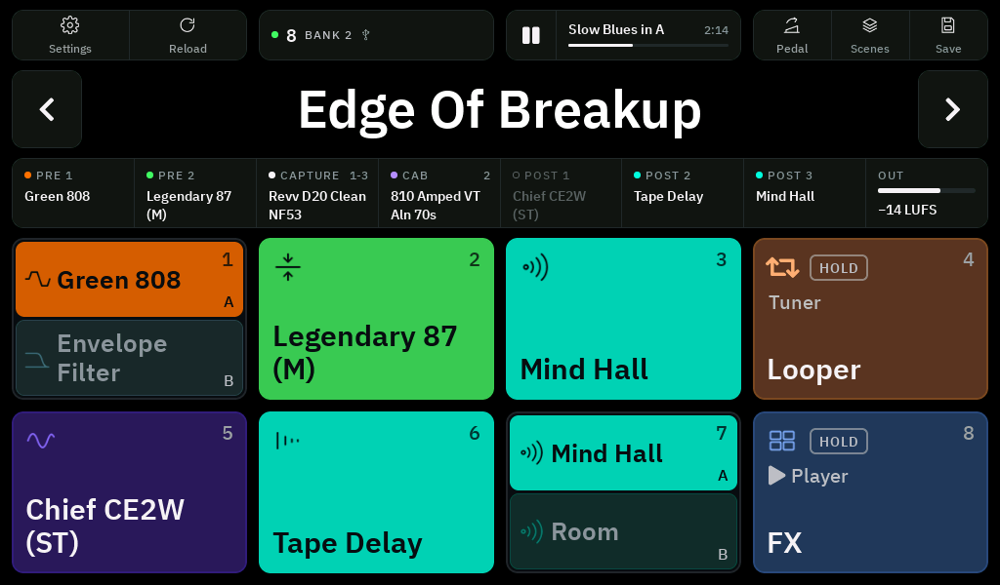</td>
</tr>
<tr>
<td valign="top">

**Scenes** – six per preset. A scene is which of the five effects are on and, if you like, how they are set; its
switch changes all of that at once, without the gap of a preset change. **Scenes** in the top bar; **hold** a tile
to set a scene up.

</td>
<td valign="top">

**FX mode** – the five effects on the switches in their own order: Pre FX on the top row, Post FX below, the reverb
switch (two mix positions, two reverbs, or two named settings of a reverb) on 7.

</td>
</tr>
<tr>
<td width="50%">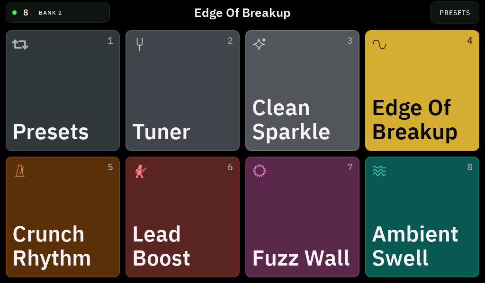</td>
<td width="50%">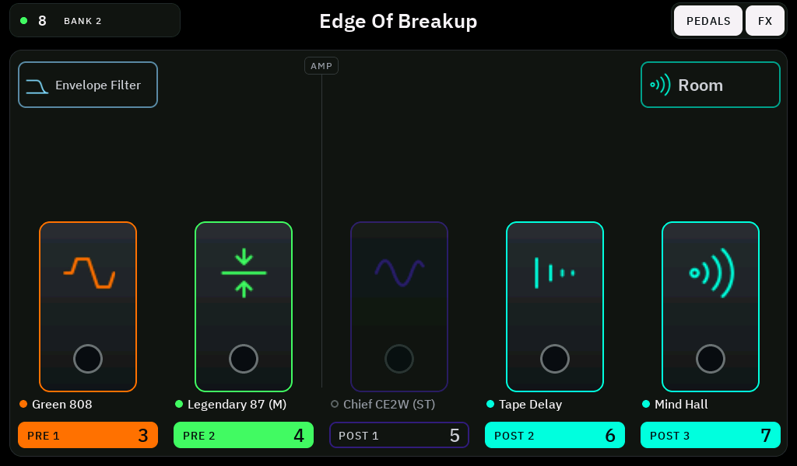</td>
</tr>
<tr>
<td valign="top">

**Gig view** – swipe up: large tiles and a slim bar with connection, preset, bank, unsaved changes and the mode.
Swipe down: back.

</td>
<td valign="top">

**Pedal view** – **PEDALS** in the gig view's bar, in FX mode: the five effects as pedals, the amp between Pre and
Post FX, each with its footswitch.

</td>
</tr>
</table>

### More on the screen

<table>
<tr>
<td width="33%">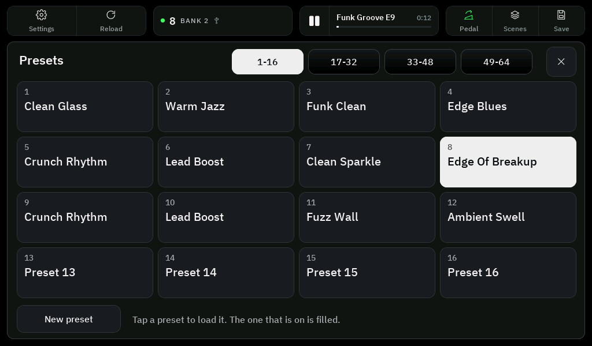</td>
<td width="33%">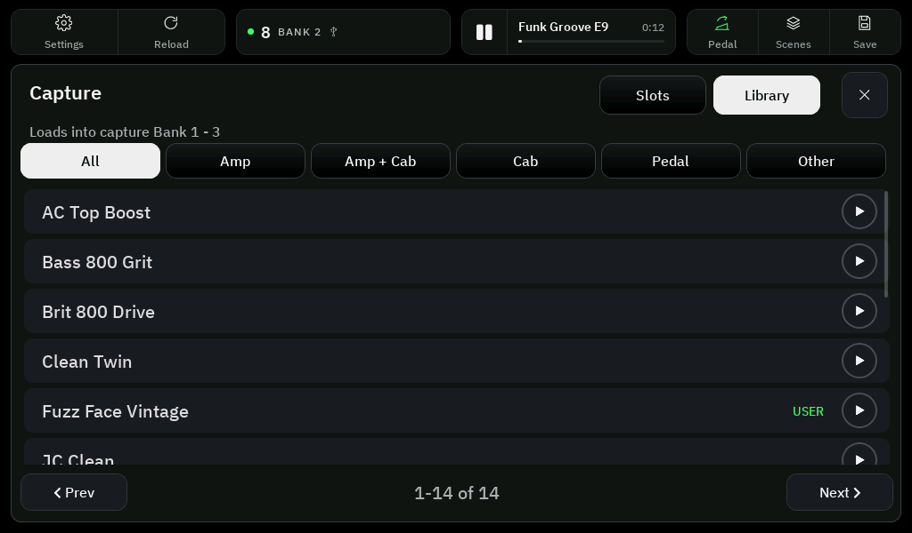</td>
<td width="33%">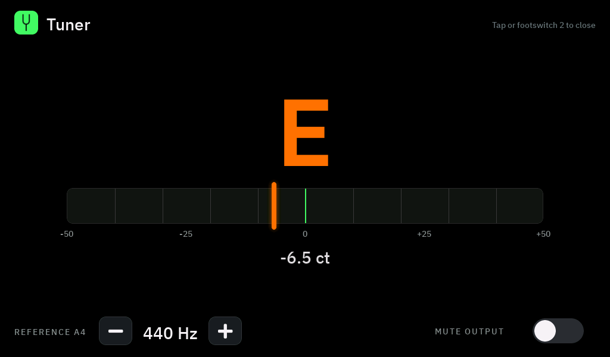</td>
</tr>
<tr>
<td valign="top">

**Preset list** – tap the preset's name: all 64 presets, **New preset** in any place.

</td>
<td valign="top">

**Capture and cab** – the Nano's slots or its whole library, with filters.

</td>
<td valign="top">

**Tuner** – hold 2. Reference pitch and output mute.

</td>
</tr>
</table>

Also: own banks with colours and symbols, a set list, the expression pedal's assignments per preset, Bluetooth
MIDI controllers (for example an M-VAVE Chocolate) with MIDI learn, the Neural Capture assistant, tempo and
metronome, a settings backup through the editor. Every function in detail: the [manual](docs/manual.md) – written
for the 4.3" board; the screens are the same, the footswitches as in the table above.

## Getting started (7" board)

**1. What you need**

| Part | Notes |
|---|---|
| [Waveshare ESP32-P4-WIFI6-Touch-LCD-7B](https://www.waveshare.com/wiki/ESP32-P4-WIFI6-Touch-LCD-7B) | 7", 1024 × 600, an ESP32-P4 with an ESP32-C6 for Bluetooth and Wi-Fi |
| Neural DSP Nano Cortex | with a USB-C cable to the board's **USB-A** socket |
| Optional: microSD card | **FAT32**, for jam tracks (folder `jam`, one sub-folder per album) and saved loops (`loops`) |
| Optional: up to 8 momentary footswitches | each between a pin of the board's header **P3** and GND, no resistors – [wiring](p4/README.md#what-you-need) |

**2. Install the firmware** – the files are on the [Releases](../../releases) page (`nano-controller-p4-<version>-…`).

- **In the browser:** open [esptool.spacehuhn.com](https://esptool.spacehuhn.com) in **Chrome** or **Edge**, connect
  the board's USB-C port **USB TO UART** and click **Connect**. First installation: **Erase**, then
  `…-full.bin` at **`0x0`**. Update: `…-update.bin` at **`0x10000`**, no erase – banks and settings stay. Press
  **RESET**. (No port? Hold **BOOT**, press and release **RESET**, release **BOOT**. Stops halfway? Choose 115200 baud.)
- **Over Wi-Fi** (once a firmware is on the board): switch on Wi-Fi (Settings › Wi-Fi, or on the jam player's page),
  open `http://nano-board.local` and choose
  `…-wifi.bin` under **Firmware**. If the new firmware does not start properly, the board goes back to the old one.
- **From the command line** (esptool 5): see [p4/README.md](p4/README.md#install-the-firmware).

**3. First start** – switch the Nano on, plug it into the board's USB-A socket and power the board. It reads the
presets over the cable and shows the current one; the green dot means connected.

More on the 7" board – the whole feature list, the footswitch pins, building: **[p4/README.md](p4/README.md)**.

## The 4.3" board

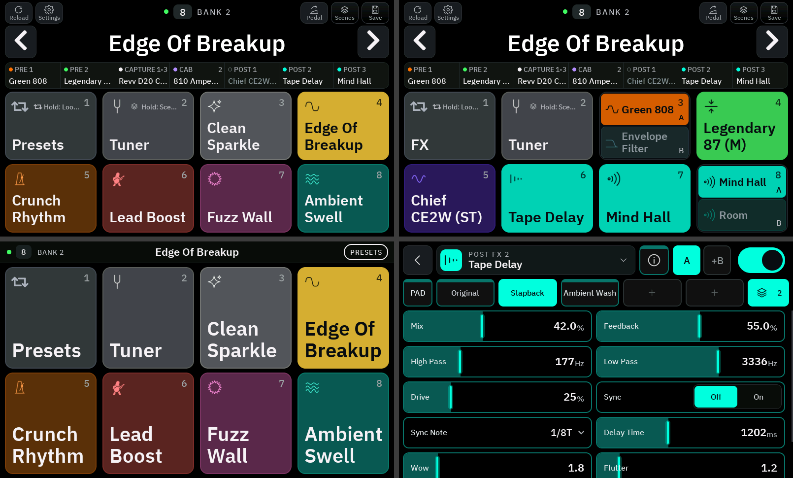

The original controller, on a **Waveshare ESP32-S3-Touch-LCD-4.3** (800 × 480, the version with ONE USB-C port
labelled **USB**). It talks to the Nano over **Bluetooth**, so it needs no cable to the Nano, and it plays no sound of
its own. The screens and functions are those of the 7" board above, without the looper, drums, jam tracks, Level, gain
reduction, the spectrum and Wi-Fi. Its footswitches are used differently:

| Footswitch | Press | Hold |
|---|---|---|
| 1 | presets or scenes ↔ FX mode | looper mode: the switches control a looper app on a phone (for example Loopy Pro) over Bluetooth MIDI |
| 2 | tuner | scenes ↔ presets |
| 3–8 | presets, scenes or effects | 3–7 in FX mode: a slot's second effect (A / B) |

**What you need:** the board, the Nano, and optionally an SX1509 breakout with up to 8 momentary footswitches
([wiring](docs/manual.md#footswitches) – the touch screen works on its own).

**Install the firmware** – in the browser, as above: [esptool.spacehuhn.com](https://esptool.spacehuhn.com),
the board's port **USB** (usually "USB JTAG/serial debug unit"), then:

| File | Address | Use it for |
|---|---|---|
| `nano-controller-<version>-full.bin` | `0x0` | the **first installation** (erases stored banks and settings) |
| `nano-controller-<version>-update.bin` | `0x10000` | **updates** – your banks and settings stay |
| `nano-controller-<version>-partitions.bin` | `0x8000` | **with the update** when coming from 1.18 or earlier (since 1.19 the settings memory is larger); settings stay |

**First start** – switch the Nano on, close the Cortex Cloud app and the Nano Cortex Editor (the Nano accepts only one
Bluetooth connection) and power the board. The Nano can be found for a few seconds after it is switched on; later,
press **EXIT + CAPTURE** on it (the controller says so). If the board does not find the Nano within a minute, switch
the Nano off and on again.

Everything in detail: the **[manual](docs/manual.md)** – banks, scenes, expression pedal, capture and cab, FX
presets, reverb switch, second effect, [Bluetooth MIDI](docs/manual.md#bluetooth-midi) with all messages, the looper
app mode, what is stored where.

## Companions: Editor and Jam Player

- **[Nano Cortex Editor](https://github.com/DrD85/nano-cortex-editor)** – the desktop editor for the Nano. It can
  connect **through** either board (Bluetooth device "Nano Cortex Controller"), so editor and board work side by
  side. It also keeps automatic backups of the board's settings.
- **[Jam Player](https://github.com/DrD85/jam-player)** – a backing-track player for the Mac that plays every track at
  the same loudness. It sends tracks to the 7" board over Wi-Fi (each folder becomes an album; only new or changed
  tracks go), and from version 1.5.0 on also their covers, and it fetches the loops saved on the board.

## Build from source

- **4.3" board:** ESP-IDF 6.0, `idf.py build` in the project folder – [docs/development.md](docs/development.md) (project
  layout, serial console, how the controller talks to the Nano). The browser version: [web/README.md](web/README.md).
- **7" board:** ESP-IDF 6.0, in `p4/firmware`:
  `idf.py -B build-public -D SDKCONFIG=build-public/sdkconfig -DNANO_PUBLIC=1 build` – details, host tests and the
  real-time rules for the audio path in [p4/README.md](p4/README.md#build-from-source).

The pictures of the screens are not photos: the firmware's own UI code draws them on a computer with example presets
(`tools/screenshots/make_screenshots.sh`, `p4/firmware/tools/screenshots/make_p4.sh`); the GIFs are sequences of
such pictures. The photos show the author's boards, with his own presets.

## Not tested yet

On the 7" board:

- New in 1.2.0 and not yet played much: the Lo-Fi kit and its grooves, the live spectrum, saving loops (fetching them
  with the Jam Player was only tried against a simulated board), the player mode's song selection
- The Nano Cortex Editor through the board was tried with the board's ESP32-C6 updated to esp_hosted 2.13.1
  (`p4/firmware/main/p4_c6_update.c` says how); with the C6's factory firmware it has not been tried yet
- The Nano over Bluetooth **without** the cable, and changing between cable and Bluetooth while playing
- Phone audio through the optional ESP32 bridge (`p4/a2dp-bridge`) into the Nano: the bridge alone was tried with a
  phone, not yet wired to the board
- The published build itself on a board: the screens and host tests come from the same code, and the author's own
  build differs only in private artwork and data (pictures, an extra group of presets on the info page, the acoustic
  drum samples) and the log port. The looper's long runs were measured with the author's build

## Credits

Built on the [Nano Cortex Editor](https://github.com/DrD85/nano-cortex-editor) (protocol, FX tables),
[rixrix/deskop-nano-cortex](https://github.com/rixrix/deskop-nano-cortex) (protocol notes),
[Builty/TonexOneController](https://github.com/Builty/TonexOneController) (the idea, display and footswitch setup),
[ESP-IDF](https://github.com/espressif/esp-idf) with NimBLE, [LVGL](https://github.com/lvgl/lvgl) and
[IBM Plex Sans](https://github.com/IBM/plex). The full list with licenses: [docs/credits.md](docs/credits.md).

## License

[MIT](LICENSE) for the code of this project. The components above keep their own licenses.
