# Nano Cortex Controller – Handbuch

Alle Funktionen im Detail. Die kurze bebilderte Anleitung steht im [README](../README.de.md); wie die Firmware gebaut wird und wie sie mit dem Nano spricht, steht in [development.de.md](development.de.md).

**Inhalt:** [Der Bildschirm](#der-bildschirm) · [Fußschalter und Kacheln](#fußschalter-und-kacheln) · [Lange drücken](#lange-drücken) · [Eigene Bänke](#eigene-bänke) · [Setlist](#setlist) · [Szenen](#szenen) · [Expression-Pedal](#expression-pedal) · [Capture und Cab/IR](#capture-und-cabir) · [FX-Editor](#fx-editor) · [Reverb-Schalter](#reverb-schalter-fußschalter-8) · [Zweiter Effekt (A / B)](#zweiter-effekt-a-und-b-auf-einem-fx-slot) · [Auto-Wah](#auto-wah) · [Stimmgerät](#stimmgerät) · [USB-Audio-Lautstärke](#usb-audio-lautstärke) · [Bluetooth-MIDI](#bluetooth-midi) · [Looper-Modus](#looper-modus-eine-looper-app-auf-dem-telefon) · [Editor über den Controller](#nano-cortex-editor-über-den-controller) · [Cortex Cloud](#cortex-cloud-über-den-controller) · [Fußschalter-Learn](#fußschalter-learn) · [Fußschalter (Verkabelung)](#fußschalter) · [System](#system-speicher-sicherung-und-selbst-neustart) · [Was wo gespeichert ist](#was-wo-gespeichert-ist)

## Der Bildschirm

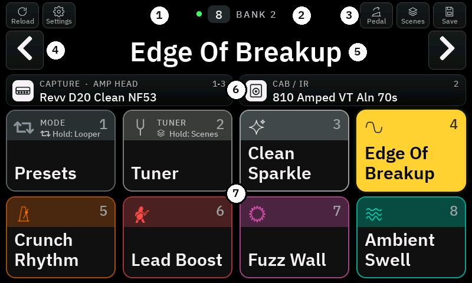

- **Kachel antippen** = ihren Fußschalter drücken. Eine Kachel leuchtet kurz auf, wenn ihr Fußschalter gedrückt wird.
- **Kacheln wie in der Signal Chain des Desktop-Editors**: das aktive Preset oder ein eingeschalteter Effekt ist in
  seiner Farbe **gefüllt**, alles andere dunkel mit **farbigem Rand** und der gedimmten Farbe hinter der oberen Zeile –
  auch von weiter weg gut zu unterscheiden.
  Alle Namen haben dieselbe Größe.
- Die Knöpfe der oberen Leiste tragen ihr Wort unter dem Symbol. **Reload** (oben links) liest alles neu vom Nano:
  Preset-Namen, aktuelles Preset und die Library. **Settings** daneben öffnet die
  [Einstellungen](#einstellungen); **Tempo** (NanOS 2.3) zeigt das Tempo und öffnet das Metronom.
- **Nach links / rechts wischen**: nächstes / vorheriges Preset.
- **Nach oben wischen – Gig-Ansicht**: die Kacheln füllen den Bildschirm mit größeren Namen, eine schmale Leiste
  oben zeigt Verbindung, Preset-Nummer, Bank, Preset-Name, ungespeicherte Änderungen und den Modus (PRESETS / SCENES / FX).
  **Nach unten wischen**: zurück.
- **Pedalansicht**: **PEDALS** in der Leiste der Gig-Ansicht zeigt die fünf FX-Slots als Pedale auf einem Brett,
  sobald der Controller im FX-Modus ist – in Signalreihenfolge, der Platz des Amps ist zwischen Pre FX 2 und
  Post FX 1 markiert. Unter jedem Pedal stehen sein Licht, sein Name und sein Fußschalter, in der Effektfarbe gefüllt,
  solange es an ist; ein ausgeschaltetes Pedal steht im Dunkeln. Ein Tipp schaltet den Effekt, ein langer Druck öffnet
  seinen FX-Editor, wie auf einer Kachel. **PEDALS** nochmal tippen bringt die Kacheln zurück. Fußschalter 1, 2 und 8
  arbeiten wie immer, sie haben in dieser Ansicht nur kein Feld.

  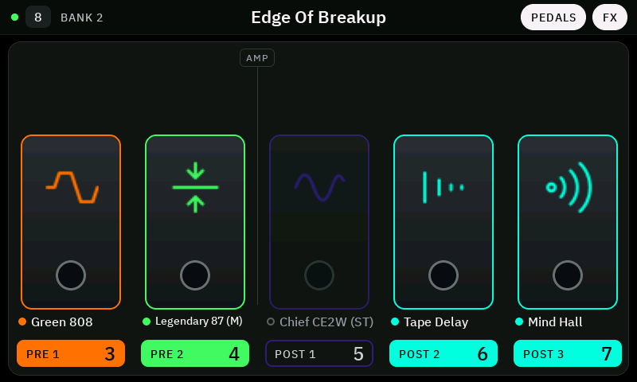

  Die veröffentlichte Firmware zeichnet jedes Pedal: seine Farbe und sein Symbol. Ein eigener Build kann stattdessen
  Bilder zeigen – siehe `tools/gen_pedalboard.py`: Sie werden in einen Teil des Flash-Speichers geschrieben, den die
  Firmware nicht benutzt, und von dort gezeichnet, wie sie sind; sie kosten also weder Speicher noch Zeit.
- Rechts in der oberen Leiste: der **Pedal**-Knopf für das [Expression-Pedal](#expression-pedal), der
  **Szenen**-Knopf (Ebenen) und **Save**. Der Szenen-Knopf legt die [Szenen](#szenen) des aktuellen Presets auf die
  Kacheln 3–8, anstelle der Presets der Bank; nochmal tippen geht zurück. In der Gig-Ansicht macht ein Tipp auf den
  Modus oben rechts dasselbe.
- Der grüne Punkt zeigt die Bluetooth-Verbindung zum Nano; **Save** wird grün und neben dem Namen erscheint ein
  oranger Punkt, wenn das Preset ungespeicherte Änderungen hat. **MIDI** wird grün, solange ein Bluetooth-MIDI-Controller verbunden ist.
- Die **Capture-Karte** zeigt wie im Editor den Typ des Captures (Amp-Head, Combo, Amp + Cab, Cab, Pedal …).

## Fußschalter und Kacheln

| Schalter | Preset-Modus | FX-Modus |
|---|---|---|
| 1 | in den FX-Modus wechseln; **gehalten: Looper-Modus** | in den Preset-Modus wechseln; **gehalten: Looper-Modus** |
| 2 | Stimmgerät an/aus; **gehalten: Szenen ↔ Presets** | Stimmgerät an/aus; **gehalten: zu den Szenen** |
| 3–8 | die sechs Presets der aktuellen Bank | 3–7: Pre FX 1, Pre FX 2, Post FX 1–3 an/aus |
| 8 | (sechstes Preset) | Reverb: Mix Pos 1 ↔ Pos 2 oder Reverb A ↔ B |

Sind die Szenen gewählt (der Ebenen-Knopf oder Fußschalter 2 gehalten), sind die Schalter 3–8 die sechs
[Szenen](#szenen) des aktuellen Presets statt der Presets der Bank, und Fußschalter 1 wechselt zwischen FX-Modus und
Szenen. Die Fußschalter 1 und 2 schalten beim Loslassen (sie haben eine Halte-Funktion): Fußschalter 1 gehalten (0,6 s)
öffnet den Looper-Modus, Fußschalter 2 gehalten wechselt zwischen den Szenen und den Presets der Bank wie der
Szenen-Knopf (ist das Stimmgerät offen, schließt Fußschalter 2 es sofort). Die Kacheln 1 und 2 zeigen das unter
ihrer Beschriftung: *Hold: Looper* und *Hold: Scenes* (oder *Presets*). Kachel 1 heißt immer *MODE* und zeigt den Modus, in dem
der Controller ist – *Presets*, *Songs* (Setlist), *Scenes* oder *FX*; Bank, Preset und Song stehen in der oberen Leiste.

Aktive Kacheln leuchten in voller Farbe, inaktive sind gedimmt. FX-Kacheln tragen die Farben der Effektkategorien.
Die Nummern hier sind die Funktionen der Schalter; wo sie liegen, bestimmt die [Kachel-Anordnung](#kachel-anordnung-6-oder-8-felder).

## Lange drücken

| Wo | Was sich öffnet |
|---|---|
| Kachel 1 | **Looper-Modus** an / aus (wie Fußschalter 1 halten) |
| Kachel 2–8 im Looper-Modus | **Looper-Kachel**: Name, Farbe und Symbol dieses Schalters |
| Kachel 2 | **Learn** für Fußschalter 2 – und mit *Switch 1* in diesem Fenster für Fußschalter 1 |
| Preset-Kachel (3–8, Preset-Modus) | **Bank-Fenster**: Farbe, Symbol und Preset dieses Schalters; `DEFAULT` stellt das Standard-Preset her; `LEARN SWITCH` |
| Szenen-Kachel (3–8, Szenen) | **Szene**: Name, Farbe und welche Effekte an sind; `Remove` leert den Schalter |
| FX-Kachel (3–7, FX-Modus) | **FX-Editor**: Modell (auf den Kopf tippen), an/aus, alle Parameter und der [zweite Effekt](#zweiter-effekt-a-und-b-auf-einem-fx-slot) (A \| B) |
| Kachel 8 (FX-Modus) | **Reverb-Fenster** mit den Reitern *MIX*, *REVERB A / B* und *2 SETTINGS* |
| Preset-Name | **Umbenennen** mit Bildschirmtastatur (mindestens 4 Zeichen, eindeutig) |

## Eigene Bänke

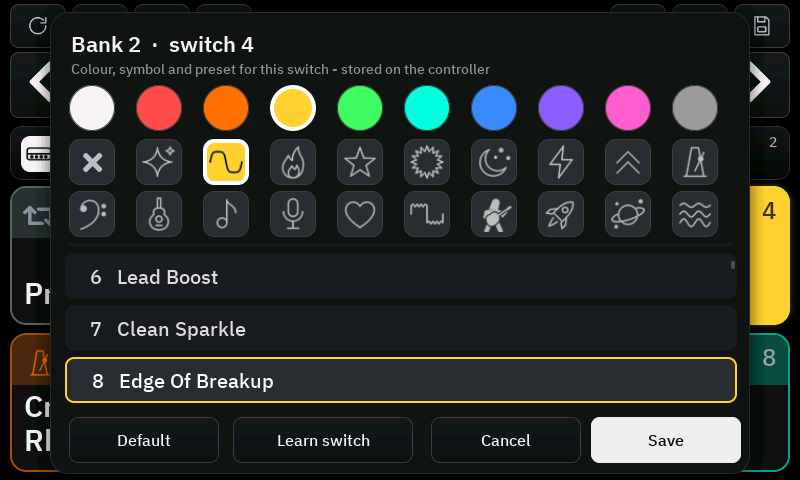

16 Bänke mit je sechs Schaltern. Ab Werk liegen in Bank 1 die Presets 1–6, in Bank 2 die Presets 7–12 und so weiter.
Lange auf eine Preset-Kachel drücken, dann beliebiges Preset, eine von zehn Farben und eines von 19 Symbolen wählen
(Clean, Edge, Drive, Solo, Fuzz, Atmospheric, Metal, Boost, Rhythm, Bass, Acoustic, Blues, Live, Favorite,
Fuzz Wave, Guitarist, Rocket, Space, Swell).
Die Bänke speichert der Controller, die Presets selbst bleiben auf dem Nano.

## Setlist

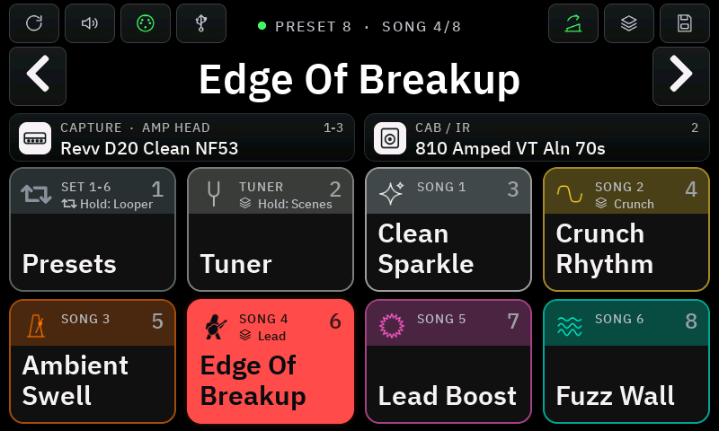 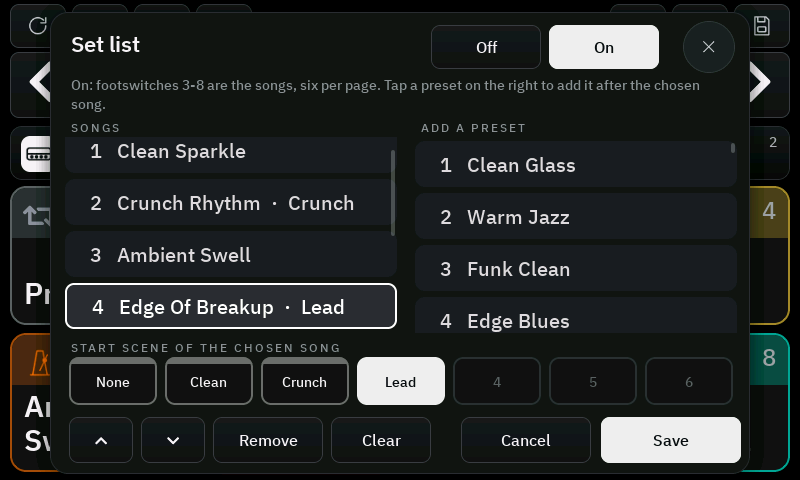

Die Songs eines Auftritts in ihrer Reihenfolge – bis zu 36, dasselbe Preset darf mehrmals vorkommen. **Auf die Zeile
oben tippen** (die Preset-Nummer und *BANK 2*) öffnet die Setlist:

- **Ein Preset rechts antippen** fügt es als Song nach dem gewählten ein (oder am Ende).
- **Einen Song links antippen** wählt ihn; dann mit den Pfeilen nach oben oder unten schieben oder mit **Remove**
  entfernen. **Clear** leert die Liste.
- **Start-Szene** (die Reihe unter den Listen): Der gewählte Song kann mit einer [Szene](#szenen) seines Presets
  beginnen – wer den Song wählt, lädt das Preset und schaltet dann auf diese Szene. So kann dasselbe Preset zweimal
  in der Setlist stehen, etwa einmal als *Clean* und einmal als *Lead*. *None* beginnt mit dem Preset, wie es
  gespeichert ist; noch nicht eingerichtete Szenen sind grau. Die Kachel des Songs nennt die Szene unter der
  Überschrift.
- **On / Off** oben: Solange die Setlist an ist, sind die Fußschalter 3–8 im Preset-Modus ihre Songs statt der Presets
  der Bank. **Save** speichert Liste und Wahl auf dem Controller.

Solange sie an ist:

- Die Kacheln 3–8 zeigen sechs Songs (*SONG 1* … *SONG 6*) in der Farbe und mit dem Symbol, die ihr Preset in den
  Bänken hat; Kachel 1 sagt, welche Songs auf der Seite sind (*SET 1-6*), die Zeile oben, welcher Song an ist
  (*SONG 4/8*).
- **Wer den sechsten Song einer Seite wählt, kommt auf die nächste Seite** – so geht es allein mit den Fußschaltern
  durch das ganze Set: 3, 4, 5, 6, 7, 8 – und Fußschalter 3 ist der nächste Song.
- Die **Pfeil-Knöpfe** blättern die Seiten um, ein **Wischen** geht zum vorigen oder nächsten Song.
- Lange auf eine Song-Kachel drücken öffnet die Setlist mit diesem Song gewählt.
- Szenen und FX-Modus funktionieren wie bisher; Fußschalter 1 und der Szenen-Knopf kehren zur Seite der Setlist zurück.
- MIDI: **CC 66** nächster Song, **CC 67** voriger Song (Wert 64–127), **CC 68** Setlist an (64–127) / aus.

## Szenen

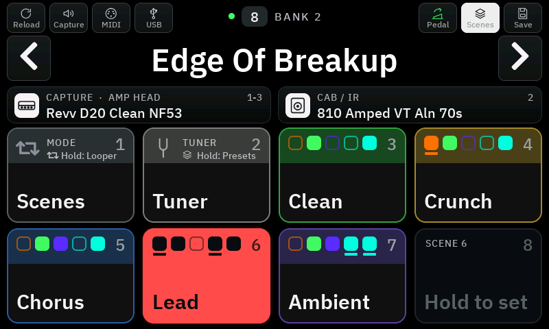 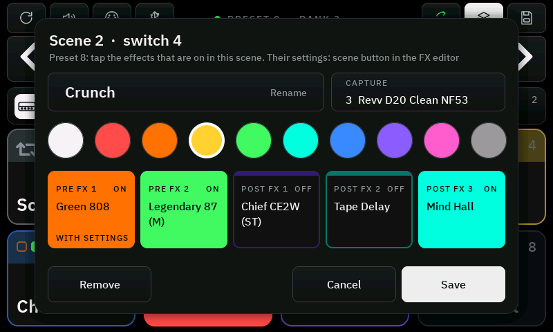

Eine Szene ist eine Einstellung der Effekte **innerhalb eines Presets**: welche der fünf FX-Slots an sind und auf
Wunsch, wie sie eingestellt sind. Jedes Preset kann sechs Szenen haben, auf den Fußschaltern 3–8. Der Schalter einer
Szene sendet nur, was sich ändert: Mehrere Effekte wechseln mit einem Tritt, und der Ton reißt nicht ab wie beim
Laden eines anderen Presets – zum Beispiel *Clean*, *Crunch* und *Lead* in einem Song.

- Der **Szenen-Knopf** (Ebenen, neben Save) zeigt die Szenen des aktuellen Presets auf den Kacheln 3–8; nochmal tippen bringt die Presets
  der Bank zurück. **Fußschalter 2 halten** macht dasselbe mit dem Fuß. Der Controller merkt sich die Wahl.
  Fußschalter 1 wechselt zwischen FX-Modus und dem, was davon
  gewählt ist.
- **Szene einrichten**: ihre Kachel halten. Name (15 Zeichen) und Farbe vergeben und die Effekte antippen, die in
  dieser Szene an sind – gefüllt = an, umrandet = aus. Eine leere Szene beginnt mit dem, was gerade an ist; man kann
  die Effekte also auch vorher im FX-Modus einstellen. **Save** speichert die Szene und schaltet auf sie um,
  **Remove** leert den Schalter.
- **Capture** (neben dem Namen): der Capture-Slot, den die Szene lädt – etwa ein Lead-Amp für die Solo-Szene.
  *As it is* lässt das Capture, wie es ist (so wie eine Szene ohne Einstellungen einen Effekt lässt). Ein Capture zu
  laden dauert beim Nano einen Moment; eine Szene mit Capture wechselt also nicht ohne Aussetzer.

  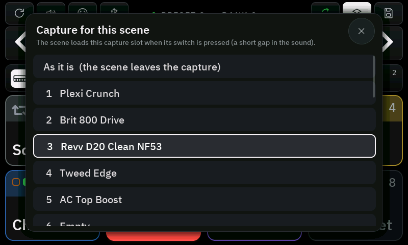
- **Auf der Kachel** stehen fünf Quadrate für Pre FX 1–2 und Post FX 1–3 in den Farben ihrer Effekte: gefüllt = die
  Szene schaltet den Effekt an, umrandet = aus, ein Punkt = der Slot ist leer.
- **Es leuchtet** die Szene, deren Effekte gerade an sind. Wird ein Effekt von Hand geschaltet (FX-Modus, Schalter
  am Nano, Editor), leuchtet keine Szene, bis wieder eine getreten wird.
- Eine Szene schaltet den Effekt, der gerade im Slot liegt; Modelle ändert sie nicht. Leere Slots werden
  übersprungen.
- Ein Szenenwechsel markiert das Preset als geändert (oranger Punkt), wie jeder von Hand geschaltete Effekt;
  gespeichert werden muss nichts. Was direkt nach dem Laden eines Presets an ist, bestimmt weiterhin das auf dem Nano
  gespeicherte Preset – es also im Zustand der Szene speichern, mit der man beginnen will.
- Szenen liegen auf dem Controller, pro Preset-Nummer. Über Bluetooth-MIDI wählt CC 60 Szenen oder Presets.

### Einstellungen eines Effekts pro Szene

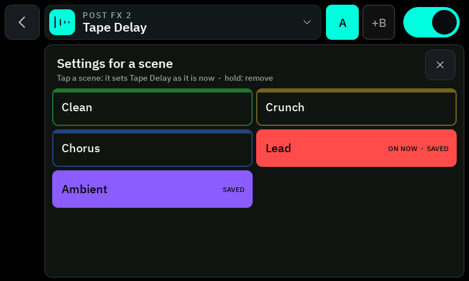

Eine Szene kann auch die Werte eines Effekts setzen – mehr Delay und Gain in *Lead* als in *Crunch*:

1. Den Effekt im [FX-Editor](#fx-editor) öffnen (er muss an sein) und so einstellen, wie die Szene klingen soll.
2. Auf den **Szenen-Knopf** am Ende der FX-Preset-Leiste tippen und dann auf die Szene. Sie trägt jetzt diese
   Einstellungen für diesen Effekt und sendet sie bei jedem Tritt auf ihren Fußschalter.
3. Dasselbe für die anderen Szenen, die diesen Effekt setzen sollen – vorher die Werte ändern, wo sie abweichen sollen.

- In der Liste ist eine Szene **gefüllt**, wenn sie Einstellungen für diesen Effekt trägt; *ON NOW* markiert die
  Szene, deren Effekte gerade an sind. Eine gefüllte Szene **antippen** ersetzt ihre Einstellungen durch die
  aktuellen, **halten** entfernt sie.
- Der Szenen-Knopf zeigt, wie viele Szenen Einstellungen für den Effekt tragen, und ist gefüllt, solange die
  laufende Szene dazugehört. Auf der Kachel einer Szene sagt ein kleiner Strich unter dem Quadrat des Effekts
  dasselbe, in ihrem Fenster *WITH SETTINGS*.
- **Eine Szene setzt nur, was für sie gespeichert wurde.** Ein Effekt, für den sie keine Einstellungen hat, bleibt,
  wie er ist – auch so, wie ihn eine andere Szene hinterlassen hat. Sollen sich zwei Szenen in einem Effekt
  unterscheiden, seine Einstellungen in beiden speichern.
- Gesendet werden nur die Werte, die abweichen: Ein Szenenwechsel, der ein paar Werte ändert, ist so schnell wie
  einer, der nur schaltet. Ein Effekt, der angeht, bekommt zuerst seine Werte.
- Die Einstellungen gehören zum Modell. Liegt ein anderes Modell im Slot, bleiben sie erhalten, werden aber nicht gesendet.

## Expression-Pedal

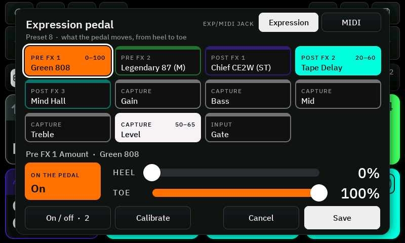 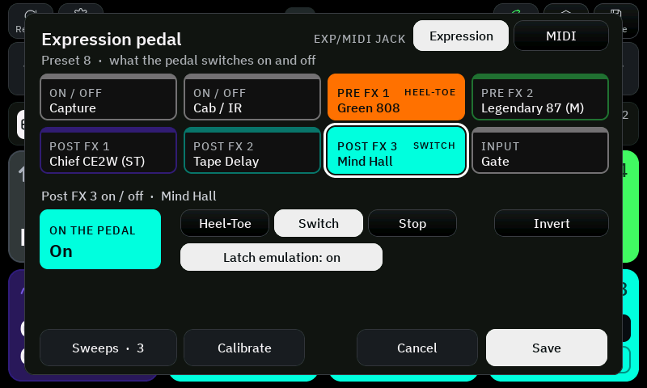

Der **Pedal-Knopf** in der oberen Leiste öffnet, was das Expression-Pedal des Nano im aktuellen Preset bewegt. Es
sind dieselben Zuweisungen wie in der Cortex-Cloud-App und im Expression-Fenster des Editors: Sie gehören zum Preset
des Nano. Das Symbol des Knopfs ist grün, solange das Pedal im Preset etwas tut.

**Im FX-Modus trägt die Kachel eines Effekts auf dem Pedal ein kleines Pedal-Symbol** (*Pedal*, *Pedal: on/off* oder
*Pedal, on/off*; auf einer Kachel mit zwei Symbolen sitzt es neben der Fußschalter-Nummer). Ein Blick darauf lohnt
sich, wenn ein Wert immer wieder zurückspringt: Egal, was man von Hand einstellt – der Nano setzt den Amount des
Effekts auf die Stellung des Pedals zurück, sobald er ein Modell oder das Preset lädt. Bei einem Compressor auf dem
Pedal ist das sein Eingangspegel.

- Elf Werte können dem Pedal folgen: der **Amount** jedes der fünf Effekte (der AMOUNT-Regler – die Stellung eines
  Wah, der Mix eines Reverbs …), Gain, Bass, Mid, Treble und Level des Captures und das Input-Gate. Ein Feld ist
  **gefüllt**, solange sein Wert auf dem Pedal liegt, und zeigt seinen Bereich.
- **Feld antippen** wählt es. **On the pedal** schaltet seine Zuweisung; **HEEL** und **TOE** sind die Werte an den
  beiden Enden des Pedalwegs (ein Fersenwert über dem Spitzenwert dreht die Richtung um). Einen Regler bewegen legt
  den Wert aufs Pedal.
- **Save** schreibt die Zuweisungen sofort ins Preset des Nano – das Preset selbst muss nicht gespeichert werden –
  und liest sie zur Kontrolle zurück. **Cancel** verwirft die Änderungen.
- **On / off** (unten links) öffnet die zweite Seite: was das Pedal ein- und ausschaltet – Capture, Cab, jeden
  Effekt, das Input-Gate. Feld wählen, dann die Art, benannt wie in der Cortex-Cloud-App: **Heel-Toe** und **Stop**
  mit einer Verzögerung (0–2000 ms), **Switch** für einen Fußschalter an der Buchse – mit **Latch Emulation** für
  einen, der nur Kontakt gibt, solange er gedrückt ist. **Invert** dreht Heel-Toe und Switch um. Der Knopf heißt
  dann *Sweeps* und führt zurück; Save schreibt beide Seiten.
- **Calibrate** (wenn die Buchse auf *Expression* steht) bringt dem Nano den Weg des Pedals bei: Nach *Start*
  vergisst der Nano seine Kalibrierung und meldet, wo das Pedal steht. Das Pedal ein paar Mal über den ganzen Weg
  bewegen und *Save* tippen – die niedrigste und die höchste Stellung werden im Nano gespeichert. *Cancel* schreibt
  den Bereich zurück, der zuletzt vom Controller aus gespeichert wurde; wurde das Pedal von hier aus noch nie
  kalibriert, bleibt es unkalibriert, und eine Meldung sagt das.
- Für ein Wah: ein Wah-Modell auf Pre FX 1 oder 2 legen, das Fenster öffnen, den Slot wählen und *On the pedal*
  einschalten.
- **EXP/MIDI JACK** (oben rechts): was die EXP/MIDI-Buchse des Nano annimmt – ein **Expression**-Pedal oder
  TRS-**MIDI**, nicht beides. Es ist die Einstellung des Nano selbst (*EXP/MIDI Input Behavior* in der
  Cortex-Cloud-App) und gilt für alle Presets. Gefüllt ist, was der Nano meldet; ein Tipp auf die andere Seite fragt
  nach, schaltet um und prüft. Steht die Buchse auf MIDI, übernimmt CC 1 die Rolle des Pedals (0 = Ferse,
  127 = Spitze). Der Nano setzt seine MIDI-Clock-Quelle zurück, wenn die Buchse MIDI verlässt – nach dem
  Zurückschalten in der App nachsehen.

## Capture und Cab/IR

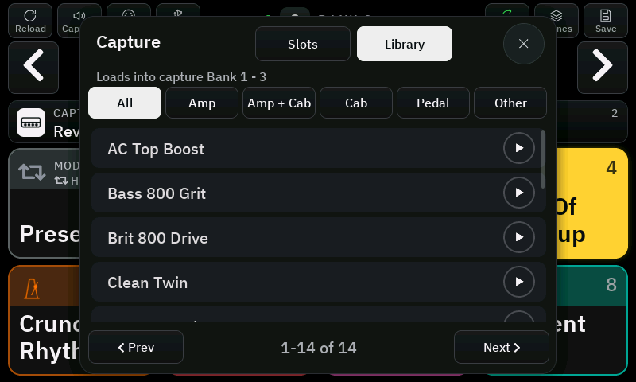 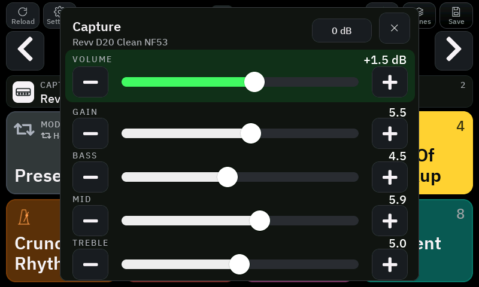

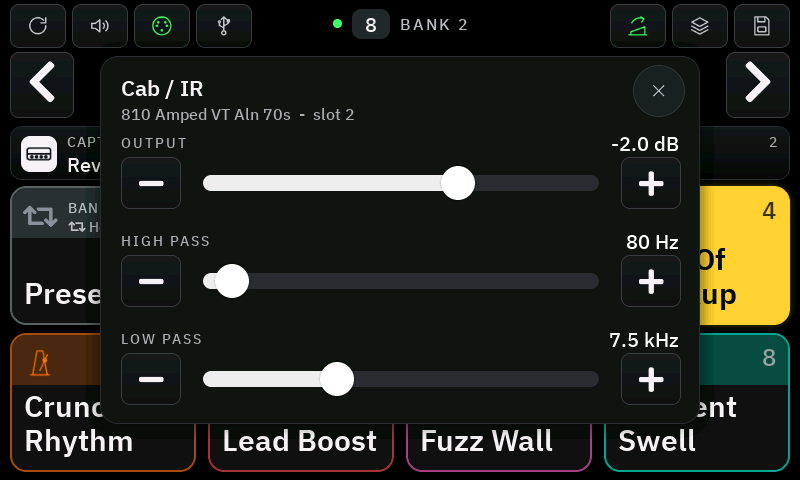 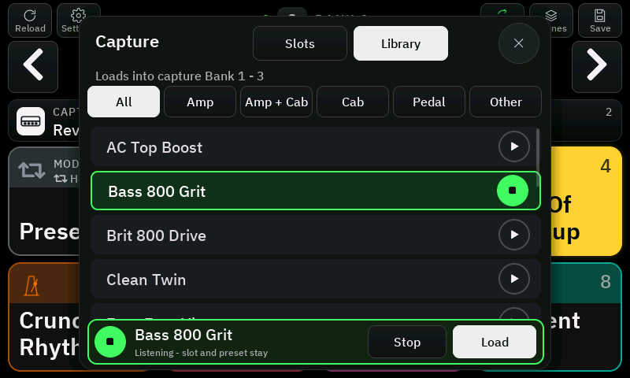

Auf das Feld CAPTURE oder CAB / IR tippen. **SLOTS** zeigt die 25 Capture-Slots (5 Bänke × 5) bzw. die 5 Cab-Slots,
**LIBRARY** alle auf dem Nano gespeicherten Captures bzw. IRs mit Kategorie-Filtern (AMP = Topteil oder Combo, AMP+CAB, CAB, PEDAL, OTHER).
Ein Library-Eintrag wird nach einer Rückfrage in den aktiven Slot geladen.

**Capture-Dialog**: lange auf das CAPTURE-Feld drücken – zuerst die **VOLUME** des Captures, −24 dB bis +12 dB
(**0 dB** setzt zurück), dann **GAIN**, **BASS**, **MID** und **TREBLE** des Captures, 0–10. **Vorhören**: der
Play-Knopf einer Library-Zeile spielt dieses Capture oder IR anstelle des Preset-eigenen, ohne es zu laden; die
Leiste unten hat **Stop** und **Load**, Schließen der Library beendet es. **Cab-Einstellungen**: lange auf das CAB / IR-Feld drücken – **OUTPUT** (−96 dB bis +12 dB),
**HIGH PASS** (20–800 Hz) und **LOW PASS** (1–20 kHz) des aktiven Cabs, beim Öffnen vom Nano gelesen.
Alles gehört zum Preset: Änderungen sind sofort zu hören, **SAVE** behält sie.

**Die Drehschalter des Nano**: Drehst du am Nano Fußschalter I (Capture-Slots) oder II (Cab-Slots), zeigt der
Controller, was er wählt – den Slot davor, den jetzigen (groß) und den danach, die Bank und *Back to* den Slot, bei dem
das Drehen begann. Zwei Sekunden nach dem letzten Schritt schließt die Anzeige.

## FX-Editor

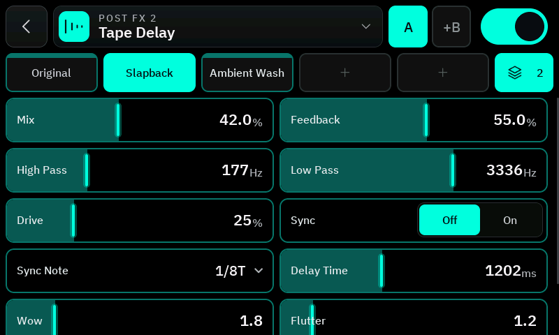 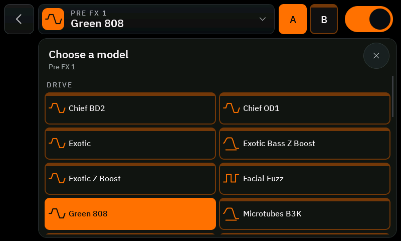

Der Kopf zeigt das Symbol des Effekts – in seiner Farbe gefüllt, wenn er an ist, nur umrandet, wenn er aus ist –
dazu Slot und Modell. Antippen öffnet die Modellauswahl, nach Art gruppiert (Drive, EQ & Utility, Wah & Filter …);
der große Schalter rechts schaltet den Effekt an oder aus.

Die Parameter sind Balken in zwei Spalten, bis zum Wert in der Effektfarbe gefüllt. **Seitlich wischen** auf einem
Balken ändert ihn: Er folgt dem Finger ab seinem aktuellen Wert, Antippen oder Scrollen lässt also keinen Wert
springen. Hoch und runter scrollt die Liste. Einstellungen mit zwei oder drei Möglichkeiten (*Off | On*, *Sync* …)
werden angetippt, längere Listen (*Sync Note* …) öffnen eine Auswahl.

Änderungen gehen schon beim Bewegen eines Reglers an den Nano. Der Nano meldet Parameterwerte nur von
eingeschalteten Effekten – einen Effekt also einschalten, um seine Werte zu sehen und zu ändern. **SAVE** im
Preset-Feld speichert das Preset auf dem Nano.

**FX-Presets** (die Leiste über den Reglern): *Original* und vier benannte Einstellungen pro Effektmodell,
gespeichert auf dem Controller und in jedem Preset und Slot mit diesem Modell nutzbar; leere Plätze zeigen **+**.

- **Halten** auf einem Platz: Die Tastatur öffnet sich, und die aktuellen Einstellungen werden unter dem
  eingegebenen Namen gespeichert. Ein leerer Name löscht den Platz.
- **Antippen** lädt die Einstellungen sofort.
- **Original** holt die Einstellungen zurück, die der Effekt beim Öffnen des Editors hatte. Direkt nach der Wahl
  eines neuen Modells sind das seine Grundeinstellungen.

Geladene Einstellungen zählen als Änderung am Nano-Preset: **SAVE** behält sie dort.

Der **Szenen-Knopf** am Ende der Leiste speichert die aktuellen Einstellungen für eine
[Szene](#einstellungen-eines-effekts-pro-szene) des Presets.

## Reverb-Schalter (Fußschalter 8)

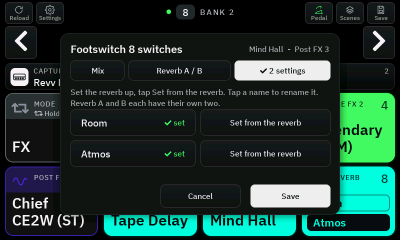 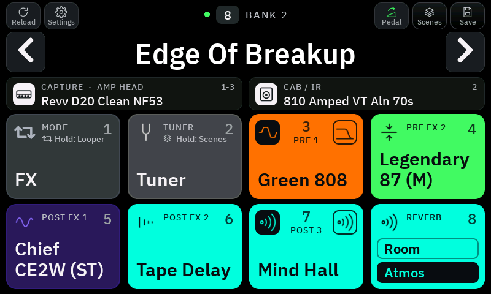
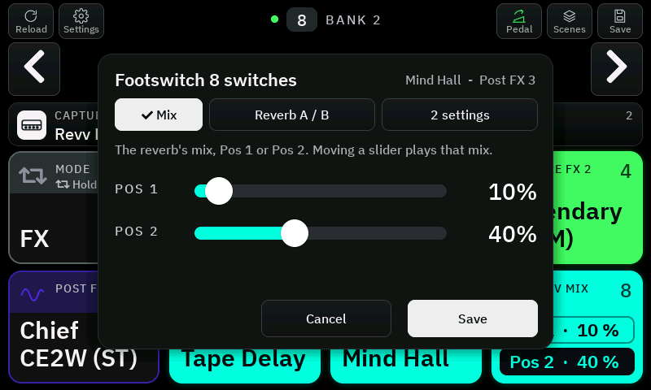 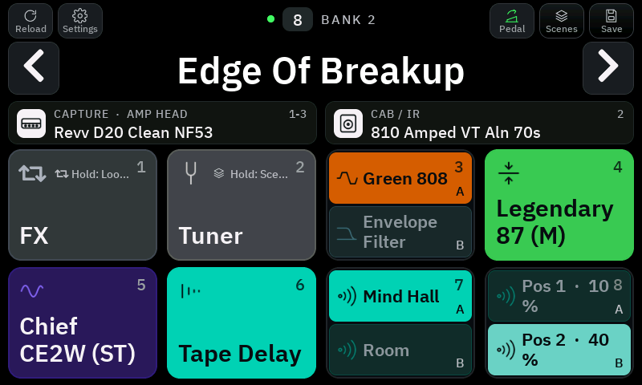

Das Fenster heißt **Footswitch 8 switches** und hat drei Reiter, einen für jede Funktion des Schalters. **Der
Reiter, der beim Tippen auf SAVE vorne ist, bestimmt, was der Schalter ab dann tut**; der gerade verwendete trägt
einen Haken. Kachel 8 zeigt die zwei Möglichkeiten des Schalters als zwei Zeilen – Pos 1 / Pos 2 mit ihrem Mix,
Reverb A / B oder die zwei Einstellungen –, die aktive gefüllt, die andere umrandet. So sieht sie nie aus wie die
Kachel des Reverbs selbst (Kachel 7).

- **MIX**: Fußschalter 8 setzt den Mix des Reverbs auf Pos 1 oder Pos 2. Beim Bewegen eines Reglers
  hörst du den Mix; **SAVE** speichert beide Werte auf dem Controller, für dieses Preset. Das Expression-Pedal des
  Nano ist daran nicht beteiligt und bleibt frei für ein Wah oder anderes.
- **Presets, die vor 1.8 eingerichtet wurden**, hatten Pos 1 und Pos 2 als Fersen- und Spitzenwert der
  Expression-Einstellung des Presets für das Reverb („Post FX 3 Amount“) auf dem Nano. Der Controller übernimmt sie,
  wenn er so ein Preset das erste Mal lädt. Die Einstellung selbst steht weiter im Preset des Nano, ein
  Expression-Pedal würde das Reverb also noch bewegen: **FREE PEDAL** in diesem Fenster nimmt sie aus dem Preset
  (die anderen Expression-Einstellungen bleiben, wie sie sind, der Schalter behält seine Positionen). Den Knopf gibt
  es nur, solange das Reverb auf dem Pedal liegt.
- **REVERB A / B**: Fußschalter 8 wechselt A und B des Reverbs – dieselben zwei, die seine eigene Kachel (Kachel 7)
  wechselt. Der Reiter zeigt beide; **Choose B in the reverb's editor** öffnet den FX-Editor des Reverbs bei seinem
  [zweiten Effekt](#zweiter-effekt-a-und-b-auf-einem-fx-slot): ein anderes Reverb oder dasselbe noch einmal für eine
  zweite komplette Einstellung davon (Mix, Decay, Damping …) ohne Aussetzer. B wird nur dort gewählt und eingestellt.
  Der Nano hat nur einen Reverb-Platz, für ein anderes Reverb tauscht der Controller deshalb das Modell aus und
  schickt die gespeicherten Werte (etwa eine halbe Sekunde). Wird das Preset gespeichert, während B läuft, wird B zum
  Reverb des Presets; ein Preset laden bringt immer sein eigenes Reverb (A) zurück.
  Auf dem Reiter *MIX* oder *2 SETTINGS* gespeichert, ist Fußschalter 8 der Mix-Schalter (oder wechselt die
  Einstellungen), und die Reverb-Kachel behält ihr A / B – der Reverb-Typ auf dem einen Schalter, die Menge auf dem
  anderen.
- **2 SETTINGS**: Fußschalter 8 wechselt zwischen zwei benannten Einstellungen des Reverbs im Preset – zum Beispiel
  *Room* und *Atmos* – mit allen Reglern (Mix, Decay, Damping …). Das Reverb bleibt dasselbe, es gibt also keinen
  Aussetzer. Einrichten: neben dem Namen der Einstellung auf eines der FX-Presets des Reverbs tippen (bis zu vier,
  die im FX-Editor des Reverbs gespeicherten). Seine Werte und sein Name werden in die Einstellung kopiert, sein
  Knopf ist gefüllt. Oder das Reverb so einstellen, wie es klingen soll (im FX-Editor von Kachel 7 oder am Nano), und
  auf **Now** tippen. Für die andere Einstellung genauso. Eine spätere Änderung am FX-Preset ändert die Einstellung
  nicht. Ein Tipp auf den Namen ändert ihn. **SAVE** braucht beide Einstellungen. Im Editor (über den Controller)
  bietet das Zahnrad von Fußschalter 8 dasselbe je Einstellung. Kachel 8 zeigt dann beide Einstellungen als ihre
  zwei Hälften: Die, die an ist, leuchtet, die andere ist gedimmt. Welche an ist, erkennt der Controller an den Werten des
  Reverbs, auch nach einem Presetwechsel; steht das Reverb auf keiner von beiden (von Hand verstellt oder das Preset
  mit anderen Werten gespeichert), ist keine Zeile gefüllt und der nächste Druck geht zur ersten Einstellung. Ein
  Druck schaltet das Reverb auch ein, falls es aus war.
  Die zwei Einstellungen speichert der Controller, pro Preset, und sie sind **etwas Eigenes**: Mit dem A und B der
  Reverb-Kachel selbst (Kachel 7) haben sie nichts zu tun – die behält ihren zweiten Effekt und ihr Tippen oder
  Halten wie bisher.
  **Jedes Reverb des Presets hat seine eigenen zwei Einstellungen**: das Reverb des Presets (A) und, falls die
  Reverb-Kachel ein zweites Reverb (B) hat, auch dieses. Auf der Reverb-Kachel zu B wechseln, dieses Fenster öffnen
  und seine zwei genauso einrichten – oben rechts steht, welches Reverb gerade im Slot ist. Ab dann wechselt
  Fußschalter 8 zwischen den zwei Einstellungen des Reverbs, das gerade an ist. Bei einem Reverb ohne eigene
  Einstellungen bleibt der Schalter bei Reverb A / B oder dem Mix, und die Kachel zeigt das.

## Zweiter Effekt: A und B auf einem FX-Slot

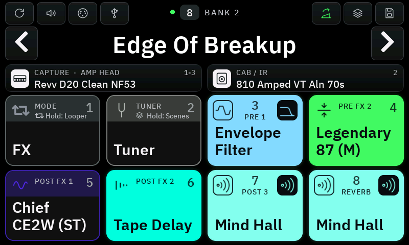 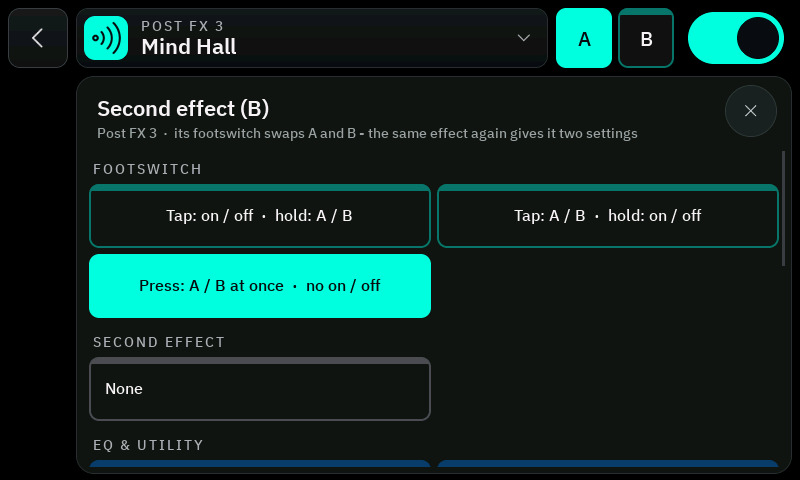

Jeder FX-Slot kann neben dem Effekt des Presets (A) einen zweiten Effekt (B) haben, und sein Fußschalter wechselt
zwischen beiden: ein Compressor und ein Drive auf Pre FX 1 – oder **derselbe Effekt zweimal mit anderen
Einstellungen**, zum Beispiel ein Reverb mit einer kurzen und einer langen Einstellung (Mix, Decay, Damping …
wechseln alle zusammen).

**Einrichten:** die FX-Kachel halten, um den FX-Editor zu öffnen, und **+B** neben dem Modell antippen. Den zweiten
Effekt aus der Liste wählen; *None* entfernt ihn. **A | B** im Kopf zeigt dann, welcher läuft: den anderen antippen
wechselt sofort, den laufenden antippen öffnet die Liste wieder. B wird im FX-Editor eingestellt, während es läuft.
Es wird auf dem Controller gespeichert, pro Preset; A bleibt der Effekt des Nano-Presets.

**Was der Fußschalter macht** (oben in derselben Liste, pro Slot):

| Wahl | Kurz drücken | Halten (0,6 s) |
|---|---|---|
| *Tap: on / off · hold: A / B* | Effekt an / aus | A ↔ B wechseln |
| *Tap: A / B · hold: on / off* | A ↔ B wechseln | Effekt an / aus |
| *Press: A / B at once · no on / off* | A ↔ B wechseln, sofort beim Treten | – |

Das zweite ist für einen Effekt gedacht, der anbleibt und nur seinen Klang ändert – ein Reverb, ein Delay. Bei den
ersten beiden schaltet der Schalter beim Loslassen (er hat eine Halte-Funktion); das dritte hat keine und schaltet
sofort – am schnellsten, wenn man den Effekt nie mit dem Fuß ausschaltet.

**Die Kachel** zeigt beide Symbole: A am linken Rand, B am rechten, das laufende gefüllt. Dazwischen stehen die
Nummer des Fußschalters und der Slot in Kurzform (*PRE 1*, *POST 3*). Die Kachel hat Farbe und Namen des Effekts,
der läuft; B desselben Effekts – eine zweite Einstellung davon – erscheint in einem helleren Ton dieser Farbe. Die
Kachel des Reverb-Schalters (Fußschalter 8) sieht genauso aus.

- **Zwei verschiedene Effekte:** Der Nano hat ein Modell pro Slot; der Controller tauscht also das Modell und schickt
  die gespeicherten Werte: etwa eine halbe Sekunde mit kurzem Aussetzer. Ohne Aussetzer geht es, wenn der zweite
  Effekt in einem freien Slot liegt und nur an- und ausgeschaltet wird.
- **Derselbe Effekt als A und B:** Es gehen nur die Werte raus – sofort, und der Ton reißt nicht ab.
- Die Werte von A werden direkt vor einem Wechsel vom Nano gelesen, Änderungen zählen also mit. War A seit dem
  Einrichten von B nie an, schaltet der erste Wechsel es kurz an, um sie zu lesen.
- Ein Preset laden – auch das, das gerade an ist – holt A zurück. Wer das Preset speichert, während B läuft, macht B
  zum Effekt des Presets.
- Den zweiten Effekt des Reverbs wechselt immer die Kachel des Reverbs selbst. Fußschalter 8 (der
  [Reverb-Schalter](#reverb-schalter-fußschalter-8)) wechselt ihn nur dann auch, wenn das Reverb-Fenster auf dem
  Reiter *REVERB A / B* gespeichert wurde; sonst bleibt er der Mix-Schalter oder wechselt die zwei Einstellungen.
  B auf der Reverb-Kachel einzurichten ändert Fußschalter 8 nicht. Wechselt die Kachel, während Fußschalter 8 der
  Mix-Schalter ist, bekommt das neue Reverb den Mix, den der Schalter zeigt (Pos 1 oder Pos 2).
- MIDI: **CC 61–65** wählen A (Wert 0–63) oder B (64–127) von FX-Slot 1–5; CC 58 wechselt Pre FX 1.

## Auto-Wah

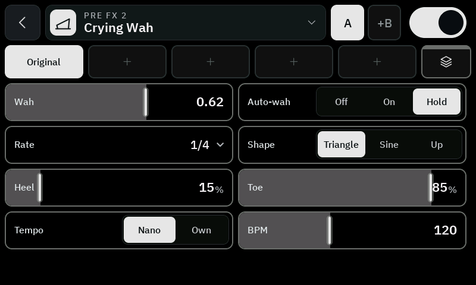

Die vier Wah-Modelle des Nano haben einen Regler, die Pedalstellung. Der Controller kann sie für dich bewegen, im
Tempo. Leg ein Wah auf Pre FX 1 oder 2 und halte seine Kachel, um den FX-Editor zu öffnen: Unter dem Balken des Wah
stehen die Einstellungen des Auto-Wah, gespeichert auf dem Controller für dieses Preset.

- **Auto-wah** – *Off*: ein gewöhnliches Wah. *On*: Das Wah bewegt sich immer, wenn es an ist – sein Fußschalter
  schaltet es wie gewohnt an und aus, Szenen ebenso. *Hold*: Im FX-Modus ist das Wah nur an und in Bewegung, solange
  du seinen Fußschalter hältst; es startet in dem Moment, in dem du drauftrittst. Ein Tipp auf die Kachel schaltet es
  weiterhin an und aus.
- **Rate** – eine Runde von Heel zu Toe und zurück pro 2 Takte, 1 Takt, 1/2, 1/4, 1/8 oder 1/16.
- **Shape** – *Triangle* (gleichmäßig auf und ab), *Sine* (an den Enden langsamer) oder *Up* (von Heel zu Toe, dann
  sofort zurück).
- **Heel** und **Toe** – die beiden Enden der Bewegung in Prozent des Pedalwegs. Heel über Toe dreht sie um.
- **Tempo** – *Nano*: das Tempo, das der Nano für das Preset meldet (das seine synchronisierten Delays nutzen).
  *Own*: die **BPM** daneben; wer den BPM-Balken bewegt, schaltet auf *Own*.

Die Kachel des Wah zeigt die Rate (*Auto: 1/4* oder *Hold: auto 1/4*), und der Balken des Wah im FX-Editor bewegt sich
mit. Der Controller schickt etwa 40 Stellungen pro Sekunde per Bluetooth: Langsame Raten sind weich, bei 1/16 kann
man Stufen hören. Bei offenem Stimmgerät bewegt sich nichts. Auf einem Slot mit zweitem Effekt behält der
Fußschalter, was er mit A und B macht – ein Wah auf *Hold* bewegt sich dort, solange es an ist. Die Bewegung verändert die
Stellung des Wah im Preset des Nano, das Preset zeigt deshalb ungespeicherte Änderungen; das schadet nicht.

## Stimmgerät

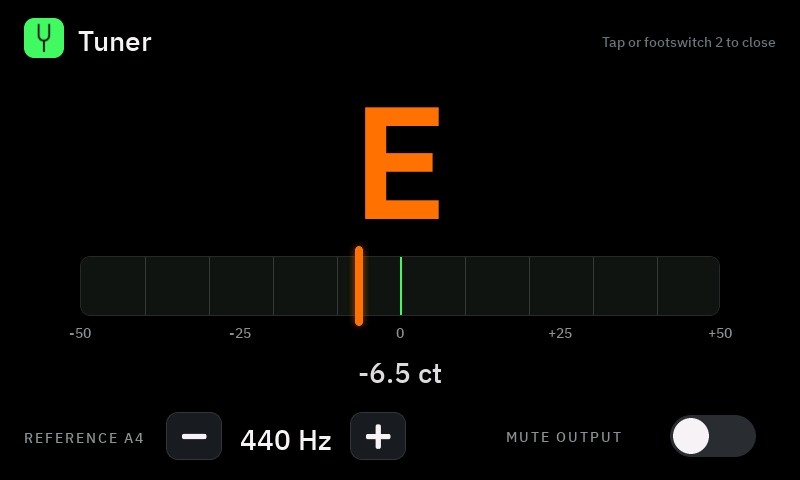

Fußschalter 2 oder die Kachel TUNER. Sieht aus wie der Tuner im Desktop-Editor: große Note in der Stimmfarbe (grün =
gestimmt, orange = daneben), eine Skala mit einem Strich alle 10 Cent und eine leuchtende Nadel, dazu die Abweichung
in Cent. Unten stellt **Reference A4** den Kammerton ein (400–480 Hz, − / + gedrückt halten läuft durch), und
**Mute output** schaltet den Nano beim Stimmen stumm. Bildschirm antippen oder Fußschalter 2 erneut drücken zum Schließen.

## Einstellungen

**Settings** in der oberen Leiste: eine Seite mit den Themen links – **Nano** (Verbindung, NanOS-Version, alles neu
lesen), **MIDI**, **USB audio**, **Tile layout**, **Footswitches** (ihre Reihenfolge lernen) und **System** – und dem
gewählten rechts. Der Pfeil oben links führt zurück zum Spielen.

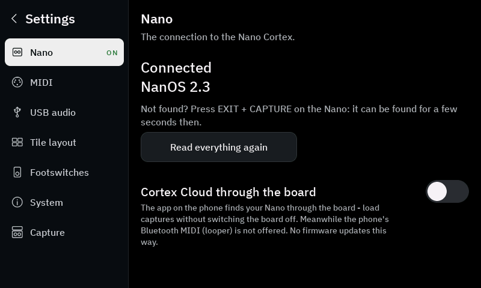

## USB-Audio-Lautstärke

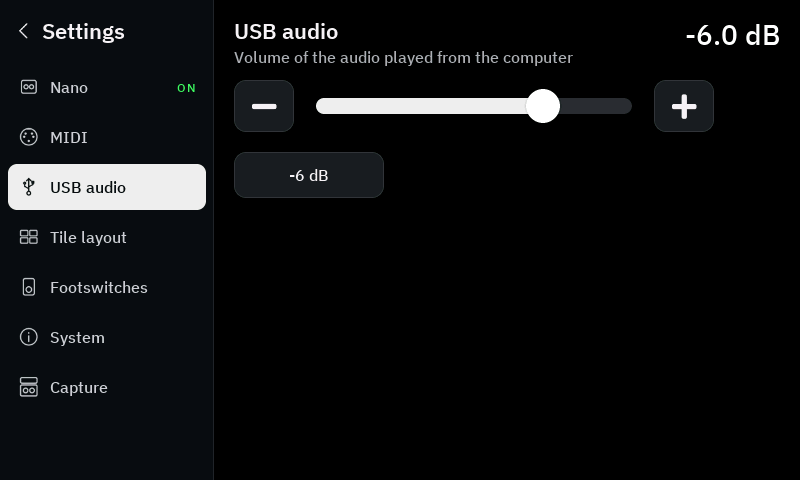

**USB audio** in den Einstellungen: Lautstärke des Audios, das der Computer über USB abspielt, −40 dB (OFF) bis 0 dB,
wie in der offiziellen App. Der Wert wird jedes Mal frisch vom Nano gelesen.

## Bluetooth-MIDI

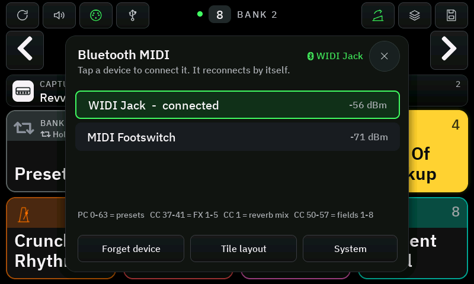

**MIDI** in den Einstellungen zeigt die Geräteliste. Sie zeigt Bluetooth-MIDI-Geräte in der Nähe – zum Beispiel einen
CME-WIDI-Adapter an der MIDI-Buchse eines Morningstar MC6 oder einen
Bluetooth-MIDI-Fußschalter. Antippen verbindet; der Controller merkt sich das Gerät und verbindet sich wieder von
selbst, sobald es eingeschaltet ist. **FORGET DEVICE** trennt und vergisst es. Der Nano bleibt dabei verbunden.

Der Controller versteht dieselben Befehle wie der Nano selbst über USB-MIDI, auf allen MIDI-Kanälen. Bänke für den
Nano (zum Beispiel aus dem MC6-Export des Nano Cortex Editors) funktionieren also auch über Bluetooth:

| Befehl | Wirkung |
|---|---|
| Program Change 0–63 | Preset 1–64 |
| CC 37–41 | FX-Slot 1–5 (Pre FX 1, Pre FX 2, Post FX 1–3): Wert 64–127 an, 0–63 aus |
| CC 1 | Expression: Reverb-Mix von Pos 1 (0) bis Pos 2 (127) |
| CC 50–57, Wert 64–127 | Feld 1–8 der [Kachel-Anordnung](#kachel-anordnung-6-oder-8-felder) drücken (Modus, Stimmgerät, Presets oder FX, Reverb-Schalter) |
| CC 58, Wert 64–127 | Pre FX 1 wechselt zum [zweiten Effekt](#zweiter-effekt-a-und-b-auf-einem-fx-slot) und zurück |
| CC 66 / CC 67, Wert 64–127 | [Setlist](#setlist): nächster / voriger Song |
| CC 68 | Setlist: Wert 64–127 an, 0–63 aus |
| CC 61–65 | [zweiter Effekt](#zweiter-effekt-a-und-b-auf-einem-fx-slot) von FX-Slot 1–5: Wert 64–127 B, 0–63 A |
| CC 59 | Looper-Modus: Wert 64–127 an, 0–63 aus |
| CC 60 | Fußschalter 3–8: Wert 64–127 [Szenen](#szenen) des Presets, 0–63 Presets der Bank |

**M-VAVE Chocolate** (Cuvave): Er erscheint in der Liste als „FootCtrl (Chocolate)“ und hat eine eigene
Belegung. Ab Werk sind A–D die Fußschalter 1–4 des Controllers (Modus, Stimmgerät, Schalter 3 und 4); C+D zusammen
blättert am Chocolate weiter, dann sind A–D die Fußschalter 5–8, A+B wieder zurück. Der Chocolate hat kein Display –
nach einem Wechsel der Gruppe also merken, wo man ist. Im CC-Modus des Chocolate (in der App Cubesuit eingestellt)
gilt dasselbe: A+B wählt die Fußschalter 1–4, C+D die Fußschalter 5–8.

Ein MIDI-Kabeleingang ist auf diesem Board ohne zusätzliche Hardware nicht möglich; dafür einen
Bluetooth-MIDI-Adapter verwenden.

## Looper-Modus (eine Looper-App auf dem Telefon)

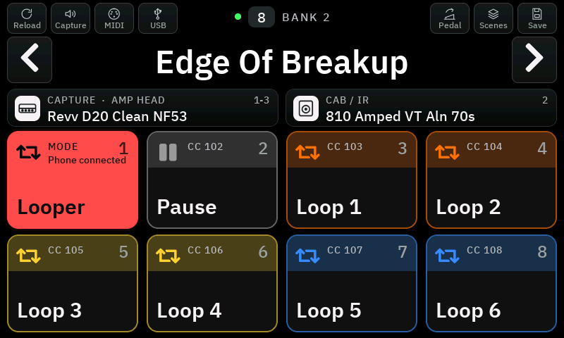 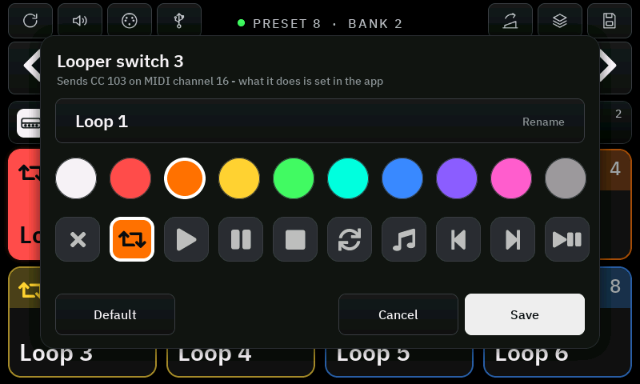

Der Controller kann der Fußcontroller einer Looper-App sein, zum Beispiel **Loopy Pro** auf iPhone oder iPad. Das
Telefon spielt über den Nano: Am USB-C-Anschluss ist der Nano das Audio-Interface des Telefons – die Gitarre geht
in die App, Loops (und Backing Tracks) kommen aus dem Nano. Ihre Lautstärke ist die *USB-Audio-Lautstärke* (siehe
oben). Die Fußschalter erreichen die App per **Bluetooth-MIDI**: Der Controller ist ein Bluetooth-MIDI-Gerät mit
dem Namen **„Nano Cortex Controller“**.

1. In Loopy Pro im Hauptmenü **Bluetooth Devices** öffnen und *Nano Cortex Controller* wählen. Der Controller zeigt
   *Phone connected* und wie oft MIDI ausgetauscht wird (auf einem iPhone alle 11,25 oder 15 ms).
2. **Fußschalter 1 halten** (0,6 s) oder lange auf Kachel 1 drücken: Die Kacheln werden zu den Schaltern des
   Loopers. Jeder Tritt auf Fußschalter 1 verlässt den Modus wieder; FX und Presets bleiben, wie sie waren.
3. In Loopy Pro **MIDI Learn** wählen, antippen, was ein Schalter tun soll (für einen Loop: *Abspielen/Stoppen*
   mit *Aufnahme, wenn leer*), und diesen Fußschalter treten. Jeden Schalter nur einmal belegen: Zwei Belegungen auf
   demselben Loop heben sich gegenseitig auf.

| Fußschalter | Sendet (MIDI-Kanal 16) | Kachel (ab Werk) |
|---|---|---|
| 2 | CC 102 | Pause |
| 3–8 | CC 103–108 | Loop 1–6 |

**Eigene Namen**: Langes Drücken auf eine Kachel im Looper-Modus öffnet ihr Fenster – Name (Tastatur), Farbe und
Symbol, gespeichert auf dem Controller; *Default* stellt die oben gezeigte Kachel wieder her. Die Symbole: Loop,
Play, Pause, Stop, Undo und eine Note, dazu für einen Player – etwa die Jamtracks des Nano Cortex Editor – Zurück,
Weiter und Play/Pause. Kachel 1 zeigt, was der
letzte Tritt gesendet hat (*Sent CC 103*) – hilfreich beim Belegen eines Schalters in der App.

Ab Werk zeigen die Kacheln die Loops in drei Farbpaaren, wie ein zweispaltiges Loopy-Pro-Projekt. Was ein Schalter
tut, bestimmt die App.

Ein Fußschalter sendet beim Treten den Wert 127 und beim Loslassen 0; so funktionieren die Auslöser *Hold*
und *Double Tap* der App. Antippen einer Kachel sendet einen kurzen Tritt. Im Looper-Modus geht ein Tritt 2–4 ms nach
dem Schließen des Kontakts hinaus; über Bluetooth wartet er dann auf den nächsten Austausch mit dem Telefon –
höchstens das beim Verbinden angezeigte Intervall. Bei Loops, die auf dem Takt beginnen und enden (Quantisierung der
App), spielt das keine Rolle; ein frei aufgenommener erster Loop kann um so viel länger oder kürzer werden.

Telefon und Nano Cortex Editor können gleichzeitig verbunden sein. Was die App zurückschickt (Rückmeldung für die
Lämpchen eines Controllers), steht vorerst im seriellen Protokoll.

Ist *Cortex Cloud through the board* eingeschaltet ([Einstellungen](#einstellungen), Seite *Nano*), bietet sich der Controller der
Cortex-Cloud-App und dem Telefon abwechselnd an, je zwei Sekunden: Beides passt nicht in eine Bluetooth-Anzeige. Das
Telefon findet ihn trotzdem, höchstens zwei Sekunden später.

## Nano Cortex Editor über den Controller

Der Nano erlaubt nur eine Bluetooth-Verbindung. Ist der Controller mit dem Nano verbunden, bietet er sich selbst als
**„Nano Cortex Controller“** mit demselben Bluetooth-Dienst wie der Nano an. Der
[Nano Cortex Editor](https://github.com/DrD85/nano-cortex-editor) verbindet sich dann mit dem Controller:
**App ↔ Controller ↔ Nano**. Die Mac-App wählt ihn automatisch; im Browser „Nano Cortex Controller“ auswählen.
Ohne Controller (oder bevor er verbunden ist) verbindet sich die App wie bisher direkt mit dem Nano.

- Alles, was die App schickt, geht an den Nano weiter; Antworten auf Anfragen der App gehen an die App, Antworten
  auf Anfragen des Controllers bleiben im Controller, Meldungen, die der Nano von sich aus schickt, gehen an beide.
- Änderungen in der App erscheinen kurz danach am Controller; Änderungen am Controller (Fußschalter, Touch, MIDI)
  lassen die App das Preset neu lesen, wie nach einem Wechsel am Pedal.
- Solange die App verbunden ist, steht **APP** in der Statuszeile.
- **Fußschalter für den Editor:** Im Looper-Modus (Fußschalter 1 halten) geht jeder Tritt auf Fußschalter 2–8 auch an
  den verbundenen Editor. Er nimmt sie als die Controller, die der Looper-Modus sendet (102–108 auf Kanal 16) –
  ab Werk startet und pausiert Fußschalter 2 seinen Jamtrack-Player, 7 geht zum vorigen Track und 8 zum nächsten;
  mit MIDI Learn im Editor legst du sie auf etwas anderes. Ein Telefon braucht es dafür nicht.

## Cortex Cloud über den Controller

*Settings › Nano › Cortex Cloud through the board* (ab Werk aus) lässt die **Cortex-Cloud-App** auf dem Telefon den
Nano über den Controller nutzen, während der Controller verbunden bleibt: Der Controller zeigt sich dann mit der
Kennung des Nano, und die App hält ihn für den Nano. Alles, was die App tut, geht an den Nano weiter – Einstellungen,
Presets und das Laden von Captures und IRs aus der Cloud in die Bibliothek des Nano. Schließe die App (oder schalte
die Einstellung aus), wenn du fertig bist; die Fußschalter des Controllers arbeiten die ganze Zeit. Mit der
Einstellung bietet sich der Controller der Cortex-Cloud-App und dem Bluetooth-MIDI eines Telefons (dem Looper)
abwechselnd an.

## Kachel-Anordnung: 6 oder 8 Felder

**Tile layout** in den Einstellungen, **Change the layout**. **6 fields** (2 × 3, größere Kacheln) oder **8 fields**
wählen, dann zwei Felder antippen, um sie zu tauschen – etwa das Stimmgerät an eine andere Stelle oder Post FX 3 und
den Reverb-Schalter aus den sechs heraus. **Save** speichert die Anordnung auf dem Controller, **Default** stellt 8
Felder in der gewohnten Reihenfolge wieder her, und Fußschalter 1 wechselt wieder zwischen FX und Presets.

Feld *n* drücken Fußschalter *n*, MIDI **CC 49 + n** (CC 50–55 bei 6 Feldern) und Schalter *n* des Chocolate; die
kleine Zahl in der Kachelecke ist ihr Feld. Ein Schalter, der nicht auf dem Bildschirm ist, tut über die Fußschalter
und CC 50–57 nichts (CC 37–41 schalten die Effekte weiterhin). Bei 6 Feldern sind die Fußschalter 7 und 8 frei.

**Wozwischen Fußschalter 1 wechselt** – der Knopf zwischen *Default* und *Save* (jedes Antippen nimmt die nächste
Wahl, *Save* behält sie):

| Wahl | Fußschalter 1 |
|---|---|
| *Switch 1: FX / presets* | FX-Modus ↔ die Presets der Bank oder die Szenen, je nachdem, was zuletzt gewählt war (wie bisher) |
| *Switch 1: FX / scenes* | FX-Modus ↔ die Szenen des Presets |
| *Switch 1: presets / scenes* | die Presets der Bank ↔ die Szenen; der FX-Modus wird nicht benutzt |
| *Switch 1: presets, scenes, FX* | alle drei der Reihe nach: Presets → Szenen → FX → Presets |

Fußschalter 1 gehalten öffnet weiter den Looper-Modus, Fußschalter 2 gehalten wechselt weiter zwischen Szenen und
Presets.

## Fußschalter-Learn

Lange auf die Stimmgerät-Kachel drücken (ihr Fußschalter; **Switch 1** im Fenster lernt stattdessen Fußschalter 1) oder **LEARN SWITCH**
im Bank-Fenster. Dann innerhalb von 15 Sekunden den
Fußschalter drücken, der diese Funktion bekommen soll. Hatte er eine andere Funktion, werden die beiden getauscht.
**DEFAULT ORDER** stellt die Standard-Reihenfolge wieder her.

## Fußschalter

Die Fußschalter liest ein **SX1509**-I/O-Expander (zum Beispiel die SparkFun-Platine), wie beim
[TonexOneController](https://github.com/Builty/TonexOneController).

- Den SX1509 an den **I2C**-Bus des Boards anschließen: SDA = GPIO 8, SCL = GPIO 9, 3,3 V und GND
  (den passenden Stecker deines Boards zeigt das Waveshare-Wiki).
- Die Adresse des SX1509 auf **0x71** (oder 0x70) stellen. 0x3E/0x3F belegt der I/O-Expander des Boards selbst.
- Jeden Fußschalter (Taster, Schließer) zwischen einen I/O-Pin des SX1509 und **GND** legen. Die internen
  Pull-ups werden genutzt, Widerstände sind nicht nötig.
- Standard-Reihenfolge: Schalter 1–8 an den SX1509-Pins **11, 10, 0, 1, 2, 3, 8, 9**. Andere Pins gehen auch –
  einfach per Fußschalter-Learn zuordnen.

Ohne SX1509 funktioniert der Controller nur mit dem Touchscreen.

## System: Speicher, Sicherung und Selbst-Neustart

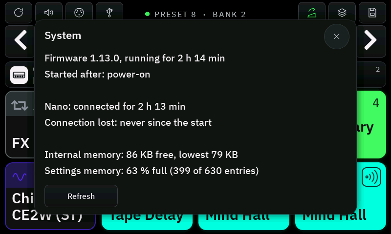

**System** im Bluetooth-MIDI-Fenster zeigt, ob alles in Ordnung ist: wie lange der Controller läuft und warum er
gestartet ist, wie lange der Nano verbunden ist und wie oft (und warum) die Verbindung abgerissen ist, den freien
internen Speicher und wie voll der Einstellungsspeicher ist.

- **Einstellungsspeicher.** Alles, was der Controller behält – Bänke, Szenen, zweite Effekte, die Setlist – liegt in
  einem kleinen Speicher. Ab 85 % meldet der Controller das nach dem Start. Szenen mit Einstellungen brauchen am
  meisten.
- **Sicherung.** Den [Nano Cortex Editor](https://github.com/DrD85/nano-cortex-editor) (ab 1.13) über den
  Controller verbinden: Im **…**-Menü stehen *Back up controller settings…* (eine Datei mit allen Einträgen) und
  *Restore controller settings…* (schreibt eine solche Datei zurück; sie ersetzt, was der Controller gespeichert hat,
  und der Controller startet neu).
- **Wenn der Speicher selbst beschädigt ist.** Findet der Controller seinen Einstellungsspeicher beim Start
  unbrauchbar, muss er ihn leeren – und kopiert ihn vorher, so wie er ist, in einen Teil des Flash-Speichers, den
  sonst nichts benutzt. Ein Computer liest diese Kopie mit `esptool read-flash 0xF00000 0x6000 store.bin` und
  schreibt sie mit `esptool write-flash 0x9000 store.bin` zurück. Der Controller meldet das nach so einem Start.
- Was eine frühere Firmware auf demselben Board im Speicher hinterlassen hat (WLAN-Einstellungen und Ähnliches), wird
  einmalig entfernt: Auf einem Board, auf dem vorher eine andere Controller-Firmware lief, macht das etwa ein Fünftel
  des Speichers frei.
- Ab 1.15 brauchen zweite Effekte und Mix-Positionen weniger Platz. Was eine frühere Version gespeichert hat, wird
  beim Start einmalig umgeschrieben (vorher wird eine Kopie des Speichers aufbewahrt, wie oben); auf einem Board im
  Einsatz machte das ein weiteres Viertel frei.
- **Ein Preset, das der Nano nicht lädt.** Der Nano kann einen Presetwechsel verweigern: Er zeigt dann die neue
  Nummer und den neuen Namen, spielt aber weiter das Preset davor. Der Controller fragt ein zweites Mal; verweigert
  der Nano wieder, meldet er das, in der Statuszeile steht orange **NOT LOADED**, und nichts, was der Controller für
  dieses Preset gespeichert hat (zweite Effekte, Reverb-Einstellungen, Mix-Positionen), wird benutzt oder
  gespeichert, bis ein Presetwechsel wieder klappt. Das trat einmal auf, in einem langen Testlauf; was den Nano in
  diesen Zustand bringt, ist noch nicht bekannt.
- **Selbst-Neustart.** Sollte der Controller einmal hängen, startet er nach 8 Sekunden von selbst neu und ist ein
  paar Sekunden später wieder verbunden; nach so einem Start meldet er das, und die System-Seite nennt den Grund.
- Nach einem Verbindungsabriss ist der Controller wieder da, sobald der Nano es ist: Er liest sofort das aktuelle
  Preset und die Preset-Namen später, in einem ruhigen Moment.
- **Wenn der Nano nicht gefunden wird.** Der Nano ist per Bluetooth nur ein paar Sekunden lang zu finden, nachdem er
  eingeschaltet wurde oder seine Verbindung verloren hat. Kommt der Controller später – er war aus oder wurde
  aktualisiert –, den Nano in den Pairing-Modus bringen: **EXIT + CAPTURE** am Nano. Der Controller sagt das nach
  sieben Sekunden auf seinem Suchbildschirm und mit einer Meldung, wenn der Nano nach einem Verbindungsabriss nicht
  wiederkommt.

## Was wo gespeichert ist

| Auf dem Nano | Auf dem Controller |
|---|---|
| Presets, Namen, Captures, Cabs, FX und ihre Werte, Expression-Einstellungen, USB-Lautstärke | eigene Bänke (Preset, Farbe, Symbol), Szenen, Reverb-Mix Pos 1 / Pos 2, Fußschalter-Reihenfolge, Kachel-Anordnung, zweite Effekte (B) der FX-Slots, Auto-Wah-Einstellungen, die Setlist, die Captures der Szenen, das Bluetooth-MIDI-Gerät |
