# Nano Cortex Controller – manual

Every function in detail. The short illustrated guide is in the [README](../README.md); building the firmware and how it talks to the Nano are in [development.md](development.md).

**Contents:** [The screen](#the-screen) · [Footswitches and tiles](#footswitches-and-tiles) · [Long presses](#long-presses) · [Own banks](#own-banks) · [Set list](#set-list) · [Scenes](#scenes) · [Expression pedal](#expression-pedal) · [Capture and Cab/IR](#capture-and-cabir) · [FX editor](#fx-editor) · [Reverb switch](#reverb-switch-footswitch-8) · [Second effect (A / B)](#second-effect-a-and-b-on-an-fx-slot) · [Auto-wah](#auto-wah) · [Tuner](#tuner) · [USB audio volume](#usb-audio-volume) · [Bluetooth MIDI](#bluetooth-midi) · [Looper mode](#looper-mode-a-looper-app-on-a-phone) · [Editor through the controller](#nano-cortex-editor-through-the-controller) · [Footswitch learn](#footswitch-learn) · [Footswitches (wiring)](#footswitches) · [System](#system-memory-backup-and-self-restart) · [What is stored where](#what-is-stored-where)

## The screen

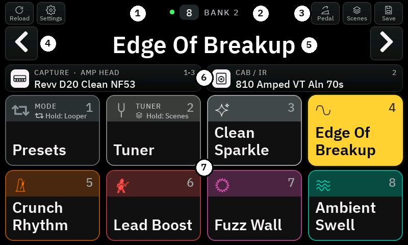

- **Tap a tile** = press its footswitch. A tile lights up briefly when its footswitch is pressed.
- **Tiles as in the desktop editor's signal chain**: an active preset or an effect that is on is **filled** in its
  colour; everything else is dark with a **coloured border** and its top row on the dimmed colour – the difference
  shows from across the stage. All
  names use one size.
- **↻** (top left) reads everything from the Nano again: preset names, the current preset and the library.
- The **speaker** symbol next to it sets the capture volume of the current preset; **MIDI** and **USB** follow.
- **Swipe left / right**: next / previous preset.
- **Swipe up – gig view**: the tiles fill the screen with larger names, and a slim bar on top shows the
  connection, preset number, bank, preset name, unsaved changes and the mode (PRESETS / SCENES / FX). **Swipe down**: back.
- **Pedal view**: **PEDALS** in the gig view's bar shows the five FX slots as pedals on a shelf whenever the
  controller is in FX mode – in signal order, with the amp's place marked between Pre FX 2 and Post FX 1. Under each
  pedal are its light, its name and its footswitch, filled in the effect's colour while it is on; a pedal that is
  off stands in the dark. A tap switches the effect, a long press opens its FX editor, as on a tile. Tap **PEDALS**
  again for the tiles. Footswitches 1, 2 and 8 work as always, they just have no field in this view.

  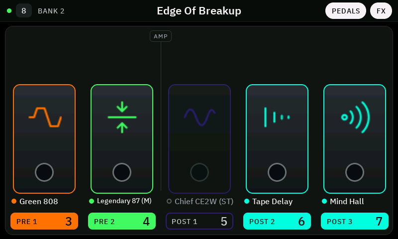

  The published firmware draws every pedal: its colour and symbol. An own build can show pictures instead – see
  `tools/gen_pedalboard.py`: they are written to a part of the flash memory the firmware does not use and drawn
  from there as they are, so they cost neither memory nor time.
- On the right of the top bar: the **pedal** button for the [expression pedal](#expression-pedal), the **scenes**
  button (layers) and **Save**. The scenes button puts the [scenes](#scenes) of the current preset on tiles 3–8
  instead of the bank's presets; tap it again to go back. In the gig view a tap on the mode at the top right does
  the same.
- The green dot shows the Bluetooth connection to the Nano; **Save** turns green and an orange dot appears next to
  the name when the preset has unsaved changes. **MIDI** turns green while a Bluetooth MIDI controller is connected.
- The **capture card** shows the capture's type (amp head, combo, amp + cab, cab, pedal …) as in the editor.

## Footswitches and tiles

| Switch | Preset mode | FX mode |
|---|---|---|
| 1 | switch to FX mode; **held: looper mode** | switch to preset mode; **held: looper mode** |
| 2 | tuner on/off; **held: scenes ↔ presets** | tuner on/off; **held: to the scenes** |
| 3–8 | the six presets of the current bank | 3–7: Pre FX 1, Pre FX 2, Post FX 1–3 on/off |
| 8 | (sixth preset) | reverb: mix Pos 1 ↔ Pos 2, or reverb A ↔ B |

With scenes chosen (the layers button, or footswitch 2 held), switches 3–8 are the six [scenes](#scenes) of the current
preset instead of the bank's presets, and footswitch 1 changes between FX mode and the scenes.

Active tiles light up in full colour, inactive ones are dimmed. FX tiles use the effect category colours.
The numbers here are the switches' functions; where they sit is up to the [tile layout](#tile-layout-6-or-8-fields).
Footswitches 1 and 2 act when you lift your foot (they have a held function). Holding footswitch 1 for 0.6 s opens
the [looper mode](#looper-mode-a-looper-app-on-a-phone); holding footswitch 2 changes between the scenes and the
bank's presets, as the scenes button does (while the tuner is open, footswitch 2 closes it at once). Tiles 1 and 2
say so under their caption: *Hold: Looper* and *Hold: Scenes* (or *Presets*).

## Long presses

| Where | What opens |
|---|---|
| Tile 1 | **Looper mode** on / off (as holding footswitch 1) |
| Tile 2–8 in looper mode | **Looper tile**: name, colour and symbol of this switch |
| Tile 2 | **Learn** for footswitch 2 – and, with *Switch 1* in that dialog, for footswitch 1 |
| Preset tile (3–8, preset mode) | **Bank editor**: colour, symbol and preset of this switch; `DEFAULT` restores the standard preset; `LEARN SWITCH` |
| Scene tile (3–8, scenes) | **Scene**: name, colour and which effects are on; `Remove` empties the switch |
| FX tile (3–7, FX mode) | **FX editor**: model (tap the header), on/off, all parameters and the [second effect](#second-effect-a-and-b-on-an-fx-slot) (A \| B) |
| Tile 8 (FX mode) | **Reverb dialog** with the tabs *MIX*, *REVERB A / B* and *2 SETTINGS* |
| Preset name | **Rename** with on-screen keyboard (at least 4 characters, unique) |

## Own banks

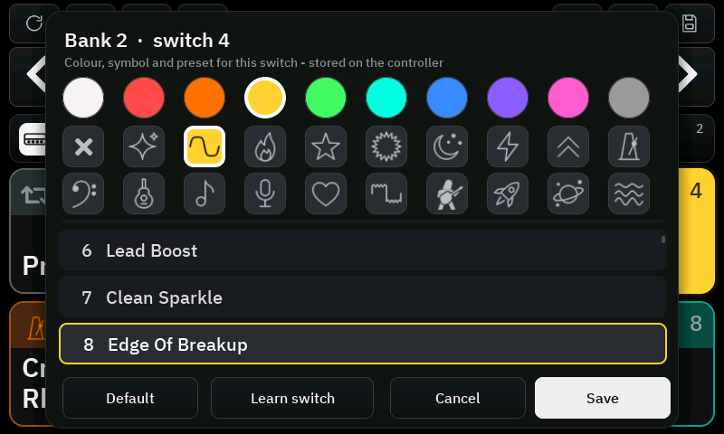

16 banks with six switches each. By default bank 1 holds presets 1–6, bank 2 presets 7–12 and so on.
A long press on a preset tile lets you choose any preset, one of ten colours and one of 19 symbols
(Clean, Edge, Drive, Solo, Fuzz, Atmospheric, Metal, Boost, Rhythm, Bass, Acoustic, Blues, Live, Favorite,
Fuzz Wave, Guitarist, Rocket, Space, Swell).
The banks are stored on the controller, the presets themselves stay on the Nano.

## Set list

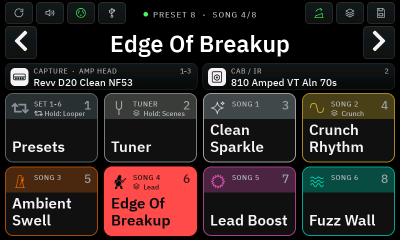 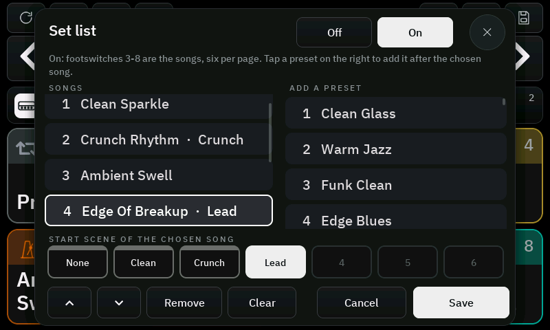

The songs of a gig in their order – up to 36, the same preset may come more than once. **Tap the line at the top**
(the preset number and *BANK 2*) to open the set list:

- **Tap a preset on the right** to add it as a song after the chosen one (or at the end).
- **Tap a song on the left** to choose it, then move it up or down with the arrows or **Remove** it. **Clear**
  empties the list.
- **Start scene** (the row below the lists): the chosen song can start with one of its preset's
  [scenes](#scenes) – choosing the song loads the preset and then switches to that scene. So the same preset can be
  in the set list twice, for example once as *Clean* and once as *Lead*. *None* starts with the preset as saved;
  scenes that are not set up yet are grey. The song's tile names the scene under its caption.
- **On / Off** at the top: while the set list is on, footswitches 3–8 in preset mode are its songs instead of the
  bank's presets. **Save** stores the list and the choice on the controller.

While it is on:

- Tiles 3–8 show six songs (*SONG 1* … *SONG 6*) in the colour and with the symbol their preset has in the banks;
  tile 1 says which songs are on the page (*SET 1-6*), the top line which song is on (*SONG 4/8*).
- **Choosing the sixth song of a page turns to the next page**, so the footswitches alone get through the whole set:
  3, 4, 5, 6, 7, 8 – and footswitch 3 is the next song.
- The **arrow buttons** turn the pages, a **swipe** goes to the previous or next song.
- A long press on a song tile opens the set list with that song chosen.
- Scenes and FX mode work as before; footswitch 1 and the scenes button go back to the set list's page.
- MIDI: **CC 66** next song, **CC 67** previous song (value 64–127), **CC 68** set list on (64–127) / off.

## Scenes

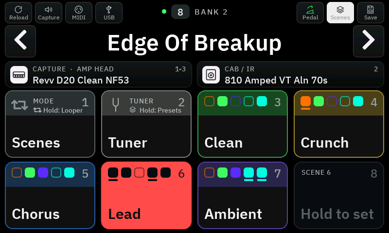 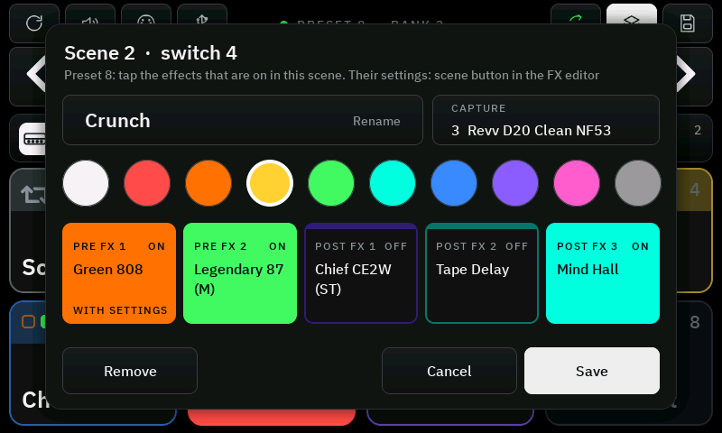

A scene is a setting of the effects **inside one preset**: which of the five FX slots are on and, if you like, how
they are set. Every preset can have six scenes, on footswitches 3–8. A scene's switch sends only what differs, so
several effects change with one press and the sound does not drop out as it does when the Nano loads another preset
– for example *Clean*, *Crunch* and *Lead* within one song.

- The **scenes button** (layers, next to Save) shows the scenes of the current preset on tiles 3–8; tap it again for the presets of the
  bank. **Holding footswitch 2** does the same with your foot. The controller remembers the choice. Footswitch 1
  changes between FX mode and whichever of the two is chosen.
- **Set a scene up**: hold its tile. Give it a name (15 characters) and a colour and tap the effects that are on in
  this scene – filled = on, framed = off. An empty scene starts from what is on right now, so you can also set the
  effects in FX mode first. **Save** stores the scene and switches to it, **Remove** empties the switch.
- **Capture** (next to the name): the capture slot the scene loads – for example a lead amp for the solo scene.
  *As it is* leaves the capture alone (as a scene without settings leaves an effect alone). Loading a capture takes
  the Nano a moment, so a scene with one does not change without a gap.

  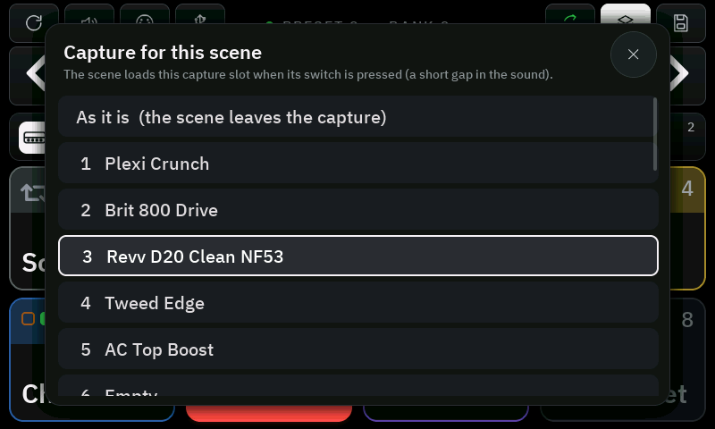
- **On a tile** five squares stand for Pre FX 1–2 and Post FX 1–3 in the colours of their effects: filled = the
  scene switches the effect on, outlined = off, a dot = the slot is empty.
- **Lit** is the scene whose effects are on right now. Switch an effect by hand (FX mode, the Nano's own switches,
  the editor) and no scene is lit until you press one again.
- A scene switches whatever effect sits in a slot; it does not change models. Empty slots are skipped.
- Switching a scene marks the preset as changed (orange dot), as any effect switched by hand does; nothing has to
  be saved. What is on right after a preset is loaded is decided by the preset as saved on the Nano – save it in the
  state of the scene you want to start with.
- Scenes are stored on the controller, per preset number. Over Bluetooth MIDI, CC 60 chooses scenes or presets.

### Settings of an effect per scene

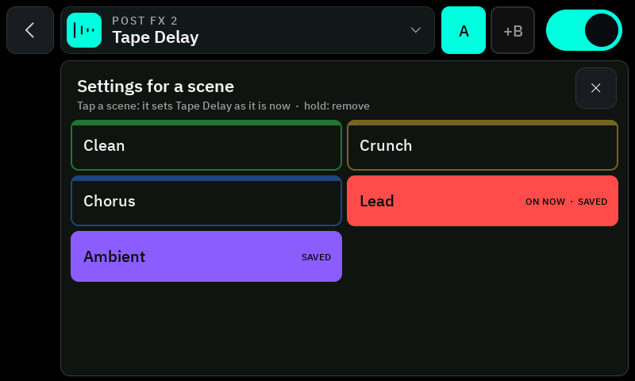

A scene can also set an effect's values – more delay and gain in *Lead* than in *Crunch*:

1. Open the effect in the [FX editor](#fx-editor) (it has to be on) and set it the way the scene should sound.
2. Tap the **scene button** at the end of the FX preset row and then the scene. It now carries these settings for
   this effect and sends them whenever its footswitch is pressed.
3. Do the same for the other scenes that should set this effect – change the values first where they should differ.

- In the list a scene is **filled** when it carries settings for this effect; *ON NOW* marks the scene whose
  effects are on. **Tap** a filled scene to replace its settings with the current ones, **hold** it to remove them.
- The scene button shows how many scenes carry settings for the effect, and is filled while the scene that is on
  does. On a scene's tile a small bar under an effect's square says the same, in its dialog *WITH SETTINGS*.
- **A scene only sets what was saved for it.** An effect it has no settings for stays as it is – also as another
  scene left it. If two scenes should differ in an effect, save its settings in both.
- Only the values that differ are sent, so a scene change that moves a few values is as quick as one that only
  switches. An effect that comes on gets its values first.
- The settings belong to the model. With another model in the slot they are kept, but not sent.

## Expression pedal

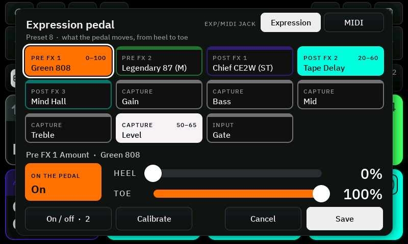 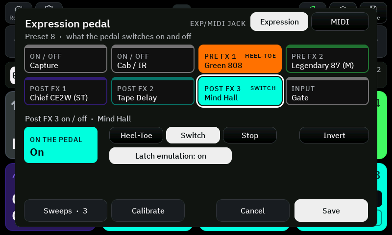

The **pedal button** in the top bar opens what the Nano's expression pedal moves in the current preset. These are the
same assignments as in the Cortex Cloud app and in the editor's Expression panel: they belong to the Nano's preset.
The button's symbol is green while the pedal does something in the preset.

**In FX mode the tile of an effect on the pedal carries a small pedal symbol** (*Pedal*, *Pedal: on/off* or
*Pedal, on/off*; on a tile with two symbols it sits next to the footswitch number). It is worth a look when a value
keeps coming back: whatever you set by hand, the Nano puts the effect's Amount back to where the pedal stands as
soon as it loads a model or the preset – for a compressor on the pedal that is its input level.

- Eleven values can follow the pedal: the **Amount** of each of the five effects (the AMOUNT knob – the position of
  a wah, the mix of a reverb …), the capture's gain, bass, mid, treble and level, and the input gate. A field is
  **filled** while its value is on the pedal and shows its range.
- **Tap a field** to choose it. **On the pedal** switches its assignment; **HEEL** and **TOE** are the values at the
  two ends of the pedal's way (a heel value above the toe value turns the direction round). Moving a slider puts
  the value on the pedal.
- **Save** writes the assignments into the Nano's preset at once – the preset itself need not be saved – and reads
  them back to check. **Cancel** drops the changes.
- **On / off** (bottom left) opens the second page: what the pedal switches on and off – the capture, the cab,
  each effect, the input gate. Choose a field, then the way, named as in the Cortex Cloud app: **Heel-Toe** and
  **Stop** with a delay (0–2000 ms), **Switch** for a footswitch on the connector – with **latch emulation** for one
  that only makes contact while it is held. **Invert** turns Heel-Toe and Switch round. The button then reads
  *Sweeps* and leads back; Save writes both pages.
- **Calibrate** (with the connector on *Expression*) teaches the Nano the pedal's range: after *Start* the Nano
  forgets its calibration and reports where the pedal is. Move the pedal over its whole way a few times and tap
  *Save* – the lowest and highest position are stored in the Nano. *Cancel* puts back the range that was saved
  from the controller last; if the pedal was never calibrated from here, it is left uncalibrated and a message
  says so.
- For a wah: put a wah model on Pre FX 1 or 2, open the dialog, choose that slot and switch *On the pedal* on.
- **EXP/MIDI JACK** (top right): what the Nano's EXP/MIDI connector takes – an **expression** pedal or TRS **MIDI**,
  not both. It is the Nano's own setting (*EXP/MIDI Input Behavior* in the Cortex Cloud app) and the same for all
  presets. The filled side is what the Nano reports; a tap on the other one asks first, switches and checks. With
  the connector on MIDI, CC 1 plays the pedal's part (0 = heel, 127 = toe). The Nano resets its MIDI clock source
  when the connector leaves MIDI – check it in the app after switching back.

## Capture and Cab/IR

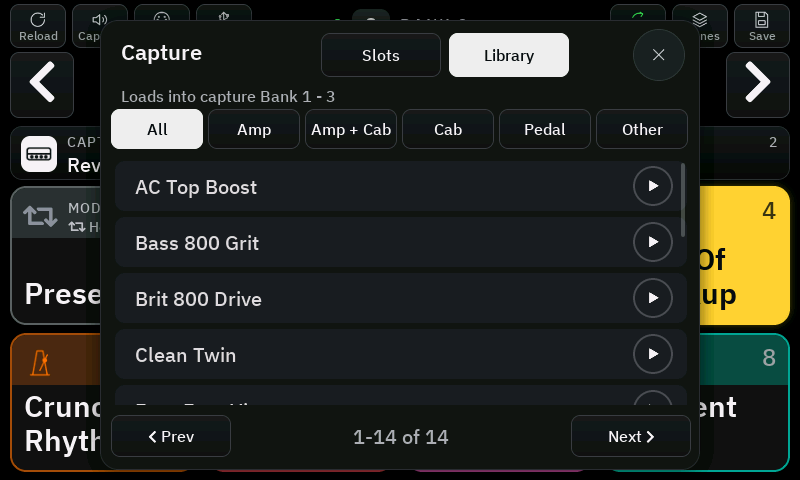 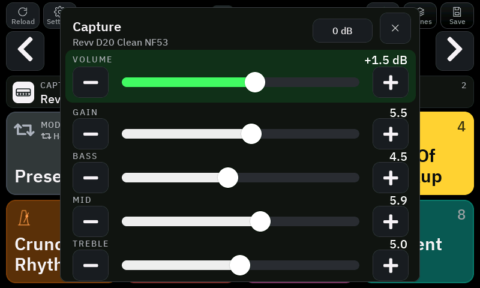

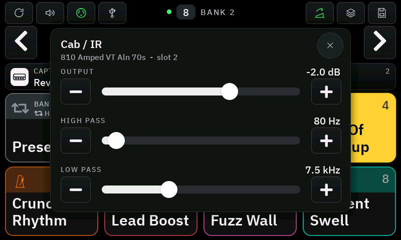 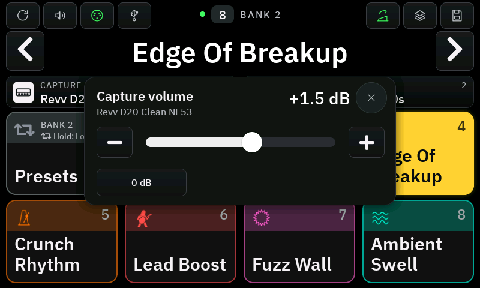

Tap the CAPTURE or CAB / IR card. **SLOTS** lists the 25 capture slots (5 banks × 5) or 5 cab slots;
**LIBRARY** shows all captures or IRs stored on the Nano with category filters (AMP = head or combo, AMP+CAB, CAB, PEDAL, OTHER).
A library item is loaded into the active slot after a confirmation.

**Capture volume**: **VOL** in the preset card, −24 dB to +12 dB (**0 dB** resets). **Capture tone**: a long press
on the CAPTURE card – **GAIN**, **BASS**, **MID** and **TREBLE** of the capture, 0–10. **Cab settings**: a long press on the CAB / IR card – **OUTPUT** (−96 dB to +12 dB),
**HIGH PASS** (20–800 Hz) and **LOW PASS** (1–20 kHz) of the active cab, read from the Nano when the dialog opens.
All of them are part of the preset: changes are heard at once, **SAVE** keeps them.

## FX editor

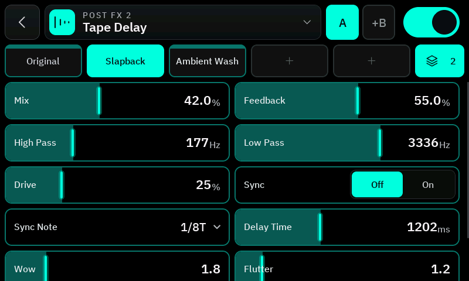 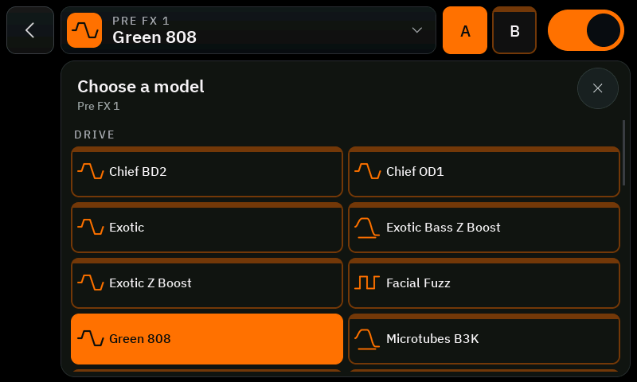

The header shows the effect's symbol – filled in its colour when the effect is on, outlined when it is off – with
the slot and the model. Tap it to choose another model from a list grouped by type (Drive, EQ & utility, Wah &
filter …); the large switch on the right turns the effect on or off.

The parameters are bars in two columns, filled in the effect colour up to the value. **Slide sideways** on a bar to
change it: it follows your finger from its current value, so a touch or a scroll never makes a value jump. Up and
down scrolls the list. Settings with two or three options (*Off | On*, *Sync* …) are switched with a tap, longer
lists (*Sync Note* …) open a list.

Changes are sent to the Nano while you move a control. The Nano only reports parameter values of effects that
are switched on – switch an effect on to see and edit its values. **SAVE** in the preset card stores the preset
on the Nano.

**FX presets** (the bar above the parameters): *Original* and four named settings per effect model, stored on the
controller and usable in every preset and slot with that model; empty places show **+**.

- **Hold** a place: the keyboard opens and the current settings are saved under the name you type. An empty name
  deletes the place.
- **Tap** a place: its settings are loaded at once.
- **Original** goes back to the settings the effect had when you opened the editor. Right after choosing a new
  model, these are the model's defaults.

Loaded settings count as changes to the Nano preset: **SAVE** keeps them there.

The **scene button** at the end of the row saves the current settings for a [scene](#settings-of-an-effect-per-scene)
of the preset.

## Reverb switch (footswitch 8)

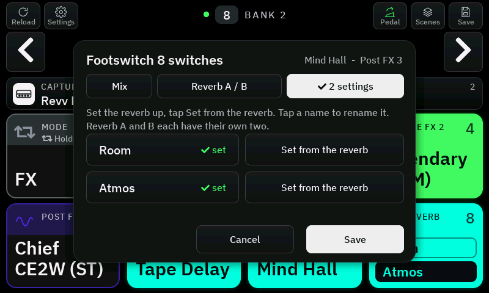 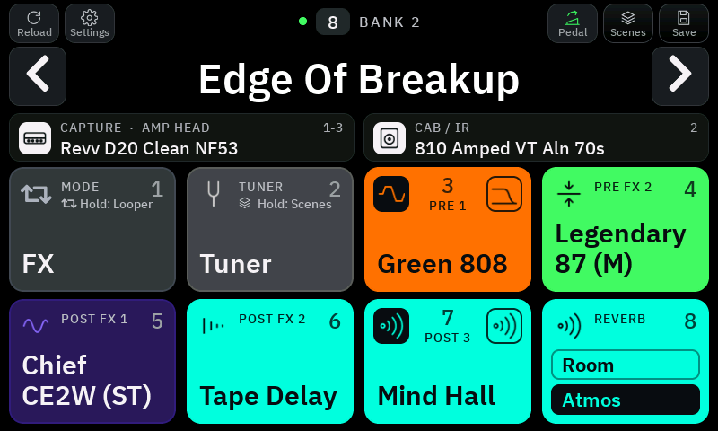

The dialog has three tabs, one for each thing footswitch 8 can do. **The tab in front when you tap SAVE is what the
switch does** from then on; the one in use carries a tick.

- **MIX**: footswitch 8 sets the reverb's Mix to Pos 1 or Pos 2. Moving a slider plays that mix;
  **SAVE** stores both values on the controller, for this preset. The Nano's expression pedal has no part in it and
  stays free for a wah or anything else.
- **Presets set up before 1.8** kept Pos 1 and Pos 2 as the heel and toe values of the preset's expression setting
  for the reverb ("Post FX 3 Amount") on the Nano. The controller takes them over the first time it loads such a
  preset. The setting itself is still in the Nano's preset, so an expression pedal would still move the reverb:
  **FREE PEDAL** in this dialog removes it from the preset (the other expression settings stay as they are, the
  switch keeps its positions). The button only shows while the reverb is on the pedal.
- **REVERB A / B**: choose a second reverb (B) for this preset – another reverb, or with **Same reverb, second
  setting** the same one again: then the switch changes between two complete settings of it (mix, decay, damping …)
  without a gap in the sound. Footswitch 8 then switches between the preset's
  reverb (A) and B; the Nano has one reverb slot, so the controller swaps the model and sends the stored values
  (takes about half a second). Tile 8 shows reverb B and lights up while it runs; tile 7 shows the reverb in the slot. **EDIT B** loads B and opens the FX editor to set it up. Reverb B is stored on the
  controller, per preset. If you save the preset while B is active, B becomes the preset's reverb.
  Loading a preset – also the one that is on, once more – always brings back its own reverb (A); B stays stored.
  Reverb B is the second effect of the reverb's own tile (tile 7), and that tile always swaps it. Saved on the
  *MIX* or *2 SETTINGS* tab, footswitch 8 is the mix switch (or the settings) and the tile keeps its A / B – the
  reverb's type on one switch, its amount on the other. *None* in the list removes B.
- **2 SETTINGS**: footswitch 8 changes between two named settings of the preset's reverb – for example *Room* and
  *Atmos* – with all its controls (mix, decay, damping …). The reverb stays the same, so there is no gap in the
  sound. To set one up: set the reverb the way you want it (in the FX editor of tile 7 or on the Nano), then tap
  **Set from the reverb** in that row; do the same for the other one. Tap a name to change it. **SAVE** needs both
  settings. Tile 8 then shows both names as two rows: the setting that is on is filled, the other one outlined.
  The controller tells which one is on from the reverb's values, also after a preset change; if the reverb is set
  to neither (changed by hand, or the preset was stored with other values), no row is filled and the next press
  goes to the first setting. A press also switches the reverb on if it was off.
  The two settings are stored on the controller, per preset, and are **their own thing**: they have nothing to do
  with the A and B of the reverb's own tile (tile 7), which keeps its second effect and its tap or hold as before.
  **Each reverb of the preset has its own two settings**: the preset's reverb (A) and, if the reverb's tile has a
  second reverb (B), that one too. Switch to B on the reverb's tile, open this dialog and set its two up the same
  way – the header shows which reverb is in the slot. From then on footswitch 8 changes between the two settings of
  whichever reverb is on. A reverb without settings of its own leaves the switch at reverb A / B or the mix, and
  the tile shows that.

## Second effect: A and B on an FX slot

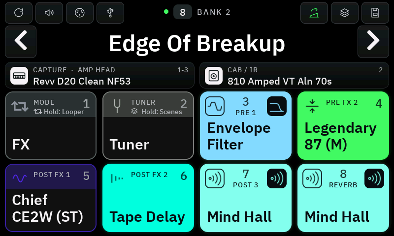 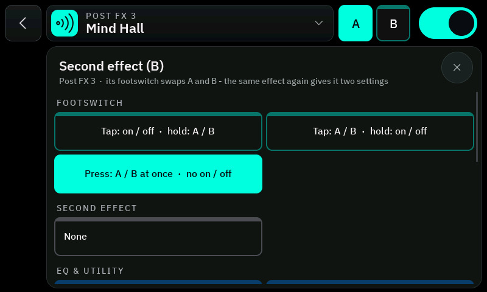

Every FX slot can have a second effect (B) next to the preset's own (A), and its footswitch swaps them: a
compressor and a drive on Pre FX 1 – or **the same effect twice with other settings**, for example one reverb with a
short and a long setting (mix, decay, damping … all change together).

**Set it up:** hold the FX tile to open the FX editor and tap **+B** next to the model. Choose the second effect
from the list; *None* removes it. **A | B** in the header then shows which one runs: tap the other one to swap at
once, tap the running one to open the list again. B is edited in the FX editor while it runs. It is stored on the
controller, per preset; A stays the effect of the Nano's preset.

**What the footswitch does** (at the top of the same list, per slot):

| Choice | Short press | Hold (0.6 s) |
|---|---|---|
| *Tap: on / off · hold: A / B* | effect on / off | swap A ↔ B |
| *Tap: A / B · hold: on / off* | swap A ↔ B | effect on / off |
| *Press: A / B at once · no on / off* | swap A ↔ B the moment you step on it | – |

The second is for an effect that stays on and only changes its sound – a reverb, a delay. With the first two the
switch acts when you lift your foot (it has a held function); the third has none and acts at once – the fastest,
if you never switch that effect off with your foot.

**The tile** shows both symbols: A at the left edge, B at the right, the one that runs filled. Between them are the
footswitch number and the slot in short (*PRE 1*, *POST 3*). The tile has the colour and the name of the effect that
runs; B of the same effect – a second setting of it – shows in a lighter shade of that colour. The tile of the
reverb switch (footswitch 8) looks the same.

- **Two different effects:** the Nano has one model per slot, so the controller swaps the model and sends the stored
  values: about half a second with a short gap in the sound. For a gapless change put the second effect into a free
  slot instead and switch it on and off.
- **The same effect as A and B:** only the values are sent – at once, and the sound does not break off.
- The values of A are read from the Nano just before a swap, so edits count. If A was never on since B was set up,
  the first swap switches it on for a moment to read them.
- Loading a preset – also the one that is on – brings back A. If you save the preset while B runs, B becomes the
  preset's effect.
- The reverb's second effect is swapped by the reverb's own tile, always. Footswitch 8 (the
  [reverb switch](#reverb-switch-footswitch-8)) swaps it too only when the reverb dialog was saved on its
  *REVERB A / B* tab; otherwise it stays the mix switch or the two settings. Setting up B on the reverb's tile leaves
  footswitch 8 as it was. When the tile swaps while footswitch 8 is the mix switch, the new reverb gets the mix the
  switch shows (Pos 1 or Pos 2).
- MIDI: **CC 61–65** choose A (value 0–63) or B (64–127) of FX slot 1–5; CC 58 swaps Pre FX 1.

## Auto-wah

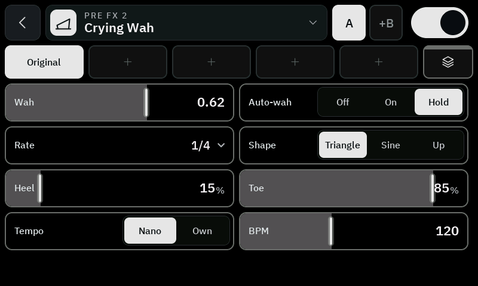

The Nano's four wah models have one control, the pedal position. The controller can move it for you, in tempo. Put a
wah on Pre FX 1 or 2, hold its tile to open the FX editor: below the wah's own bar are the settings of the auto-wah,
stored on the controller for this preset.

- **Auto-wah** – *Off*: an ordinary wah. *On*: the wah moves whenever it is on – its footswitch switches it on and
  off as usual, so do scenes. *Hold*: in FX mode the wah is on, and moving, only while you hold its footswitch; it
  starts the moment you step on it. A tap on the tile still switches it on and off.
- **Rate** – one round from heel to toe and back per 2 bars, 1 bar, 1/2, 1/4, 1/8 or 1/16.
- **Shape** – *Triangle* (evenly up and down), *Sine* (slower at the ends) or *Up* (heel to toe, then back at once).
- **Heel** and **Toe** – the two ends of the movement in per cent of the pedal's way. Heel above toe turns it round.
- **Tempo** – *Nano*: the tempo the Nano reports for the preset (the one its synced delays use). *Own*: the **BPM**
  set next to it; moving the BPM bar switches to *Own*.

The tile of the wah shows the rate (*Auto: 1/4*, or *Hold: auto 1/4*), and the wah's bar in the FX editor moves along.
The controller sends about 40 positions a second over Bluetooth: slow rates are smooth, at 1/16 you may hear steps.
While the tuner is open nothing moves. On a slot with a second effect the footswitch keeps what it does with A and
B – a wah set to *Hold* there moves while it is on. The moving changes the wah's position in the Nano's preset, so the
preset shows unsaved changes; that does no harm.

## Tuner

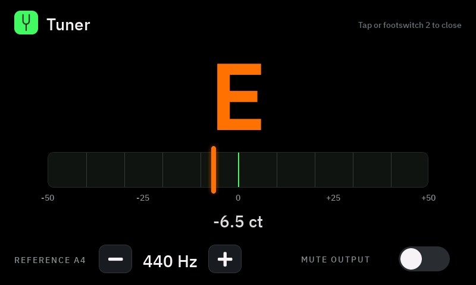

Footswitch 2 or the TUNER tile. Looks like the desktop editor's tuner: a large note in the tuning colour (green = in
tune, orange = off), a scale with a tick every 10 cents and a glowing needle, the deviation in cents. At the bottom,
**Reference A4** sets the reference pitch (400-480 Hz, hold − / + to run) and **Mute output** silences the Nano while
tuning. Tap the screen or press footswitch 2 again to close it.

## USB audio volume

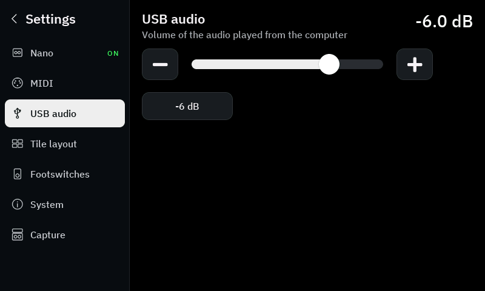

**USB** in the preset card: volume of the audio played from the computer over USB, −40 dB (OFF) to 0 dB,
as in the official app. The value is read from the Nano each time.

## Bluetooth MIDI

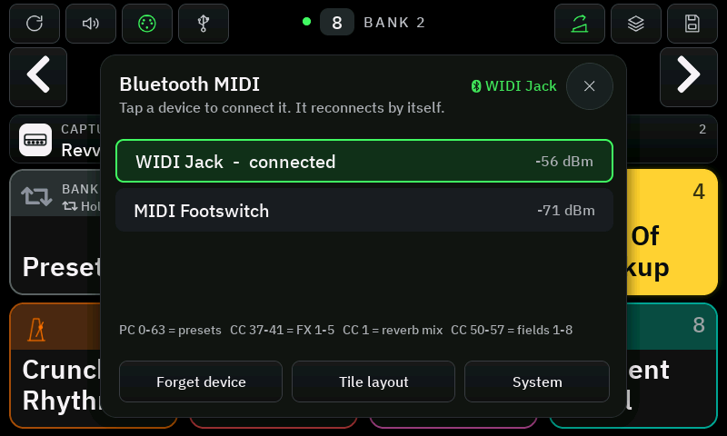

**MIDI** in the preset card opens the device list. It shows Bluetooth MIDI devices nearby – for example a
CME WIDI adapter on the MIDI port of a Morningstar MC6, or a Bluetooth MIDI
footswitch. Tap one to connect it; the controller remembers it and connects again by itself whenever it is
switched on. **FORGET DEVICE** disconnects and forgets it. The Nano stays connected at the same time.

The controller understands the same messages as the Nano's own MIDI over USB, on all MIDI channels, so banks made
for the Nano (for example with the MC6 export of the Nano Cortex Editor) work over Bluetooth too:

| Message | Action |
|---|---|
| Program Change 0–63 | preset 1–64 |
| CC 37–41 | FX slot 1–5 (Pre FX 1, Pre FX 2, Post FX 1–3): value 64–127 on, 0–63 off |
| CC 1 | expression: reverb mix from Pos 1 (0) to Pos 2 (127) |
| CC 50–57, value 64–127 | press field 1–8 of the [tile layout](#tile-layout-6-or-8-fields) (mode, tuner, presets or FX, reverb switch) |
| CC 58, value 64–127 | Pre FX 1 swaps to its [second effect](#second-effect-a-and-b-on-an-fx-slot) and back |
| CC 66 / CC 67, value 64–127 | [set list](#set-list): next / previous song |
| CC 68 | set list: value 64–127 on, 0–63 off |
| CC 61–65 | [second effect](#second-effect-a-and-b-on-an-fx-slot) of FX slot 1–5: value 64–127 B, 0–63 A |
| CC 59 | looper mode: value 64–127 on, 0–63 off |
| CC 60 | footswitches 3–8: value 64–127 [scenes](#scenes) of the preset, 0–63 presets of the bank |

**M-VAVE Chocolate** (Cuvave): it shows up in the list as "FootCtrl (Chocolate)" and has its own mapping. Out of the
box A–D are the controller's footswitches 1–4 (mode, tuner, switches 3 and 4); C+D together moves the Chocolate on,
then A–D are footswitches 5–8, A+B back again. The Chocolate has no display, so remember where you are after
changing the group. In the Chocolate's CC mode (set in the Cubesuit app) it is the same: A+B chooses footswitches 1–4,
C+D footswitches 5–8.

A wired MIDI input is not possible on this board without extra hardware; use a Bluetooth MIDI adapter instead.

## Looper mode (a looper app on a phone)

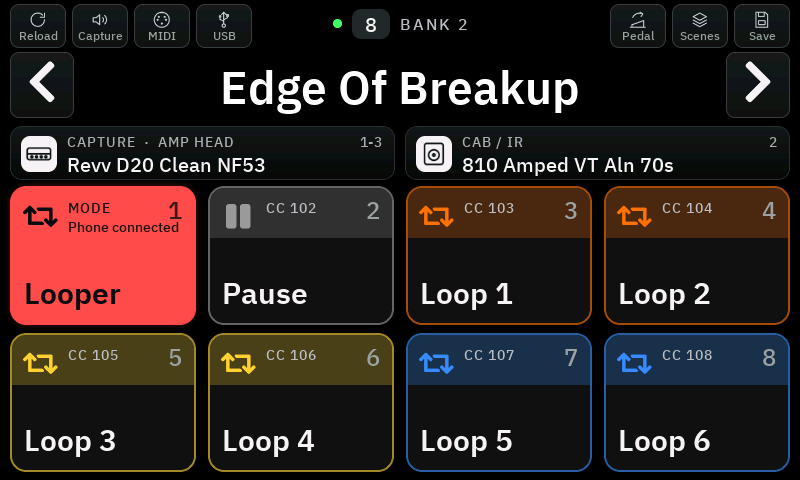 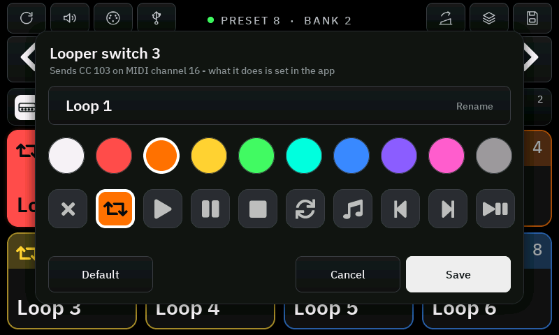

The controller can be the foot controller of a looper app, for example **Loopy Pro** on an iPhone or iPad. The
phone plays through the Nano: connected to its USB-C port, the Nano is the phone's audio interface, so the guitar
goes into the app and the loops (and backing tracks) come out of the Nano. Their level is the *USB audio volume*
(see above). The footswitches reach the app over **Bluetooth MIDI**: the controller is a Bluetooth MIDI device with
the name **"Nano Cortex Controller"**.

1. In Loopy Pro open the main menu > **Bluetooth Devices** and choose *Nano Cortex Controller*. The controller
   shows *Phone connected* and how often MIDI is exchanged (every 11.25 or 15 ms on an iPhone).
2. **Hold footswitch 1** (0.6 s) or long press tile 1: the tiles become the looper's switches. Any press of
   footswitch 1 leaves the mode again; FX and presets are as you left them.
3. In Loopy Pro choose **MIDI Learn**, tap what a switch should do (for a loop: *Play/Stop* with *Record if
   empty*) and press that footswitch. Bind every switch only once: two bindings on the same loop cancel each other.

| Footswitch | Sends (MIDI channel 16) | Tile (as delivered) |
|---|---|---|
| 2 | CC 102 | Pause |
| 3–8 | CC 103–108 | Loop 1–6 |

**Your own names**: a long press on a tile in looper mode opens its dialog – name (keyboard), colour and symbol,
stored on the controller; *Default* brings back the tile shown above. The symbols: loop, play, pause, stop, undo and
a note, and for a player – such as the jam tracks of the Nano Cortex Editor – previous, next and play / pause. Tile 1 shows what the last press sent
(*Sent CC 103*), which helps when you bind a switch in the app.

By default the tiles show the loops in three colour pairs, as a two-column Loopy Pro project does. What a switch
does is up to the app.

A footswitch sends the value 127 when you press it and 0 when you lift your foot, so the app's own *hold* and
*double tap* triggers work. Tapping a tile on the screen sends a short press. In looper mode a press goes out
2–4 ms after the contact closes; over Bluetooth it then waits for the next exchange with the phone – at most the
interval shown when the phone connects. With loops that start and end on the beat (the app's quantisation) this
does not matter; a freely recorded first loop can be that much longer or shorter.

The phone and the Nano Cortex Editor can be connected at the same time. What the app sends back (feedback meant
for a controller's lights) is written to the serial log for now.

## Nano Cortex Editor through the controller

The Nano accepts only one Bluetooth connection. When the controller is connected to the Nano, it offers itself as
**"Nano Cortex Controller"** with the same Bluetooth service as the Nano, so the
[Nano Cortex Editor](https://github.com/DrD85/nano-cortex-editor) connects to the controller instead:
**app ↔ controller ↔ Nano**. The Mac app picks it automatically; in the browser choose "Nano Cortex Controller".
Without the controller (or before it has connected) the app connects to the Nano directly, as before.

- Everything the app sends goes on to the Nano; replies to the app's requests go back to the app, replies to the
  controller's own requests stay on the controller, and messages the Nano sends on its own reach both.
- Changes made in the app appear on the controller a moment later; changes made on the controller (footswitches,
  touch, MIDI) make the app read the preset again, as after a change on the pedal.
- While the app is connected, **APP** is shown in the status line.
- **Footswitches for the editor:** in looper mode (hold footswitch 1) every press of footswitch 2–8 is also passed
  on to the connected editor. It takes them as the controllers the looper mode sends (102–108 on channel 16) – by
  default footswitch 2 plays and pauses its jam track player, 7 goes to the previous track and 8 to the next; MIDI
  Learn in the editor assigns them to anything else. No phone is needed for this.

## Tile layout: 6 or 8 fields

**Tile layout** in the Bluetooth MIDI dialog (MIDI button in the top bar). Choose **6 fields** (2 × 3, larger tiles)
or **8 fields**, then tap two fields to swap them – for example the tuner to another place, or Post FX 3 and the
reverb switch out of the six. **Save** stores the layout on the controller, **Default** brings back 8 fields in
the usual order, and footswitch 1 changes between FX and presets again.

Field *n* is pressed by footswitch *n*, MIDI **CC 49 + n** (CC 50–55 with 6 fields) and the Chocolate's switch *n*;
the small number in a tile's corner is its field. A switch that is not on the screen does nothing from the
footswitches or by CC 50–57 (CC 37–41 still switch the effects). With 6 fields footswitches 7 and 8 are free.

**What footswitch 1 changes between** – the button between *Default* and *Save* (a tap takes the next choice, *Save*
keeps it):

| Choice | Footswitch 1 |
|---|---|
| *Switch 1: FX / presets* | FX mode ↔ the bank's presets or the scenes, whichever was chosen last (as before) |
| *Switch 1: FX / scenes* | FX mode ↔ the scenes of the preset |
| *Switch 1: presets / scenes* | the bank's presets ↔ the scenes; FX mode is not used |
| *Switch 1: presets, scenes, FX* | all three in turn: presets → scenes → FX → presets |

Holding footswitch 1 still opens the looper mode, holding footswitch 2 still changes between scenes and presets.

## Footswitch learn

Long press on the tuner tile (its footswitch; **Switch 1** in the dialog learns footswitch 1 instead), or **LEARN SWITCH** in the
bank editor. Then press the footswitch that should have
this function within 15 seconds. If it had another function, the two are swapped. **DEFAULT ORDER** restores
the standard order.

## Footswitches

The footswitches are read by an **SX1509** I/O expander (for example the SparkFun breakout), as in
[TonexOneController](https://github.com/Builty/TonexOneController).

- Connect the SX1509 to the board's **I2C** bus: SDA = GPIO 8, SCL = GPIO 9, 3.3 V and GND
  (see Waveshare's wiki for the connector of your board).
- Set the SX1509 address to **0x71** (or 0x70). 0x3E/0x3F are taken by the board's own I/O expander.
- Wire each footswitch (momentary, normally open) between an SX1509 I/O pin and **GND**. Internal pull-ups are
  used, no resistors needed.
- Default order: switch 1–8 on SX1509 pins **11, 10, 0, 1, 2, 3, 8, 9**. Any other pins work too – use
  footswitch learn to assign them.

Without an SX1509 the controller works with the touch screen only.

## System: memory, backup and self-restart

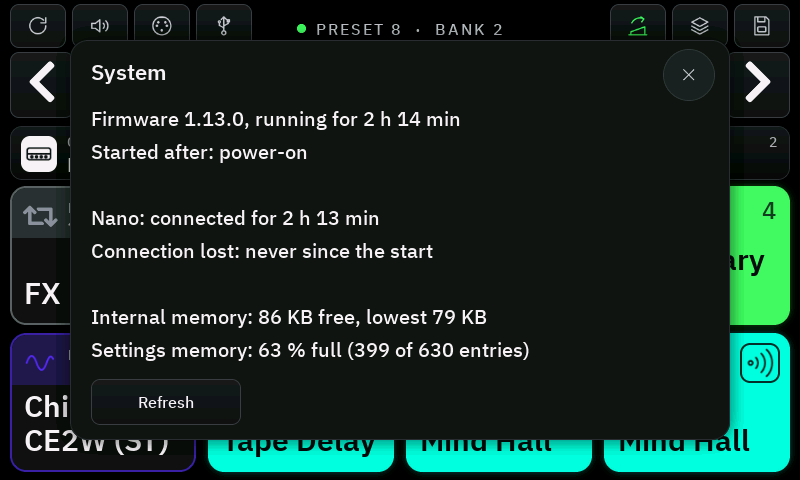

**System** in the Bluetooth MIDI dialog shows whether everything is well: how long the controller has been running
and why it started, how long the Nano has been connected and how often (and why) the connection was lost, the free
internal memory, and how full the settings memory is.

- **Settings memory.** Everything the controller keeps – banks, scenes, second effects, the set list – is in one
  small store. From 85 % on the controller says so after the start. Scenes with settings take most.
- **Backup.** Connect the [Nano Cortex Editor](https://github.com/DrD85/nano-cortex-editor) (1.13 or later)
  through the controller: the **…** menu has *Back up controller settings…* (a file with every entry) and *Restore
  controller settings…* (writes such a file back; it replaces what the controller stores, and the controller restarts).
- **If the store itself is damaged.** Should the controller find its settings memory unusable at the start, it has
  to empty it – and first copies it, as it is, into a part of the flash memory nothing else uses. A computer reads
  that copy with `esptool read-flash 0xF00000 0x6000 store.bin` and writes it back with
  `esptool write-flash 0x9000 store.bin`. The controller says so after such a start.
- What an earlier firmware on the same board left in the store (Wi-Fi settings and the like) is removed once: on a
  board that ran another controller firmware before, that frees about a fifth of the store.
- From 1.15 second effects and mix positions take less room. What an earlier version stored is rewritten once at
  the start (a copy of the store as it was is kept first, as above); on a board in use that freed another quarter.
- **A preset the Nano does not load.** The Nano can refuse a preset change: it then shows the new number and name
  but keeps playing the preset before. The controller asks once more; if the Nano refuses again it says so, the
  status line shows **NOT LOADED** in orange, and nothing the controller keeps for that preset (second effects,
  reverb settings, mix positions) is used or stored until a preset change succeeds. It was seen once, in a long test
  run; what brings the Nano into this state is not known yet.
- **Self-restart.** If the controller ever hangs, it restarts by itself after 8 seconds and is connected again a few
  seconds later; after such a start it says so, and the System page names the reason.
- After a lost connection the controller is back as soon as the Nano is: it reads the current preset at once and
  the preset names again later, in a quiet moment.
- **If the Nano is not found.** The Nano can be found over Bluetooth for a few seconds only after it was switched on
  or lost its connection. If the controller comes later than that – it was off, or updated – put the Nano into
  pairing mode: **EXIT + CAPTURE** on the Nano. The controller says so on its search screen after seven seconds,
  and with a message if the Nano does not come back after a lost connection.

## What is stored where

| On the Nano | On the controller |
|---|---|
| presets, names, captures, cabs, FX and their values, expression settings, USB volume | own banks (preset, colour, symbol), scenes, reverb mix Pos 1 / Pos 2, footswitch order, tile layout, second effects (B) of the FX slots, auto-wah settings, the set list, the captures of the scenes, the Bluetooth MIDI device |
