# Nano Cortex Controller – 7" board (ESP32-P4)

The large version of the [Nano Cortex Controller](../README.md): a **Waveshare ESP32-P4-WIFI6-Touch-LCD-7B** with
a 7" touch screen (1024 × 600). The Nano is connected **with a USB cable**. The board controls it over that cable
and also plays its own sound into the Nano: a looper with two parts, a drum machine and jam tracks from a microSD card.

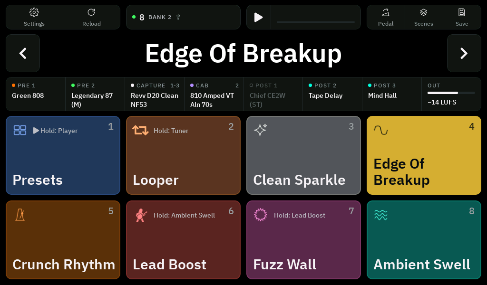

> **Unofficial community project.** Not affiliated with, endorsed by or supported by Neural DSP. Use it at your own
> risk and keep backups of your presets.

## What it can do

**Everything the 4.3" board does** (as of 1.27.1): banks, scenes, FX mode, pedal view, the FX editor with the pad and
the info page, capture and cab library, expression pedal, tuner, set list, gig view, the preset list with **New
preset**, MIDI learn, auto-wah, the Neural Capture assistant. How they work: the [main README](../README.md#how-to-use-it)
and the [manual](../docs/manual.md). In addition:

| | |
|---|---|
| **Nano over USB** | The Nano is plugged into the board's USB-A socket: no pairing and no Bluetooth window. The cable is also the way for the board's own audio into the Nano. Without a cable, the board looks for the Nano over Bluetooth instead |
| **Looper** | On the board, recorded from the Nano's sound (USB channels 3/4) and played back into it. Two parts **A** and **B**, record, overdub, play / stop, undo / redo, hold to clear. Loops are rounded to bars of the Nano's tempo; the USB round trip is taken out. Up to 45 s. If the Nano's USB stream ever goes garbled (a robotic sound), the board starts it anew by itself |
| **Drum machine** | A computed kit (no sample files) in the Nano's tempo: 88 grooves, a groove of its own per looper part, its own level, a count-in, and drums that start with the first take |
| **Jam player** | WAV backing tracks from a microSD card in **albums** (one folder each), with their **covers**, each one measured and levelled to −21 LUFS, a correction by ear per track. **Player mode** (hold footswitch 1): cover, title, time, next and previous track, play / pause, back, next on the footswitches. Tracks come onto the card over Wi-Fi: from the [Jam Player](https://github.com/DrD85/jam-player) on a Mac (folders become albums, only new or changed tracks are sent, covers go along) or the board's page `http://nano-board.local` |
| **Level** | Measures each preset's loudness (LUFS) and sets the Nano's output level to match the others, with a count-down so you can start playing |
| **Gain reduction** | The FX editor of a compressor shows how much it is compressing, worked out from its knobs and the Nano's dry input (the Nano does not report it) |
| **Auto-wah from your playing** | Besides the auto-wah in tempo: a wah that opens with your picking (sensitivity, attack, release), with a live view in the FX editor |
| **Second preset per switch** | Each bank switch can hold a second preset, loaded when the switch is released after a long press |
| **Bluetooth** | Through the board's ESP32-C6: MIDI controllers (for example an M-VAVE Chocolate, with MIDI learn), a looper app on a phone, and the [Nano Cortex Editor](https://github.com/DrD85/nano-cortex-editor) through the board |
| **Updates over Wi-Fi** | A new firmware file on the board's page; if the new firmware does not run properly, the board goes back to the old one |
| **Footswitches** | Eight switches straight on the board's header P3, no extra board needed, or the SX1509 board of the 4.3" version |
| **Phone audio** (optional) | A classic ESP32 as a Bluetooth speaker for the phone (`a2dp-bridge/`), its sound into the Nano. **Experimental** |

<table>
<tr>
<td width="50%">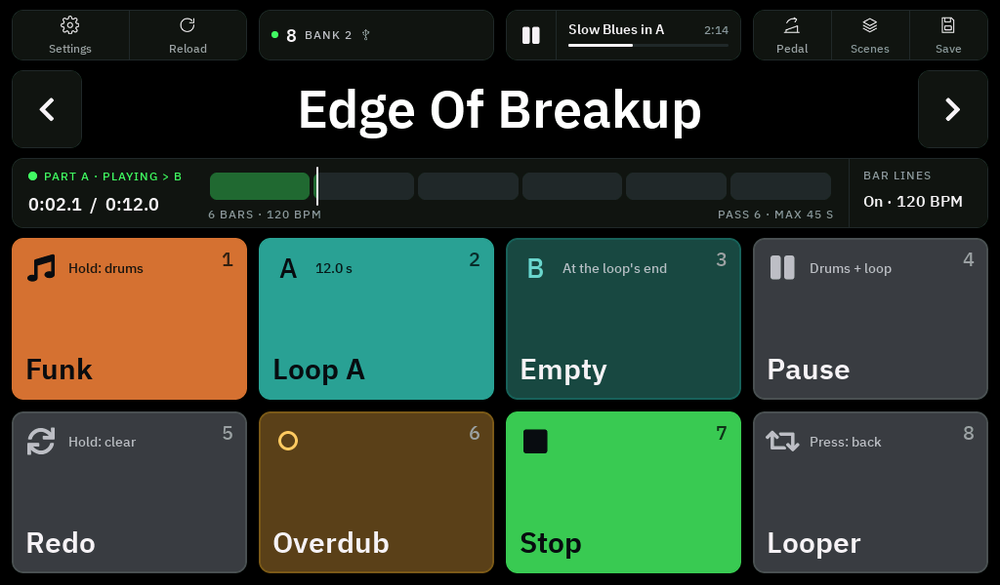</td>
<td width="50%">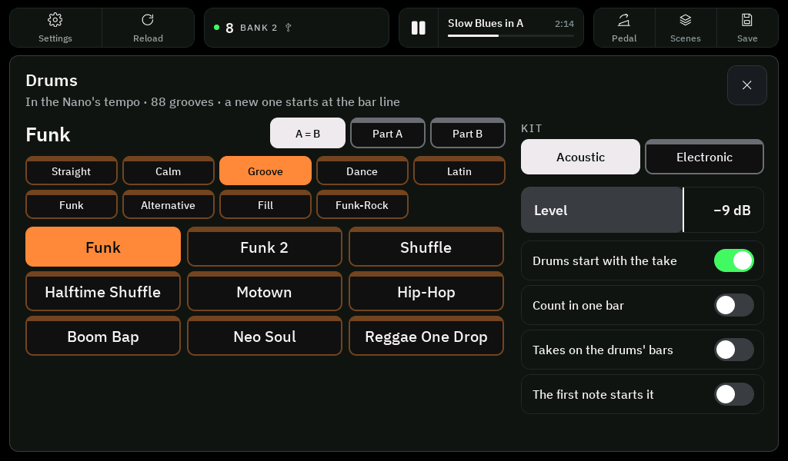</td>
</tr>
<tr>
<td>

**Looper** – **press footswitch 2** (hold it: tuner). Tile 1 = drums (hold for the drum menu), 2 / 3 = parts A
and B, 4 = pause drums + loop, 5 = undo / redo (hold: clear), 6 = record / overdub, 7 = play / stop, 8 = back to the
presets. The bar above shows the part, the time and the bars.

</td>
<td>

**Drums** – grooves by style, the level, and how a part's first take starts: with the drums, after a one-bar count-in,
on the drums' bar lines or with the first note.

</td>
</tr>
<tr>
<td width="50%">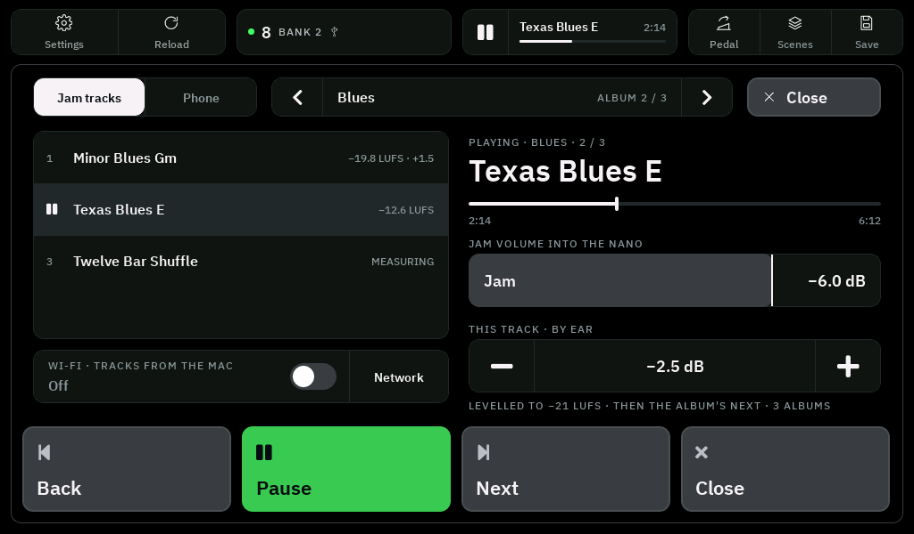</td>
<td width="50%">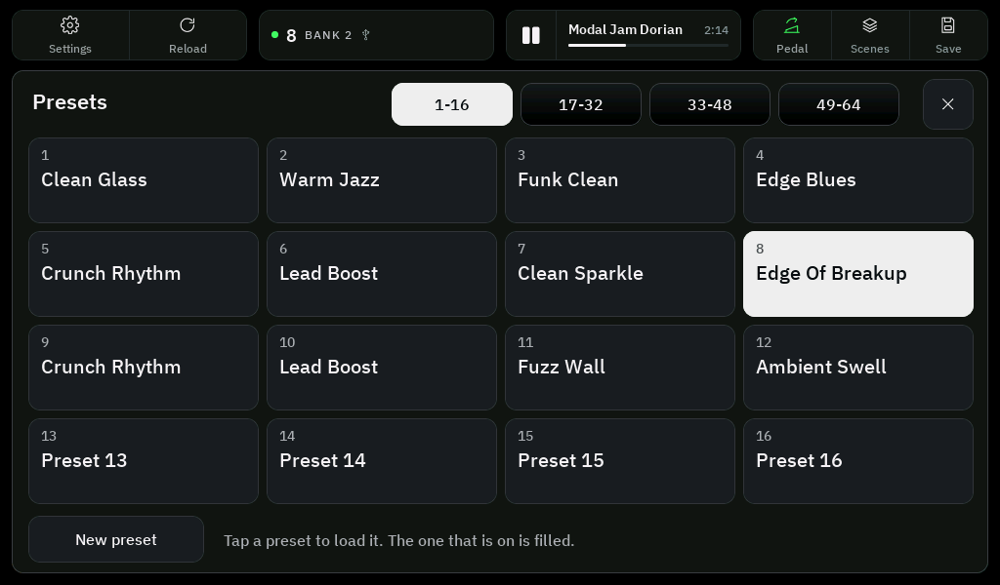</td>
</tr>
<tr>
<td>

**Jam player** – tap the player in the top bar. Tracks from the card's `jam` folder, one album at a time (the
arrows at the top), levelled.

</td>
<td>

**Preset list** – tap the preset's name: all 64 presets, and **New preset** in any free place.

</td>
</tr>
<tr>
<td width="50%">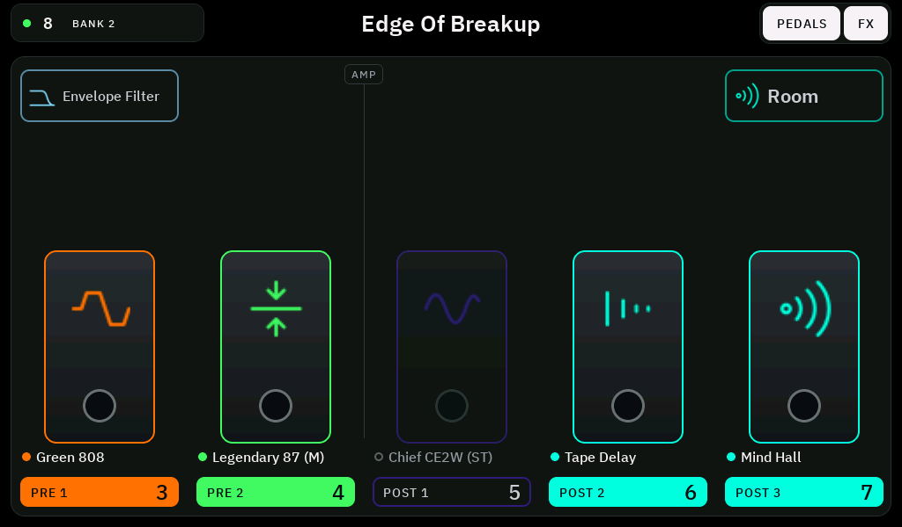</td>
<td width="50%">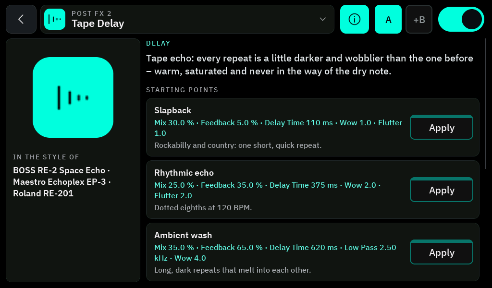</td>
</tr>
<tr>
<td>

**Pedal view** in the gig view: the five FX slots as pedals on footswitches 3–7.

</td>
<td>

**Info page** in the FX editor: what the effect is based on, starting points and players' sounds.

</td>
</tr>
<tr>
<td width="50%">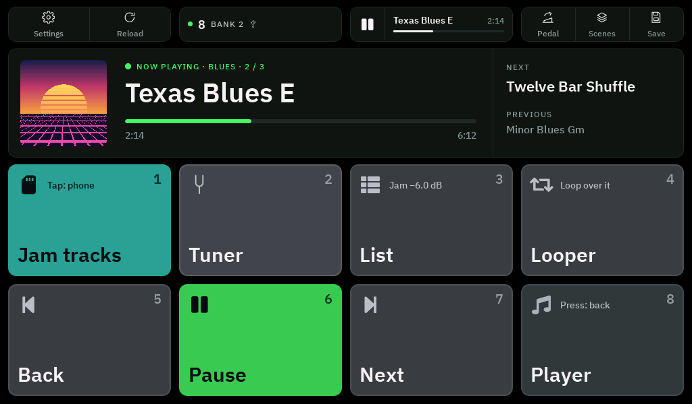</td>
<td width="50%">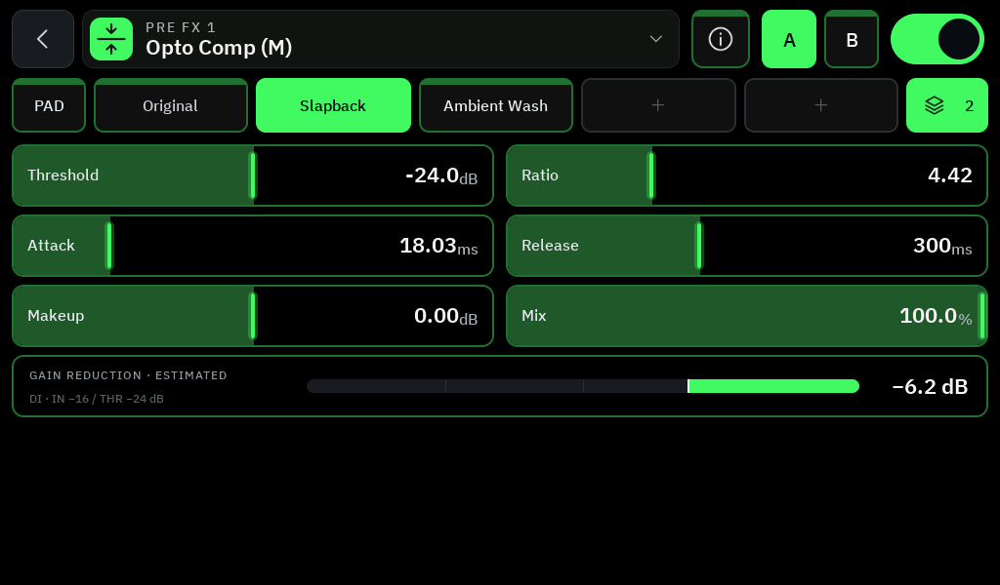</td>
</tr>
<tr>
<td>

**Player mode** – **hold footswitch 1**: the track's cover, the album, next and previous; 6 = play / pause,
5 / 7 = back / next, 8 = back to the presets.

</td>
<td>

**Gain reduction** below a compressor's knobs (estimated from its knobs and the dry input).

</td>
</tr>
<tr>
<td width="50%">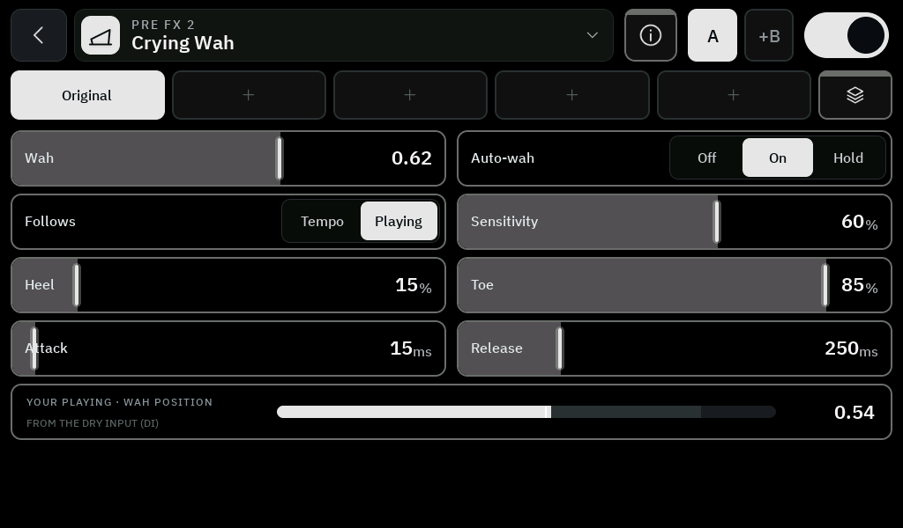</td>
<td width="50%">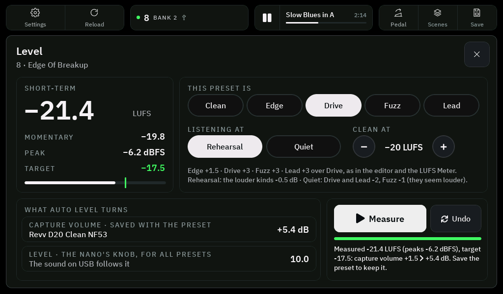</td>
</tr>
<tr>
<td>

**Auto-wah** that follows your playing: sensitivity, attack and release, the live row shows where it is.

</td>
<td>

**Level**: play for a few seconds, the board suggests the preset's level from its loudness.

</td>
</tr>
</table>

## What you need

| Part | Notes |
|---|---|
| [Waveshare ESP32-P4-WIFI6-Touch-LCD-7B](https://www.waveshare.com/wiki/ESP32-P4-WIFI6-Touch-LCD-7B) | 7", 1024 × 600, ESP32-P4 with an ESP32-C6 for Bluetooth and Wi-Fi |
| Neural DSP Nano Cortex | with a USB-C cable to the board's **USB-A** socket |
| Optional: microSD card | **FAT32**, for the jam player (folder `jam`, one sub-folder per album) |
| Optional: up to 8 momentary footswitches | each between a pin of header **P3** and GND (below) |
| Optional: ESP32 (ESP-WROOM-32 dev board) | only for phone audio over Bluetooth, see `a2dp-bridge/main/main.c` for the wiring |

**Footswitches on header P3** – no resistors, the pull-ups are in the chip:

| Footswitch | 1 | 2 | 3 | 4 | 5 | 6 | 7 | 8 | GND |
|---|---|---|---|---|---|---|---|---|---|
| P3 pin | 10 | 9 | 8 | 7 | 6 | 5 | 4 | 3 | 11 |
| GPIO | 2 | 3 | 4 | 5 | 28 | 29 | 30 | 31 | |

Leave pins 1, 2 (GPIO 36 / 34, strapping pins) and 12 (3.3 V) free. An SX1509 board on the I2C socket works too: if
one answers, the board uses it and leaves P3 alone.

## Install the firmware

The files are on the [Releases](../../../releases) page (`nano-controller-p4-<version>-…`).

**In the browser** – [esptool.spacehuhn.com](https://esptool.spacehuhn.com) in **Chrome** or **Edge**:

1. Connect the board's USB-C port **USB TO UART** (or **USB 1.1 FS Direct Out**) to the computer and click
   **Connect**. No port? Hold **BOOT**, press and release **RESET**, release **BOOT**, try again.
2. **First installation:** click **Erase**, then add `nano-controller-p4-<version>-full.bin` at **`0x0`** and
   click **Program**.
   **Update:** `nano-controller-p4-<version>-update.bin` at **`0x10000`**, no erase. Banks and settings stay.
3. Press **RESET**.

If flashing stops halfway, choose a lower speed (115200 baud) and try again.

**From the command line** (esptool 5):

    esptool --chip esp32p4 erase-flash                                   # first installation only
    esptool --chip esp32p4 write-flash 0x0 nano-controller-p4-<version>-full.bin
    esptool --chip esp32p4 write-flash 0x10000 nano-controller-p4-<version>-update.bin   # an update

**Over Wi-Fi** (from the second version on) – switch on Wi-Fi in the jam player, open `http://nano-board.local` and
choose `nano-controller-p4-<version>-wifi.bin` under **Firmware**.

## First start

Switch the Nano on, plug it into the board's USB-A socket and power the board. It reads the presets over the cable
and shows the current one; the green dot in the top bar means connected. The settings page says whether the Nano is
connected over USB or Bluetooth.

## Build from source

ESP-IDF 6.0, in `p4/firmware`:

    idf.py -B build-public -D SDKCONFIG=build-public/sdkconfig -DNANO_PUBLIC=1 build

`tools/release.sh` builds the release files. With `-D "SDKCONFIG_DEFAULTS=sdkconfig.defaults;../sdkconfig.uart"` the
log also appears on the UART port. Host tests: `tools/test_main/run.sh` (after one build; `BUILD=build-public`),
`tools/test_midi_switches/run.sh`, `components/nano_audio/test/run.sh`, `tools/test_cover/run.sh` (covers). Screens on the computer:
`tools/screenshots/make_p4.sh`.

Most of `main/` is the 4.3" board's code with a P4 part (`NANO_P4`); [UPSTREAM.md](firmware/UPSTREAM.md) lists
what came over from it. The audio is in `components/nano_audio` (USB audio host for the Nano, mixer, looper,
drums, track player, loudness). `components/esp_lvgl_port` is Espressif's esp_lvgl_port 2.9.0 (Apache-2.0) with a
few lines changed for ESP-IDF 6.0 and the P4's display (marked "P4 board"). `main/tjpgd` is ChaN's TJpgDec R0.03 as
LVGL ships it (its own licence in that folder), used for the covers.

## Not tested yet

- The Nano over Bluetooth **without** the cable, and changing between cable and Bluetooth while playing
- Phone audio through the ESP32 bridge
- The published build itself on a board: the screenshots and host tests come from the same code, and the
  author's own build differs only in private artwork and the log port
- New in 1.1.0 and not yet played much: the gain reduction view and the auto-wah from the playing
- The Nano Cortex Editor through the board over Bluetooth (the board's ESP32-C6 stops taking packets during long
  messages; under investigation)

## License

[MIT](firmware/LICENSE), as the rest of this project.
