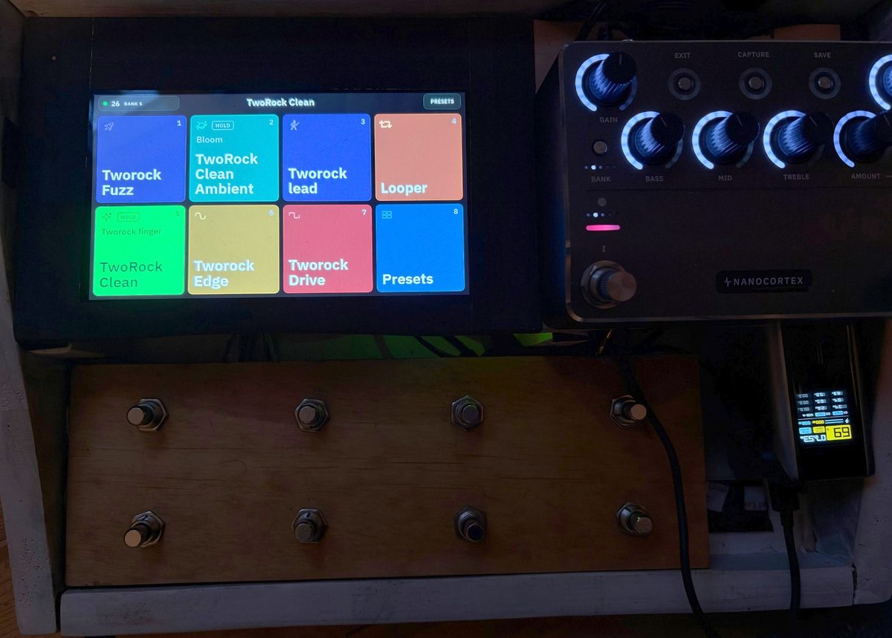

# Nano Cortex Controller – 7" board (ESP32-P4)

The large version of the [Nano Cortex Controller](../README.md): a **Waveshare ESP32-P4-WIFI6-Touch-LCD-7B** with
a 7" touch screen (1024 × 600). The Nano is connected **with a USB cable**. The board controls it over that cable
and also plays its own sound into the Nano: a looper with two parts, a drum machine and jam tracks from a microSD card.

> **Unofficial community project.** Not affiliated with, endorsed by or supported by Neural DSP. Use it at your own
> risk and keep backups of your presets.

How to use it – the main screen, the footswitches in each mode, the looper, drums, player and editors, with pictures
and GIFs: **[main README](../README.md#the-7-board)**. This page has the whole feature list, the hardware and the
technical details.

## What it can do

**Everything the 4.3" board does** (as of 1.27.1): banks, scenes, FX mode, pedal view, the FX editor with the pad and
the info page, capture and cab library, expression pedal, tuner, set list, gig view, the preset list with **New
preset**, MIDI learn, auto-wah, the Neural Capture assistant, the settings backup through the editor – except the
4.3" board's looper mode for a looper app on a phone: this board has a looper of its own. Its footswitches 1 and 2
lead to the player and the looper ([table](../README.md#footswitches-and-modes)). Also from the 4.3" board's next
version: the effects' real control ranges (the reverb switch now moves the real Mix of Room, Hall, Ambience, Cave and
Modulated) and **27 more players' sounds** on the info page (Warpaint, Deftones, Geese, Klinghoffer, Frusciante), with
two new starting points, a spring tank (Blossom) and a 70s plate (Mind Hall). In addition:

| | |
|---|---|
| **Nano over USB** | The Nano is plugged into the board's USB-A socket: no pairing and no Bluetooth window. The cable is also the way for the board's own audio into the Nano. Without a cable, the board looks for the Nano over Bluetooth instead |
| **Looper** | On the board, recorded from the Nano's sound (USB channels 3/4) and played back into it. Two parts **A** and **B**, record, overdub, play / stop, undo / redo, hold to clear, pause. Loops are rounded to bars of the Nano's tempo; the USB round trip is taken out. Up to 22 s per part. The USB audio path runs from the chip's internal RAM, so a busy screen does not make it skip; if the Nano's USB stream still goes garbled (a robotic sound, even a mild one), the board starts it anew by itself |
| **Saving loops** | **Save loops** in the drum menu writes parts A and B to the card as WAV files (`loops/`, named with number, tempo and bars) while the looper plays on. The [Jam Player](https://github.com/DrD85/jam-player) 1.5.0 lists them and fetches the new ones over Wi-Fi |
| **Drum machine** | Two computed kits (no sample files) in the Nano's tempo: **Electronic** and **Lo-Fi** (muffled, tape-saturated, for atmospheric loops); the menu's Acoustic kit needs a sample file that is not part of the release and stays dimmed without it. 108 grooves in ten styles (among them Lo-Fi: lo-fi hip-hop, trip-hop, half-time, ambient; and calm ones in 6/8 and 12/8), a groove of its own per looper part, its own level, a count-in, and drums that start with the first take |
| **Jam player** | WAV backing tracks from a microSD card in **albums** (one folder each), with their **covers**, each one measured and levelled to −21 LUFS, a correction by ear per track. Tracks come onto the card over Wi-Fi: from the [Jam Player](https://github.com/DrD85/jam-player) on a Mac (folders become albums, only new or changed tracks are sent; covers reach the board from version 1.5.0 on) or the board's page `http://nano-board.local` |
| **Player mode** | Hold footswitch 1: the playing track's cover, title and time, and the album's list beside it. Songs are chosen first and then played: 5 / 7 select the song before / after, 6 plays the selected one (or pauses / plays the one that plays), 3 = the next album, 2 = the list, 1 = jam tracks or phone, 4 = the looper, 8 = back to the presets |
| **EQ with a live spectrum** | The FX editor of Parametric 3, Graphic 9 and Low-High Cut shows the Nano's sound as a spectrum below the controls, with the EQ's curve over it. **HOLD** keeps the sound of the moment as a line, to compare before and after |
| **Level** | Measures each preset's loudness (LUFS) and suggests the level that matches the others, with a count-down so you can start playing |
| **Gain reduction** | The FX editor of a compressor shows how much it is compressing, worked out from its knobs and the Nano's dry input (the Nano does not report it) |
| **Auto-wah from your playing** | Besides the auto-wah in tempo: a wah that opens with your picking (sensitivity, attack, release), with a live view in the FX editor |
| **Second preset per switch** | Each bank switch can hold a second preset, loaded when the switch is released after a long press |
| **Tiles say how** | A tile's second function is marked with a small **HOLD**, **TAP** or **PRESS** key, the function written below it |
| **FX mode's own order** | FX mode keeps its own footswitch order (Settings › Tile layout › FX mode): Pre FX 1 and 2 on the top row with Post FX 3 and the looper / tuner, Post FX 1 and 2 below with the reverb switch and the mode. The pedal view numbers its pedals the same way |
| **Bluetooth** | Through the board's ESP32-C6: the Nano without the cable, MIDI controllers (for example an M-VAVE Chocolate, with MIDI learn), and the [Nano Cortex Editor](https://github.com/DrD85/nano-cortex-editor) through the board (long Bluetooth packets are cut to a size the board's Bluetooth stack can pass on) |
| **Updates over Wi-Fi** | A new firmware file on the board's page; if the new firmware does not run properly, the board goes back to the old one |
| **Footswitches** | Eight switches straight on the board's header P3, no extra board needed, or the SX1509 board of the 4.3" version |
| **Phone audio** (optional) | A classic ESP32 as a Bluetooth speaker for the phone (`a2dp-bridge/`), its sound into the Nano. **Experimental** |

<table>
<tr>
<td width="50%"></td>
<td width="50%"></td>
</tr>
<tr>
<td valign="top">

**Looper** – press 2. 6 records part A and closes the loop at the bar line, then overdub / play; 3 chooses part B at
the loop's end. *(Shortened.)*

</td>
<td valign="top">

**Drums** – hold 1 in looper mode: style, groove, kit, how a take starts, **Save loops**.

</td>
</tr>
<tr>
<td width="50%"></td>
<td width="50%"></td>
</tr>
<tr>
<td valign="top">

**Player mode** – hold 1. 7 selects the next song, 6 plays it, 3 the next album, 8 back.

</td>
<td valign="top">

**EQ spectrum** – HOLD keeps the sound as a dashed line, then the EQ is changed. *(A made-up sound.)*

</td>
</tr>
<tr>
<td width="50%"></td>
<td width="50%"></td>
</tr>
<tr>
<td valign="top">

**Jam player** – tap the player in the top bar: one album at a time, the tracks levelled, Wi-Fi for tracks from the
Mac.

</td>
<td valign="top">

**Level** – play for a few seconds, the board suggests the preset's level from its loudness.

</td>
</tr>
</table>

## What you need

| Part | Notes |
|---|---|
| [Waveshare ESP32-P4-WIFI6-Touch-LCD-7B](https://www.waveshare.com/wiki/ESP32-P4-WIFI6-Touch-LCD-7B) | 7", 1024 × 600, ESP32-P4 with an ESP32-C6 for Bluetooth and Wi-Fi |
| Neural DSP Nano Cortex | with a USB-C cable to the board's **USB-A** socket |
| Optional: microSD card | **FAT32**, for the jam player (folder `jam`, one sub-folder per album) and saved loops (folder `loops`) |
| Optional: up to 8 momentary footswitches | each between a pin of header **P3** and GND (below) |
| Optional: ESP32 (ESP-WROOM-32 dev board) | only for phone audio over Bluetooth, see `a2dp-bridge/main/main.c` for the wiring |

**Footswitches on header P3** – no resistors, the pull-ups are in the chip:

| Footswitch | 1 | 2 | 3 | 4 | 5 | 6 | 7 | 8 | GND |
|---|---|---|---|---|---|---|---|---|---|
| P3 pin | 10 | 9 | 8 | 7 | 6 | 5 | 4 | 3 | 11 |
| GPIO | 2 | 3 | 4 | 5 | 28 | 29 | 30 | 31 | |

Leave pins 1, 2 (GPIO 36 / 34, strapping pins) and 12 (3.3 V) free. An SX1509 board on the I2C socket works too: if
one answers, the board uses it and leaves P3 alone. Which switch is which can be learned afterwards (Settings ›
Footswitches).

## Install the firmware

The files are on the [Releases](../../../releases) page (`nano-controller-p4-<version>-…`).

**In the browser** – [esptool.spacehuhn.com](https://esptool.spacehuhn.com) in **Chrome** or **Edge**:

1. Connect the board's USB-C port **USB TO UART** (or **USB 1.1 FS Direct Out**) to the computer and click
   **Connect**. No port? Hold **BOOT**, press and release **RESET**, release **BOOT**, try again.
2. **First installation:** click **Erase**, then add `nano-controller-p4-<version>-full.bin` at **`0x0`** and
   click **Program**.
   **Update:** `nano-controller-p4-<version>-update.bin` at **`0x10000`**, no erase. Banks and settings stay.
3. Press **RESET**.

If flashing stops halfway, choose a lower speed (115200 baud) and try again.

**From the command line** (esptool 5):

    esptool --chip esp32p4 erase-flash                                   # first installation only
    esptool --chip esp32p4 write-flash 0x0 nano-controller-p4-<version>-full.bin
    esptool --chip esp32p4 write-flash 0x10000 nano-controller-p4-<version>-update.bin   # an update

**Over Wi-Fi** (once a firmware is on the board) – switch on Wi-Fi (Settings › Wi-Fi, or on the jam player's page),
open `http://nano-board.local` and choose `nano-controller-p4-<version>-wifi.bin` under **Firmware**.

## First start

Switch the Nano on, plug it into the board's USB-A socket and power the board. It reads the presets over the cable
and shows the current one; the green dot in the top bar means connected. The settings page says whether the Nano is
connected over USB or Bluetooth.

## Build from source

ESP-IDF 6.0, in `p4/firmware`:

    idf.py -B build-public -D SDKCONFIG=build-public/sdkconfig -DNANO_PUBLIC=1 build

`tools/release.sh` builds the release files. With `-D "SDKCONFIG_DEFAULTS=sdkconfig.defaults;../sdkconfig.uart"` the
log also appears on the UART port. Host tests: `tools/test_main/run.sh` (after one build; `BUILD=build-public`),
`tools/test_midi_switches/run.sh`, `components/nano_audio/test/run.sh`, `tools/test_cover/run.sh` (covers). Screens on the computer:
`tools/screenshots/make_p4.sh`.

Most of `main/` is the 4.3" board's code with a P4 part (`NANO_P4`); [UPSTREAM.md](firmware/UPSTREAM.md) lists
what came over from it. The audio is in `components/nano_audio` (USB audio host for the Nano, mixer, looper,
drums, track player, loudness). `components/esp_lvgl_port` is Espressif's esp_lvgl_port 2.9.0 (Apache-2.0) with a
few lines changed for ESP-IDF 6.0 and the P4's display (marked "P4 board"). `components/espressif__usb` is Espressif's
USB host library 1.6.0 (Apache-2.0) with its descriptor lists out of the cache and a cache sync moved out of a critical
section (marked "Patched" in `src/hcd_dwc.c`). `main/tjpgd` is ChaN's TJpgDec R0.03 as LVGL ships it (its own licence
in that folder), used for the covers.

**Before changing code that runs on the board, read [REALTIME.md](firmware/REALTIME.md):** the looper, the drums and
the jam player send audio to the Nano every 125 µs, and code in flash on the USB's core, cache syncs, waits or flash
writes in the audio path make it lose packets.

## Not tested yet

- New in 1.2.0 and not yet played much: the Lo-Fi kit and its grooves, the live spectrum, saving loops (fetching them
  with the Jam Player was only tried against a simulated board), the player mode's song selection
- New in 1.1.0 and not yet played much: the gain reduction view and the auto-wah from the playing
- The Nano Cortex Editor through the board was tried with the board's ESP32-C6 updated to esp_hosted 2.13.1
  (`firmware/main/p4_c6_update.c` says how); with the C6's factory firmware it has not been tried yet
- The Nano over Bluetooth **without** the cable, and changing between cable and Bluetooth while playing
- Phone audio through the ESP32 bridge into the Nano: the bridge alone was tried with a phone (every sound packet
  arrives with the I2S pins of 1.2.0, see `a2dp-bridge/main/main.c`), not yet wired to the board
- The published build itself on a board: the screenshots and host tests come from the same code, and the
  author's own build differs only in private artwork and data (pictures, an extra group of presets on the info
  page, the acoustic drum samples) and the log port. The looper's long runs without a skipped packet were measured
  with the author's build

## License

[MIT](firmware/LICENSE), as the rest of this project.
